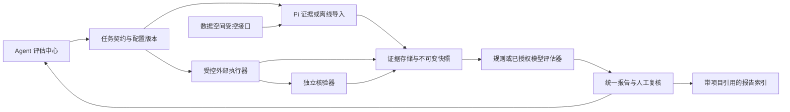

# Agent 评估中心：统一技术方案与分期实施规范

设计版本：2.1 · 日期：2026-10-23 · 状态：**设计完成，功能分期实施中，产品验收未完成**。

实施状态以 [工作包记录](agent-evaluation-evidence/README.md) 为准；0.4.16已补封存文件/批次阅读、原生详情核对、当前可见SDK消息定位及客户端禁用收尾，相关实际桌面路径通过；性能门禁和完整产品矩阵仍未完成；本文中的“本次仅设计”和初始待执行状态保留为设计交付历史，不代表后续已完成的工程包。

本文是内部任务、外部 Agent 客户端及 Agent 项目评估的**唯一实施规范**，替代原 E00–E08 与 EX00–EX06 两套计划。外部接入不再独立建设产品、存储或评分中心。用户已明确：首批外部对象优先本地/命令行客户端，按阶段实施，不一次性建设全部能力。

本文中的“必须”是实施约束；“建议”允许在不改变边界和验收条件时调整；“待确认”须在对应工作包启动前解决。方案通过不等于授权调用付费模型、使用个人凭据、修改外部业务或发布产品。本文只修改设计文档。

## 1. 复审结论与收敛决定

**原方案方向合理，但需要合并和缩小首版关键路径。** 可信证据、确定性规则优先、独立核验、适配器扩展值得保留；两个计划并行实施会产生状态、对象标识和能力边界冲突。以下修订已纳入本文。

| 发现的问题                                          | 统一后的决定                                                    | 对实施的影响                                                   |
| --------------------------------------------------- | --------------------------------------------------------------- | -------------------------------------------------------------- |
| 内部、外部方案分别定义执行器、状态和交付阶段        | 同一评估中心、同一契约与报告；只在接入层区分来源                | 不新增“外部评估中心”或第二套评分服务                           |
| 只读 Evaluator 与会执行测试的 Verifier 混用         | 运行、核验、评分分开授权；Verifier 产生证据，Evaluator 消费证据 | 重评不会重新执行 CLI、业务或验证脚本                           |
| 进程完成、评估作业完成、目标完成容易混淆            | 三类状态独立；补齐等待输入、取消未确认及启动失败语义            | 退出 0、最后一句答复、成功生成报告均不能替代业务成功           |
| 首版绑定全部 Pi 专项规则、ATIF、两个 CLI 和实验平台 | 内部诊断、离线导入、首个 CLI、专项规则、批量对比分期            | 首个 CLI 不等待数据空间专项核验或第二个客户端                  |
| 声称完整链路，实际只有截断日志或外部自报            | 每条结论标注必要证据、来源、缺口和时点                          | 不可观测项为无法判定；完整 JSON 不等于真实完整轨迹             |
| 引入多种成熟框架可能带来重复编排                    | 首批只选一种 CLI 执行后端；框架选择有退出条件                   | Harbor 不适配就选直接 CLI，不并建 Harbor、Inspect 两套运行平台 |
| 综合分掩盖未知、正确拒绝和基础设施故障              | 首版不用总分排名，先展示目标、行为、覆盖率、成本                | 安全停止可通过，原业务目标仍未达成或无法判定                   |
| 分批执行容易漏接线、放宽门槛和重复实现              | 固定工作包、验收编号、阶段证据记录及变更流程                    | 后续只执行选定编号，不顺手推进下一阶段                         |

**简化边界：** 不重建 Agent 循环，不修改 UI/API runner，不新建通用插件市场、分布式调度、数据库集群或全量实时监控；首版不自动修复被测 Agent，不采集隐藏思考，不用模型给每次调用评分。

## 2. 依据、当前事实与待确认项

依据标签：U＝用户要求；R＝仓库规则；C＝当前代码事实；D＝本文明确选择的设计契约；X＝第 17 节官方资料。验收预期以 U/R/D 与固定夹具为依据，X 只说明方法来源，不代替项目实测。

本轮设计核对基线为 `8b400e037d0b3f3c70eb35882a92e61162e362e1`，工作区有其他任务修改。以下是仓库事实，不代表用户其他运行环境的状态；实施前必须重新核对。

| 编号 | 当前入口与事实                                                                                                  | 必须保留的边界                               |
| ---- | --------------------------------------------------------------------------------------------------------------- | -------------------------------------------- |
| C01  | [PluginRunEvent](../server/plugins.ts) 提供运行/消息/工具事件；任务截断 500 字，参数/结果预览约 4K              | 实时插件事件不是完整原始证据接口             |
| C02  | [agent-service](../server/agent/agent-service.ts) 分发插件事件，异常隔离；当前订阅没有持久消费确认契约          | 不宣称零丢失或任意历史重放                   |
| C03  | [协议](../server/protocol.ts)、[序列化](../server/serialize.ts) 已有耗时、模型、费用等字段，但正文和细节会裁剪  | 复用实测值；未知不补零，摘要不冒充全文       |
| C04  | [run-trace](../plugins/run-trace/README.md)、[goal-evidence](../server/goal-evidence.ts) 已有轨迹展示和有界摘要 | 复用已有事实，估算时长和摘要不能替代完整证据 |
| C05  | [test-asset-reader](../server/test-asset-reader.ts) 核验部分 UI/API 原生产物                                    | 复用读取与校验，不复制执行、批准或业务规则   |
| C06  | [subagents](../server/agent/subagents.ts) 有父会话关系                                                          | 仍须稳定任务/尝试关联和子任务覆盖清单        |
| C07  | [数据空间](../plugins/data-space/README.md) 管理项目、环境、用例和运行                                          | 原业务事实归数据空间；通过受控接口关联       |
| C08  | 当前未检索到拟新增的 `agent-evaluation` 实现模块                                                                | 不把已有追踪能力或设计文档算成评估中心已实现 |

EC00 必须关闭内部诊断的待确认项：实际可复用模块、运行配置、读取权限、性能基线和资源阈值。外部分支同时登记首个 CLI 的名称/版本/官方非交互接口、隔离环境、运行权限和费用授权；尚未确定的外部条件标明阻塞范围，不阻挡 M1。EC06 开始前须关闭执行后端和工程隔离条件，EC08 开始前须关闭真实客户端与模型授权条件。第二个客户端、API/GUI 对象在各自阶段再确定。旧桌面试验额度不可直接沿用为新的模型授权。

可信范围是**受限来源上的本地可审计评估**：哈希用于发现内容变化，不能证明第三方日志真实，也不能抵抗有全部宿主权限的管理员改写。可证明某项结果，不一定能还原全部过程；来源不完整时明确降级。

## 3. 产品范围与可独立交付的里程碑

| 里程碑              | 优先级         | 用户可用能力                                                 | 完成范围与可暂停点                                  |
| ------------------- | -------------- | ------------------------------------------------------------ | --------------------------------------------------- |
| M1 内部任务诊断     | P0             | 选任务范围，确定验收条件，读取证据，逐项判断、人工复核和导出 | EC00–EC04；无模型费用即可验收，完成后可长期独立使用 |
| M1a 离线轨迹导入    | P1，可提前     | ATIF 原包导入、版本转换、来源和缺口展示                      | EC05；不需要运行外部客户端，不是 M2 前置            |
| M2 首个 CLI 评估    | P0，接 M1      | 注册一个 CLI，隔离启动、停止、收集产物、独立核验、统一报告   | EC06–EC08；未确定真实客户端/授权时只交工程阶段报告  |
| M3 专项与可重复实验 | P1             | 数据空间专项核验；数据集版本、串行批量、第二个客户端和比较   | EC09 独立交付；EC10–EC11 形成实验交付；两者互不阻塞 |
| M4 扩展评估         | P2，按目标选择 | API/插桩接入、辅助模型评审、GUI/TUI 试点                     | EC12、EC13、EC14 分别交付，不相互依赖               |

完整路线覆盖六个维度：目标完成、产物正确性、约束遵守、工具与过程行为、可靠性、效率/成本。首版的过程分析只输出可核验事实和异常候选，不由“多调用几次”直接推断能力差。

| 接入对象            | 可以评价的内容                                   | 常见观测限制                                 |
| ------------------- | ------------------------------------------------ | -------------------------------------------- |
| 内部 Pi 任务        | 授权范围内的任务、工具、原生产物及约束           | 历史裁剪、缺子任务或中途开始采集             |
| 本地/CLI 客户端     | 进程行为、产物、独立任务结果；有轨迹时加过程规则 | 封闭客户端可能没有工具轨迹、usage 或可靠取消 |
| HTTP/异步 API Agent | 请求/任务状态及业务结果                          | 服务端步骤、远端停止和费用可能不可见         |
| 有源码的 Agent 项目 | 通过其 CLI/API 运行，并在真实边界插桩            | 插桩仍可能采样、漏 flush；不保证业务语义正确 |
| GUI/TUI 客户端      | 可见交互、任务产物和受控后台回查                 | 驱动错误、人工介入、初态恢复能力有限         |
| 离线轨迹            | 已有证据支持的条件                               | 不具备执行能力；无法补采历史已丢失事实       |

源码插桩是证据采集方式，离线导入是输入方式，均不另建执行对象体系。仅有最终输出的黑盒对象仍可做结果评估，但不能声称已评估其不可见内部过程。

## 4. 统一架构与职责

- **宿主**负责身份、权限、工作区路径、证据读取边界、进程所有权和必要的持久关联。插件不得穿透读取宿主私有对象。
- **Agent 评估插件**负责目标档案、任务契约、快照、规则、作业、报告和页面。服务端持有事实，页面不计算权威结论。
- **ExecutionAdapter**只执行被测对象；保留其原有 Agent 循环。**Verifier**在独立环境检查产物。**Evaluator**只评分，不执行原任务、验证脚本或业务写入。
- **UI/API 原生测试系统**持有原始结果；**数据空间**持有业务项目、环境和用例；评估中心只保存引用、必要快照及评估结论。
- 首版一个本地宿主、单写者、文件存储。各 dataDir 独立；远端执行必须有独立宿主能力，不把本机路径当远端路径。DSH 等引擎未实测不得宣称支持。

### 4.1 拟实施位置

以下是职责规划，不表示文件已经存在。EC00 如发现等效实现必须复用，并记录路径映射。

| 位置                                                                         | 职责与引入时机                                                                                            |
| ---------------------------------------------------------------------------- | --------------------------------------------------------------------------------------------------------- |
| `server/agent/evaluation-evidence.ts`                                        | EC02：受控源读取、任务/尝试关联、持久采集接线                                                             |
| `server/external-evaluation-runtime.ts`                                      | EC06：固定无网VZ生命周期与持久假CLI执行；0.4.35接入原产品宿主接口                                         |
| `server/external-evaluation-log.ts`                                          | EC06：有界原始流/JSONL解析，最终日志持久校验；活跃游标为worker易失观察                                    |
| `server/external-evaluation-guest.ts`                                        | EC06：有界argv/stdin编码与guest分帧解析；固定可信假CLI，不接受任意程序                                    |
| `server/external-evaluation-guest-session.ts`                                | EC06：固定假CLI登记/worker串口、背压与独立日志；原execution/port接入产品；产物留EC07                      |
| `server/external-evaluation-execution.ts`                                    | EC06：固定执行到原targets/attempts/evidence/snapshots；登记在enrollment，原执行授权在port，独立核验留EC07 |
| `plugins/agent-evaluation/{index,store,evaluate}.mjs`                        | EC01/EC03：注册、持久化、评分编排；不堆进一个入口                                                         |
| `plugins/agent-evaluation/{adapters,evaluators,profiles}/`                   | Pi、原生测试、ATIF、数据空间证据适配；规则；声明式配置                                                    |
| `plugins/agent-evaluation/{targets,executors,verifiers}/`                    | EC06 起：客户端档案、唯一首批执行后端、可信核验器                                                         |
| `plugins/agent-evaluation/client/`                                           | EC04 起：统一页面、状态和证据展示                                                                         |
| `plugins/agent-evaluation/skills/agent-evaluation/SKILL.md`                  | EC04：唯一技能原实现，说明入口和边界，不内置第二套判定逻辑                                                |
| `scripts/enable-agent-evaluation.mjs`                                        | 显式 agentDir/dataDir 登记，幂等且保留个人安装与禁用状态                                                  |
| `tests/unit/agent-evaluation-*.test.ts`、`tests/agent-evaluation-*-test.mjs` | 纯规则、宿主、恢复、桌面集成；fixture 放 `tests/fixtures/agent-evaluation/`                               |

跨端协议只在 `server/protocol.ts` 定义；插件宿主接口沿现有 `server/plugins.ts`；工具目录和守卫联动 `server/tool-manager.ts`。实际新增模块时同步模块地图、目录和文档导航；设计阶段不登记不存在的实现模块。

## 5. 统一对象、标识与状态

### 5.1 数据模型

所有对象带 `schemaVersion`；ID 由服务端生成，不由任务名或模型自报产生。配置/源码/数据集采用内容摘要和版本引用；摘要排除凭据值。

| 对象                           | 必要字段与关系                                                                                                                                                                                                  |
| ------------------------------ | --------------------------------------------------------------------------------------------------------------------------------------------------------------------------------------------------------------- |
| `TaskContract`                 | `taskId, revision, scope, objective, conditions[], constraints[], environmentRefs, provenance`；scope 包含来源、消息边界或实验输入及子任务策略                                                                  |
| `TargetProfile`                | `targetId, revision, kind, clientVersion, executableIdentity, adapterVersion, launchSpec, configRef, capabilities, isolation, credentialRef`；内部 Pi 也有目标身份                                              |
| `ExecutionAttempt`             | `attemptId, taskId, taskRevision, targetRevision, sourceSessionId?, parentAttemptId?, experimentId?, caseRevision?, configDigest, state, terminationReason, startedAt, endedAt?`                                |
| `EvidenceItem`                 | `evidenceId, attemptId, sourceId, sourceEventId?, sourceLocator, sourceRevision?, producer, availability, origin, kind, observedAt, occurredAt?, contentDigest, size, redaction, truncated, authorizationScope` |
| `EvidenceSnapshot`             | `snapshotId, attemptIds[], contractRevision, sourceWatermarks, evidenceRefs[], coverage, gaps[], sealedAt, manifestDigest`；封存后不增删                                                                        |
| `VerificationRun`              | `verificationId, attemptId, verifierVersion, artifactSnapshotId, fixtureDigest, state, resultEvidenceRefs, error?`；不是评分作业                                                                                |
| `EvaluationRun`                | `evaluationId, snapshotId, contractRevision, profileVersion, evaluatorVersions, configDigest, state, findings[], summary.deliveryVerdict, assessmentStage`                                                      |
| `Finding`                      | `findingId, conditionId?, ruleId, ruleVersion, verdict, evidenceState, method, nature, evidenceRefs[], missingEvidence[], reason, attributions[], metrics?, error?`                                             |
| `ReviewRevision`               | `reviewId, evaluationId, findingId, previousRevision?, decision, reason, reviewer, at`；追加，不覆盖原判定                                                                                                      |
| `DatasetRevision / Experiment` | EC10 才引入：固定 case 版本与初态、目标配置、重复次数、调度计划、attempt 引用、聚合规则                                                                                                                         |

不另设与 `ExecutionAttempt` 重复的 Trial 实体。第三方 `trial_id/run_id/trajectory_id` 放 `externalRefs` 并带来源命名空间；一次 case 的一次运行就是一个 attempt。一个任务可以有多次尝试，一次尝试可被多次重新评分；重评只生成新 evaluationId。任何重新执行（包括单任务人工重试、故障后重新提交和数据集重跑）均创建新 attemptId，并关联 previousAttemptId；仅重新附着原运行、恢复采集或只读状态对账沿用原 attemptId。

条件含 `id, statement, sourceRef, sourceType, required, applicableWhen, verifierRef?, ruleRef?`。sourceType 为 `user/project-policy/proposed`；推测条件默认建议项，未经确认不能成为硬性失败依据。验收条件、规则和配置在本次评分开始前冻结，改变它们需要新版本。用户已有明确要求时直接引用，不重复确认。历史消息缺少稳定定位时保存经核对的选区快照/摘要及边界精度；无法证明两次续跑属于同一任务时由用户关联，不按标题猜测。

允许只选效率、费用或工具行为规则，不强制补齐全部业务预期；缺少业务目标依据时目标状态为 undetermined，仍可交付有依据的效率结论。TaskContract 另存 `evaluationSubject=agent-task/client-software`：通过客户端完成任务与测试其登录、菜单、窗口质量是不同对象，分别标识样本、规则和报告，不能混成 Agent 能力分数。

### 5.2 状态机

| 对象          | 状态与转移规则                                                                                                                                                                       |
| ------------- | ------------------------------------------------------------------------------------------------------------------------------------------------------------------------------------ |
| 执行尝试      | `queued → preparing → running ↔ waiting-input → ended`；开始前可 `blocked/start-failed`；未开始取消可直接 `cancelled`；活跃取消进入 `cancelling`，确认退出后为 `cancelled/timed-out` |
| 执行无法确认  | 宿主中断为 `interrupted`；进程/远端事实不明为 `unknown`；保存最后已知状态及原因。只允许依据受控对账转为已确认状态，不自动重启任务                                                    |
| 核验/评分作业 | `queued/running/completed/failed/cancelled`；取消请求与取消确认分别记录，取消后迟到结果不得覆盖本代报告                                                                              |
| 用户目标      | `achieved/partially-achieved/not-achieved/undetermined`，由必需目标条件计算，与进程状态无直接映射                                                                                    |
| 单项结论      | `pass/fail/inconclusive/not-applicable`；评估器异常或缺必要证据归 `inconclusive`；被测异常/超时按契约及证据逐项判断，不能一律算失败或未知                                            |
| 证据状态      | `sufficient/partial/unavailable/invalid`；按单项必要证据计算，不由整份日志是否存在决定                                                                                               |

`EvaluationRun.completed` 表示按计划完成评估处理并产出有效报告，允许包含单规则错误、未知和失败；全局输入无效、无法读取必要快照或无法保存报告则为 `failed`，不伪装为空成功报告。执行状态对账以追加事件记录变化，不抹掉此前的 unknown/interrupted 事实。

`ended` 只表示进程/运行已结束，另存退出码和 `terminationReason`。`waiting-input` 不自动答复授权请求；等待计入总耗时，超时策略事前配置。无法确认取消或清理完成时，不启动共享环境的下一次尝试。用户断开页面不等于取消。

### 5.3 聚合口径

先计算适用的**必需目标条件**，过程建议项不混进目标完成度；条件适用性未知记 `inconclusive`，不借 `not-applicable` 删除分母。过程顺序规则只约束有依据的必要依赖，不固定所有工具调用路径，不因轨迹与示例不一致判失败。

| 必需目标条件集合                           | 目标结论                                                  |
| ------------------------------------------ | --------------------------------------------------------- |
| 空集合，或存在 `inconclusive` / 未执行条件 | `undetermined`，同时展示已确认通过/失败；不能掩盖已知失败 |
| 全部 `pass` 且至少一项                     | `achieved`                                                |
| 无未知，既有 `pass` 又有 `fail`            | `partially-achieved`                                      |
| 无未知，全部 `fail`                        | `not-achieved`                                            |

行为约束独立显示 `pass/fail/inconclusive`。**交付门禁**要求目标 achieved 且所有必需约束 pass；任一必需项已确认 fail 则不通过，即使其他项仍未知；无失败但有未知则待核验。这样既保留知识不完整，也不把已知违规隐藏起来。`summary.deliveryVerdict` 使用 `pass/fail/inconclusive`，列表和导出优先展示它，并同时显示业务目标与约束结果；业务产物 achieved 但违反必需约束时，不能显示整项任务“已完成/通过”。这细化了原版将全部必需条件一并计入完成判断的口径，没有降低整体通过门槛。

被测任务异常不自动决定所有规则：如契约明确要求 10 秒内完成，可信计时证明超时，该时限项可 fail；如验证器本身启动失败，则受影响结果项 inconclusive。失败归因可多选 `agent-decision/tool-or-app/environment-or-permission/requirement-or-data/evaluator/unknown`，每项含 evidenceRefs 和 `verified/unconfirmed`，缺证据不强行归因；判定失败不自动等于 Agent 决策错误。

可信性质由服务端按规则和来源推导：`verified`＝可复核客观证据支撑；`judgment`＝模型或人工判断；`unconfirmed`＝证据不足。即使程序读取到第三方自报的“通过”或外部框架 reward，也不能据此标 verified。模型自报置信度不进入可信性质判定。

报告必须分别展示：统计对象（规则或样本）、计划/已执行/可判定数量、确定项通过率 `pass/(pass+fail)`、判定覆盖率 `(pass+fail)/适用计划项`、未知/未执行/错误数量及排除项理由；分母为零显示“无可判定项”。缺少观测能力不会把必需项变成不适用。首版不输出统一百分制总分。

## 6. 证据、存储与数据空间边界

### 6.1 证据链最低要求

一条结论应能追到：**用户/政策条件 → 对应尝试及配置 → 原始事件或产物 → 核验依据 → 规则版本 → 单项结果 → 人工修订（若有）**。只有结果条件需要产物证据时，不强制取得全部内部思考或工具轨迹；过程规则缺少轨迹时单独无法判定。

来源 `origin` 至少区分 `harness-observed/target-reported/instrumented/externally-verified/human-observed`。保存来源声明、采集版本、时间范围、截断和脱敏影响。适配器不能自行把 target-reported 提升为 externally-verified，需有相应独立核验记录。

原文、预览、分析摘要分开。原文只在授权范围保存；默认脱敏和最小采集，不读取个人凭据。脱敏后的内容是派生证据，保留转换说明；无法保留原文时如实记录，不宣称逐字节完整。历史产物现在回查只证明回查时刻，不反推历史时刻一定相同。

只有用户选定或已明确启用采集/评估的范围进入评估库；安装插件不触发全历史扫描、全文广播或默认后台采集。额外业务查询须显式标记“本次额外核验”，使用既有只读入口及授权范围，不隐式登录、刷新凭据或执行脚本。

同一事实的来源冲突时保留双方及观察时点；若规则已有可核验的来源适用条件可按该条件解析，否则受影响项 inconclusive 并转人工复核，不能由模型覆盖原证据。其他独立项不受牵连。

### 6.2 采集可靠性与封存

1. 优先从已有持久真相源取得稳定事件标识；缺失字段才在生产边界增加最小追加记录。插件事件用于提示刷新，不作为唯一证据源。
2. 以 `sourceId + sourceEventId` 去重；无稳定源 ID 的导入以原包摘要及包内定位去重。不同执行即使内容相同也不能合并。
3. 证据持久成功后才推进游标。记录开始/结束覆盖、工具调用配对、子任务清单、采样/丢弃计数；仅序号连续不足以证明源头未丢事件。
4. 崩溃后恢复已确认记录，隔离损坏尾部并保留原件。发现断档标 gap；不补造 tool_end、run_end 或成功状态。
5. 封存前生成 manifest，记录每个引用、摘要、缺口和采集截止点。新补充材料生成新 snapshot 和新 evaluation，旧报告仍可回看。
6. 普通业务任务的采集故障不阻塞原任务，评估降级；专用实验可以按冻结的“必要证据失败即停止”策略取消。不得静默丢证据后继续声称完整。

### 6.3 文件存储、权限与恢复

使用 `<dataDir>/agent-evaluation/`，保存 `contracts/targets/attempts/evidence/snapshots/evaluations/reviews`，EC10 再加 `datasets/experiments`。证据按摘要复用，索引可重建；拒绝多个进程同时写同一目录。采用临时文件、同步持久和原子替换模式；先提交 blob，再提交引用 manifest，最后发布索引，故障时不会展示半份报告。

EC04 批量持久化可将多条证据的物理字节合并为不可变 pack，逻辑记录、逐条请求回执、正文摘要和授权域不变。每包最多受现有 1,000 项及 8 MiB 预算约束，单记录/正文原上限继续生效；先写正文并同步，再写记录与有界范围索引并再次同步，最后原子发布并同步目录，成功后才更新内存索引。恢复先验证整包范围与全部记录，异常包保留且阻止新写入，不能部分发布；逐引用授权与读取时摘要校验继续生效。同步批次可在本次准备阶段复用写入环境检查，但发布前必须再次核对写锁、恢复状态、写入权限和会话授权；不跨请求缓存。请求摘要优化必须保持原canonical envelope字节语义及旧回执幂等。旧独立 JSON/blob 文件继续读取，不改写、不自动迁移；不认识 pack 的旧插件会拒绝写入，回滚后读取新报告的兼容性须另验，不宣称自动降级。

采集页可由存储层按已准备输入和物理记录大小划分独立持久化分块，移除采集器重复正文预扫描。每块遵守原预算，发布后才返回记录；后续失败可保留已提交前缀，原请求键重试复用回执，最后才发布采集检查点。边界项在前块发布后重新准备并核验授权；单批原子写入接口仍拒绝整体超限，最终pack编码继续精确检查物理大小。

引用含所属用户/工作区/项目授权域；去重不能绕过逐引用权限校验。服务端从会话上下文取得身份，不信任请求体 owner。路径经 realpath/范围校验，符号链接、归档路径和文件读取竞态需在受控宿主层验证；UI 不接收任意绝对路径读取能力。

EC04桌面历史回读使用同一独立userData内主进程生成并持久保存的窗口clientId，仅恢复给已健康验证的自有sidecar主窗口；额外窗口与开发URL不取得此编号，Web标签页继续各自使用sessionStorage。不得从请求、界面偏好或旧报告选择principalId，不改写历史授权域；打开对应SDK来源后仍逐会话/工作区核验。旧临时编号报告不自动认领，损坏身份文件保留并拒绝启动，恢复需完整userData备份。

容量上限、单文件/事件大小、每次读取预算、解析超时、报告分页阈值在 EC00 数值化，EC01 按配置校验执行。满容量停止扩充并保留缺口，不删除失败证据。工具 `details` 不超过现有 64KB 限制，大证据分页或引用读取。

首版不自动清理历史：先提供归档与空间统计；删除需显式操作、引用检查和活动作业保护。导出默认脱敏，包含版本、manifest、选定证据和哈希校验；备份恢复只恢复记录，不恢复执行。旧 schema 只读兼容，破坏性迁移先备份并保留旧文件；遇到更高未知版本拒绝写入，不猜测兼容。

### 6.4 与数据空间的关系

EC09 实现 `projectRef={spaceId,projectId}`、`environmentRef={environmentId,revision}`、case/run/导入批次引用。读取正式接口返回的身份关系；不得凭项目名、目录名或 URL 相似度自动匹配。环境所属项目冲突时明确阻塞专项核验，项目重命名不改变稳定引用。

评估中心不另建用例库。数据空间已有用例/结果通过版本引用形成评估样本或证据；实验数据集是“输入、预期、初态及引用”的冻结清单，不复制业务管理体系。若数据空间暂时关闭，普通任务诊断继续；相关专项条件显示证据不可用。

报告归档采用 `evaluationId + projectRef` 幂等索引，报告正文仍由评估中心持有。写回失败显示 `pending/failed`，重试只重试该索引写回，不重执行 Agent、不再导入用例、不覆盖原生结果；成功显示 `synced` 并保留回执。删除/归档引用后显示来源不可用，不静默改绑其他项目。数据空间现有能力不足时只补最小受控接口，不直接修改其存储文件。

## 7. 扩展接口与操作权限

### 7.1 接口契约

| 扩展点              | 最小接口                                                                                   | 边界                                                                          |
| ------------------- | ------------------------------------------------------------------------------------------ | ----------------------------------------------------------------------------- |
| `EvidenceAdapter`   | `capabilities()`；`collect(scope,cursor,budget,signal) → {items,coverage,gaps,nextCursor}` | 只读来源；一次有界采集，不执行业务                                            |
| `Evaluator`         | `manifest`；`evaluate(contract,snapshotView,config,signal) → findings`                     | 只消费授权证据；无 shell、网络或业务工具权限；模型调用只经单独授权 judge 服务 |
| `EvaluationProfile` | `id,version,taskTypes,rules,required,aggregation`                                          | 声明式选择与阈值，不实现另一套调度                                            |
| `ExecutionAdapter`  | `probe/prepare/start/status/cancel/cleanup`                                                | EC06 才实现；start 返回持久 handle，status 包含停止确认与日志游标             |
| `Verifier`          | `manifest`；`verify(artifactSnapshot,fixture,limits,signal) → evidenceRefs`                | EC07 才实现；运行预先登记的可信检查，受独立沙箱和预算控制                     |

Evaluator manifest 含 `id/version/method/supportedTaskTypes/requiredEvidence/configSchema/outputSchemaVersion/timeout/budget`；Verifier 额外声明命令模板、允许产物类型、隔离与依赖。注册时校验重复 ID+版本、schema、依赖环和输出约束。只加载随可信代码发布的实现，不执行上传轨迹中的脚本，不开放任意 evaluator 插件执行。同进程可信 JavaScript 的纯函数约束依靠依赖限制、代码审查与测试维持，不宣称构成恶意代码沙箱；未来若加载非可信实现，必须先设计独立隔离边界。

`capabilities` 对每项分别给 `supported/partial/unsupported/unknown`，至少覆盖：历史/实时轨迹、工具输入输出、子代理、权限/审批记录、产物、usage、等待输入、本地/远端取消、网络限制、会话/配置/记忆隔离、可重复初态、模型替换，以及分别声明的轨迹导入/导出/恢复旧会话。附声明来源、探测结果与版本；客户端升级后重新探测，不能沿用旧版本可信标签。

### 7.2 对外操作

EC00 在现有插件 API 上冻结操作名和 schema，不另造 RPC 框架。语义分组如下：

| 操作                                                                 | 权限与副作用                                                    |
| -------------------------------------------------------------------- | --------------------------------------------------------------- |
| `list/get/readEvidence/export`                                       | 只读/受控导出；逐记录鉴权，导出写入指定目标                     |
| `createContract/reviseContract/importEvidence/collect/seal/evaluate` | 本地写入；计划/只读/委派守卫照常执行；evaluate 不重新采集或执行 |
| `review`                                                             | 仅可信人工入口取身份；Agent 自述不能生成 human review           |
| `probe/prepare/start/verify/cancel/cleanup`                          | 独立运行权限与资源范围；取消只作用于归属自己的 handle           |
| `syncProjectReport`                                                  | 单独的数据空间写权限、稳定项目引用、幂等键                      |

EC04 重评入口明确区分：`evaluate(ref=snapshot, configs=...)` 用显式配置生成新报告；`evaluate(ref=evaluation)` 只用于本中心 internal profile 报告，复用原 snapshot、profile 标识、规则精确版本与配置，不能同时覆盖 configs。原配置缺失、profile 无法无损恢复或旧规则版本未安装时拒绝，不静默换用当前规则；旧请求/快照写法保持兼容。修订目标或条件则先追加 contract revision，再显式采集原选区并生成新 snapshot/evaluation，不把修订伪装成原快照重评。

EC04评分作业回查：`list(kind:"jobs", limit, cursor)`只读分页当前授权来源的持久评分回执，返回jobId、保存时间及目标预览，不据queued回执推断当前状态。界面“查找评分作业”后逐项调用原status；有报告则打开，unknown明确不自动重放且不提供无法确认的取消操作。过滤在原记录/传递引用授权之后，匹配回执计入分页上限，过滤扫描沿用原2秒读取截止；来源切换后旧列表失效，不改变持久记录/评分或模型执行权限。

请求带 `requestId` 和配置版本；冲突返回 `VERSION_CONFLICT`。同一写请求重复提交返回原结果；副作用是否发生未知时返回 `EXECUTION_UNKNOWN`，查询或人工处理，不自动补发。其他错误至少区分 `PERMISSION_DENIED/CAPABILITY_UNAVAILABLE/EVIDENCE_GAP/SCHEMA_UNSUPPORTED/LIMIT_EXCEEDED/VERIFIER_ERROR`，并含阶段、可否重试和缺失条件；retryable 不表示获准自动重执行。

插件停用后停止新作业、注销监听、取消可控运行、保留未确认句柄及证据。作业使用代次令牌隔离迟到回调。安全收尾不能因 UI 或插件卸载而失去进程所有权，必要状态由宿主持久持有。

## 8. 规则、核验和可信结论

### 8.1 首批规则与实施顺序

| ID  | 内容                       | 证据及限制                                                      | 阶段                |
| --- | -------------------------- | --------------------------------------------------------------- | ------------------- |
| F01 | 产物存在、格式与明确约定   | 文件快照/约定 schema；存在不代表内容正确                        | EC03                |
| F02 | 测试执行声明与原生结果一致 | 同 attempt 的原生 run、逐项状态；未启动、旧批次不计本轮通过     | EC03                |
| F03 | 用例入库数量与项目归属     | 批次来源、项目/环境关系、回执及有效回查；不通过重新导入核验     | EC09                |
| F04 | 前置失败后的依赖行为       | 明确依赖与事件；停止依赖步骤可以通过，独立取证不受阻            | EC03                |
| F05 | 完成声明一致性             | 首版只自动核对结构化声明；自由文本人工复核，EC13 才提供模型候选 | EC03                |
| F06 | 工具失败、拒绝、取消分布   | 去重后的完整调用状态；故障统计不自动归咎 Agent                  | EC03                |
| F07 | 重复调用/重复失败候选      | 目标/参数/前提/错误类别；只提示，合理轮询和修复后复验不扣分     | EC03                |
| F08 | 耗时与费用                 | 时钟来源与可核验 usage；缺失为未知、估算单列                    | EC03；外部扩展 EC07 |
| F09 | 外部产物独立正确性         | 固定可信测试/只读业务核验；被测 Agent 自写 pass 不生效          | EC07                |

验证器启动失败、测试依赖缺失、沙箱异常是核验基础设施错误；可信检查实际执行并发现产物不满足冻结条件才产生 fail。对不确定测试失败原因保留 inconclusive，不能把所有非零退出都记为 Agent 失败。

历史“修复测试用例入库与环境项目匹配”可作复盘样本：隔离测试通过与真实桌面接入/实际入库完成是不同验收项。只使用当时记录说明当时状态，不把历史“实际入库 0”写成当前事实。EC09 的 75 条样本使用隔离 fixture，不重复操作真实业务库；75 条及其历史 P0=28/P1=47 分布仅是样本数据，不硬编码进通用规则。

### 8.2 指标与费用

总耗时分 setup、agent、verification、evaluation、cleanup，另列等待输入/等待审批。并行区间按并集算墙钟耗时、按各调用加和算累计工作量；父任务等待子任务不重复计费。同进程耗时优先用单调时钟，墙钟用于关联；跨重启不伪造单调连续性。跨来源时钟偏差需标注，不凭时间戳顺序制造精确因果。未观测时间为 unknown，不以“总耗时减工具时间”充当模型思考时长；压缩、重复读取等只作线索，不自动算浪费。

费用区分被测运行、验证器、评分器；同一模型调用只入账一次。优先供应商实测 usage；无 usage 为未知，估算附价格版本。无真实调用前置拦截能力时只能提供时间/调用预算和费用告警，不能声称严格金额封顶；要求硬费用上限的配置应在预检拒绝。

### 8.3 模型评审与人工复核（EC13）

模型只用于需要语义判断的候选结论；先运行确定性规则。使用无业务工具的独立上下文，把被测输出视为不可信材料；输入只含授权且有界的证据片段和 rubric。服务端校验证据 ID、范围、schema、规则版本；引用存在仅证明引用合法，不保证模型解释正确。

保留原始模型判断、模型/提示词版本、成本及人工修订。模型不得覆盖原生执行事实、必要门禁或人工身份；judge 超时/失败不抹掉已有客观结果。人审也保存依据、角色和分歧，不默认绝对正确。

冻结带标签校准集及独立留出集，覆盖正常、失败、缺证据、歧义、注入和正确拒绝；报告误报/漏报/弃权及分场景表现，避免只算一致率。上线门槛在查看留出结果前登记，未达到时仅辅助建议，不参与自动门禁。同一模型多次投票不是独立证据；规则与模型冲突时保留分项结果并转人工，不覆盖客观事实。模型样本和调用额度需单独授权，模拟 judge 只验证工程控制。恢复原方案的人工反馈闭环：支持按已记录策略抽取结果进行人审，并把失败样本推荐为候选回归集；先保存人工确认的候选清单；EC10 可用后才按其入口生成 dataset revision，不让 EC13 反向依赖实验平台，不自动修改 Agent 或训练模型。

## 9. 外部本地/CLI 接入细节

### 9.1 技术路线选择

EC00 进行有限可行性核对：固定首个候选客户端及版本，检查官方非交互接口、隔离、结束/取消、日志和产物；以无模型假 CLI 验证框架集成，真实模型冒烟留到 EC08。选型结论只允许“Harbor 已满足首批要求”“直接 CLI 更合适”“缺条件阻塞”三种，不无限调研。

优先复用 Harbor 已有且匹配本机条件的集成及 ATIF；若引入容器/依赖的成本或功能缺口超过首批需要，使用直接 CLI。只实现一种首批执行后端，选择依据与锁定版本写入 EC00 记录。ATIF 是可选输入标准，不是直接 CLI 的运行前置。Inspect bridge 后置，用于受控实验，不替代原生客户端模式。

### 9.2 启动与环境

TargetProfile 记录二进制真实路径、版本/摘要、参数模板、提示输入方式（stdin/文件）、工作目录、环境变量白名单、模型/Skill/MCP 配置版本及限制。通过 argv 数组启动，不拼接 shell 字符串；不假设所有 CLI 都支持统一 JSON 或禁确认开关。不通过关闭客户端审批绕过测试授权。

每次 attempt 使用新工作区、独立会话/缓存/配置范围，复制固定 fixture，而非个人 home 或认证目录。凭据只引用明确授权的注入渠道，报告仅记录引用标识和权限范围，凭据值不进入 argv、日志或仓库。不自动登录或复制个人认证目录；只能使用个人登录且无法隔离的客户端不得自动进入无人值守批量。需要联网时固定允许目标；被测模型的远端托管工具是否在本地沙箱之外单独声明。

**工作目录不是安全沙箱。** 文件/网络/进程限制必须由可验证的容器、VM 或系统权限实施。原生 macOS 与 Linux 容器属于不同环境，不能宣称等价。无法提供所需隔离时拒绝相应执行配置，可继续离线导入；不偷偷退回宿主宽权限运行。

EC06离线工程候选补充（2026-10-26）：[无网络VZ Linux VM](agent-evaluation-evidence/EC06-vm-diagnostics.json)已在macOS arm64证明无共享目录/磁盘/网络/vsock、独立RAM初态及整机停止包含detached子进程。仅以此作为唯一离线工程候选，固定Alpine3.22.7启动输入及摘要；不把Linux guest说成原生macOS，不开放联网/任意挂载或真实CLI。当前仍无产品ExecutionAdapter；后续须满足下面持久启动/对账/日志/温和取消再强停/清理账本，不能凭诊断通过跳过EC06或启动EC07。真实客户端及模型授权继续暂缓。

### 9.3 生命周期、日志与故障恢复

prepare 完成版本/权限/依赖/容量/隔离预检后才 start。启动前写入 intent 和 attemptId，启动后登记带进程开始身份、受控进程组/容器 ID 的 handle，不能只存 PID。启动与登记间故障通过专属 supervisor/可发现运行标签对账；无法核实则 unknown，禁止自动重发。

stdout/stderr 持续采集，处理 UTF-8 分片、JSONL 半行、混杂 stderr、超大单行和背压。原始有界字节流与解析事件分开，解析失败保留来源并标 gap；日志沉默不等于成功。最终文本只是一条证据，必须确认进程状态再封存执行结束。

cancel 先温和终止并等待已配置宽限期，再终止本 attempt 的受控进程树。不能全局 pkill，也不能误杀复用 PID 或其他测试。逃逸子进程应由隔离层 containment 解决；远端任务不能确认停止时记录 remote unknown，保留预算风险并阻塞冲突运行。

重启后先对账 handle、状态和日志游标；不自动重播提示或外部写任务。cleanup 只删除该 attempt 的可重建工作目录，证据目录独立保留；失败保留收尾状态，不因“报告已生成”丢掉残留进程。

### 9.4 独立核验与产物采集

采集包括修改、新增、未跟踪、删除及事先约定的忽略文件；不能只看 git diff。建立路径/类型/大小/摘要清单，拒绝越界符号链接、特殊文件与未授权文件；冻结后核验，防止检查时产物仍被修改。

可信测试定义、预期和 verifier 配置位于被测工作区之外。对代码结果只把允许的 patch/产物应用到新的验证环境，测试仍从可信版本加载；Agent 改测试、改报告或写入“全部通过”不能改变判定。被测代码运行本身也须沙箱隔离，不能在评分服务进程直接执行。平台证据和评估记录不可被被测 Agent 写入；隐藏测试、标准答案和保留集还必须不可被其读取，不能只放在另一个可访问目录。公开开发测试与隐藏验收集分开，合法修改测试的任务也由另一份可信集核验；保留集不回传给客户端调试。二进制与依赖优先复用锁定的只读版本，不复制整份依赖进入证据。

验证结果保存原生退出状态、逐项结果、日志、环境和测试版本。业务类结果优先独立只读 API 回查；只有截图时只评价可见条件。修复前失败/修复后通过的成对对照能帮助排除无效测试，但仅在已有该契约的场景要求，不普遍多执行一轮模型任务。

### 9.5 ATIF 与其他输入

ATIF 导入固定已支持的 schema 版本，保留原包摘要、外部标识、转换器版本及字段映射损失；未知版本拒绝或只归档，不能按最新结构猜。相同原包重复导入幂等，不同任务不能因内容相同误合并。

导入默认只接收声明的本地数据文件；拒绝路径穿越、越界符号链接、过深/过大压缩包，按展开后大小与数量限额。附件 URL 不自动下载，包内脚本不执行。schema 校验通过不提升来源真实性；缺工具结果、子代理或末尾日志都在能力覆盖中展示。

## 10. 数据集、实验和公平比较

EC10 才新增实验页和串行调度。dataset revision 冻结输入、任务条件、初始 repo/data、依赖、可信验证器和资源限制；每次尝试保存实际模型/客户端/Skill/MCP/提示/采样参数、环境镜像或 OS 版本及配置摘要。未提交改动也纳入摘要，不能仅记录 Git HEAD。历史轨迹转为样本前须人工确认输入、有限上下文、预期及禁止行为；历史 Agent 输出不能自动成为标准答案。

默认串行一次一项；重试是新 attempt，链接 previousAttemptId，不覆盖失败尝试或只保留最好结果。批次预先声明中断/失败是否继续、重试策略与重复次数；预算分别包含最大调用次数、单次超时、总时限、最大输出和费用控制能力。环境清理未确认或必要证据缺失时停止依赖项，独立只读报告仍可生成。

比较分两类：**原生产品模式**比较客户端完整系统；**受控模式**固定模型/工具接口，可能通过 bridge 改变客户端行为。两类不能放同一排行榜，也不把不同模型的原生比较解释为纯客户端推理能力差异。

比较资格检查 dataset、初态、验证器、规则/profile、运行模式、资源限制是否相容；规则变化可对同一证据重评，数据/初态变化需新实验。保留不相容维度，允许并排查看但禁止宣称公平排名。模拟、缓存、真实执行分别标识。报告样本量、配对差异和未知/失败/未运行，单个样本不外推总体能力；随机性重复与统计方法在实验前确定，首批小样本只作工程试点。性能只在同等目标覆盖的共同可比样本上比较，同时保留全体失败/退化/阻塞，不只展示成功子集。一次优先只改一个配置因素，多因素同时改变只评价整体配置，不归因于单一模型或客户端。

首批真实 CLI 场景目录：按约定写文件、修复可复现缺陷、多文件修改保留无关内容、引用来源、遵守只读约束、缺输入时停止/询问、可恢复工具失败、永久失败时正确停止、重复提交幂等、超时及子进程收尾。危险行为用隔离夹具模拟，不能直接对个人目录或真实服务做破坏测试。

## 11. 页面、技能和可发现性

所有入口都叫 **Agent 评估中心**，目标类型是筛选条件。M1 两页即可：

1. **评估记录**：来源、目标版本、任务范围、执行状态、目标状态、覆盖率、更新时间；提供新建诊断、导入（可用后）、取消和回看。
2. **评估详情**：概览、逐项结论、证据、配置/费用、人工复核。每项能跳到 source event/文件片段/原生 run；缺证据显示具体补充方式。不要让用户读内部 schema 才能理解结果。

报告保存 `assessmentStage=provisional/final`，与证据快照 sealed 分开：运行中的阶段评估也使用不可变快照，但必须标 provisional；只有范围结束且按契约完成最终评估处理才能标 final，final 仍可含 fail/inconclusive。新证据生成新快照和报告，不覆盖阶段记录。

M2 增加“评估对象”管理和单次执行入口；M3 再增加数据集/实验/对比。能力未知、依赖缺失、等待输入、取消未确认、同步失败、无判定项必须有清晰状态，不能统一显示红色“Agent 失败”。

同任务交付插件 manifest、图标、必要工具、技能页、工具页、插件页和 `/skill:agent-evaluation` 发现；优先现有菜单，不新造命令系统。工具描述按项目要求精简英文，Skill 仅编排操作与解释边界。应用登记脚本必须显式指向 agentDir/dataDir、可重复执行且不覆盖其他安装。

Electron macOS arm64 是主要交付对象；共享 UI 使用主题令牌、zh/en、appUrl/appSend 与现有浮层。隔离验证后还要核对实际桌面加载版本、启停、重新扫描及重载持久性；若需要用户 reload 且未完成，保留该项待验收，不能拿 Web 或隔离实例代替。

## 12. 有顺序的实施工作包

全部 EC 工作包初始为**待执行**；下表和详细步骤是实施约束，不是本轮执行记录。优先级不代表强行串行：只遵守依赖；每次选择一个工作包或明确的一组，不自动扩展范围。

| ID   | 优先级 | 硬前置           | 交付物                                                | 验收编号                         |
| ---- | ------ | ---------------- | ----------------------------------------------------- | -------------------------------- |
| EC00 | P0     | 无               | 现状/范围、契约与资源基线、CLI 后端选择记录、夹具计划 | AC01、AC39（冻结，不算功能通过） |
| EC01 | P0     | EC00             | 统一对象/schema、权限与文件仓库、迁移/恢复基础        | AC01–AC04、AC10、AC13            |
| EC02 | P0     | EC01             | Pi/原生测试只读适配、持久采集和证据封存               | AC05–AC09、AC14                  |
| EC03 | P0     | EC01、EC02       | 规则/profile、评分作业、聚合与费用口径                | AC11–AC12、AC15–AC17             |
| EC04 | P0     | EC03             | M1 页面、人工复核、技能/工具/插件与实际桌面接入       | AC18–AC20、AC39、AC40            |
| EC05 | P1     | EC01、EC03       | ATIF 原包导入与统一报告入口                           | AC21–AC22                        |
| EC06 | P0     | EC00、EC01       | 一种受控执行后端、假 CLI、取消/恢复/收尾              | AC23–AC27                        |
| EC07 | P0     | EC03、EC06       | 独立验证器、产物快照、外部指标                        | AC28–AC30                        |
| EC08 | P0     | EC04、EC06、EC07 | 首个真实 CLI、10 场景、M2 桌面入口与证据              | AC20、AC31、AC39、AC40           |
| EC09 | P1     | EC02、EC03、EC04 | F03、数据空间关系核验与报告索引                       | AC32–AC33                        |
| EC10 | P1     | EC08             | 数据集/实验、串行隔离执行、预算与重试账本             | AC34–AC35                        |
| EC11 | P1     | EC10             | 第二个客户端、可比性检查、差异报告                    | AC36                             |
| EC12 | P2     | EC08             | 明确对象的 HTTP/异步 API 与 OTel/OpenInference 适配   | AC37                             |
| EC13 | P2     | EC04             | 无工具模型评审、人工校准与留出集验证                  | AC38                             |
| EC14 | P2     | EC08             | GUI/TUI 单一对象试点及隔离/人工干预记录               | AC40 及本节专项标准              |

建议顺序：EC00 → EC01 → EC02 → EC03 → EC04（M1）→ EC06 → EC07 → EC08（M2）→ EC09 / EC10 → EC11；EC05 可在 M1 后独立安排，EC12/EC13/EC14 由具体需求选择。不要求提前建后续阶段空目录、空接口实现或占位页面。

### EC00：冻结范围和可验证基线

1. 核对当前代码、dirty 文件、真实应用配置与模块位置；输出“已存在/可复用/缺失/未知”清单，不能只根据本设计创建重复模块。
2. 固定 M1 条件/证据 schema、状态/错误码、首批规则输入输出与权限矩阵；为资源限制、采集增量、报告生成/读取延迟写入明确数值及测量机器。
3. 按第 9.1 节选一种 CLI 后端；真实目标未定可记录阻塞，不妨碍内部诊断继续。冻结核心、异常、边界、权限及一致性夹具。
4. 输出 `docs/agent-evaluation-evidence/EC00.md`（实施时新建）。验收要求是决定可追溯且无关键空白；不把未来性能或 CLI 兼容性标成已通过。暂停点：无产品执行副作用。

### EC01：契约与仓库

1. 实现 schema、稳定 ID、revision、引用权限与幂等请求；任务选区包含消息边界和明确的子任务策略。
2. 实现单写者存储、原子封存、游标、可重建索引和只读兼容；注入写盘失败、重复请求、损坏尾记录和跨域请求。
3. 用固定样本验证保存/重启/回读、未知版本拒绝、无凭据导出及引用权限。交付数据契约和 migration 说明；不提前引入实验调度。

### EC02：证据接线

1. 在既有持久源与生产边界之间选最小改动点；明确普通业务不因采集失败而停止。
2. 接 Pi 消息、工具、子任务、原生产物；保留源定位、截断、读时点及 coverage；仅新增确实缺失的宿主 API。
3. 对照源事件账本验证重复、乱序、进程崩溃、中途启用、超长内容和缺子任务；封存后变更能检测。交付采集覆盖矩阵和故障证据，不宣称历史全量可恢复。

### EC03：评分引擎和基础规则

1. 实现三类首版扩展点注册、输入输出校验、预算/超时/取消代次及失败隔离；规则不能访问原业务写能力。
2. 实现 F01/F02/F04/F05/F06/F07/F08 与第 5.3 节聚合；未知不当通过，正确拒绝不直接当失败，费用缺失不当零。
3. 增加一条独立规则证明只需实现/注册/测试；校验旧报告仍可读。交付带预期和实际的规则对照集，重评不得增加 CLI/业务调用计数。

### EC04：M1 产品闭环

1. 两页展示真实服务端状态、证据定位、版本、人工修订和脱敏导出；实现空/错误/长文本/中英文/主题状态。
2. 补 manifest、技能、工具、管理页、快捷发现、登记脚本及启停清理；隔离应用先验，再核对真实桌面加载。
3. 运行核心故障和性能对照，按 AC01–AC20 逐项标本阶段适用状态并附证据；缺项不能靠“整体完成”掩盖。M1 满足后可暂停，无需启动外部 Agent。

### EC05：离线导入

1. 固定支持的 ATIF 版本和字段映射；保留原包、来源声明、损失和外部 ID。
2. 加解析资源上限、路径/归档检查、重复导入幂等；接现有报告页，不新增独立报告模型。
3. 完整/截断/未知版本/恶意包分别验证；导入期间业务与网络调用为零。不要求同时支持所有 trace 格式。

#### EC05 实施契约补充（2026-10-25）

首批支持显式ATIF-v1.8严格JSON profile，限制与官方来源见[EC05记录](agent-evaluation-evidence/EC05.md)。原始UTF-8字节在现有私有blob目录按域及摘要归档，新增evidence envelope可选originalRef（sha256/size）；普通证据、工具、评分器与导出只读脱敏副本，原文读取另须可信human授权并重新核验原证据引用。原包不编码进普通content来规避脱敏。副本与原包分别记摘要，不能混称同一字节。

契约scope增加独立offline分支：sessionId仅为可信宿主授权锚点，packageDigest/format/converterVersion/trajectoryPointers冻结导入选择；外部session_id不参与宿主会话授权。沿用原七类记录及报告，不建平行模型。导入的attempt.state为unknown，表示未独立观察执行；不从轨迹结束或“通过”声明推导真实任务成功。完整转换不等于证据可信，快照保留target-reported与缺口。

同一契约revision/原包摘要/转换器及来源声明复用确定性操作回执，中断后按原请求继续已完成阶段；新的来源声明须新契约revision，不静默替换。不同任务/契约revision不因同包合并。原包先落盘、引用后发布；未发布临时文件保留并按现有恢复门禁阻止继续，发布后丢回执可按原请求恢复。旧记录不迁移。新增originalRef对普通旧记录读取无影响；不识别offline scope的旧插件不能回读新离线契约，回滚前保留完整dataDir，不能把离线兼容当实际桌面降级验收。

上传传输补充：保持128KiB请求/48KiB响应，UI-only按24KiB原字节分块，先声明总长度和SHA256；暂存绑定可信用户/工作区/宿主会话，单客户端1个/全局4个，固定10分钟过期、禁用/卸载清除。预览不创建契约/归档；人工确认后独立生成offline scope。原包只通过human-only分页接口读取。刷新/重启不持久化暂存；已确认的导入记录持久保留，新表单创建新任务，显式复用同契约revision的服务重试保持幂等。

### EC06：外部运行基础

1. 以假 CLI 实现版本探测、argv/stdin 输入、隔离 prepare、持久启动意图/handle、status、cancel、cleanup；零模型费用。
2. 测试半行日志、等待输入、退出 0 无产物、输出结束但进程未退、超时、子进程及启动登记窗口崩溃。
3. 验证重启不重发、PID 复用不误杀、旁路进程不受影响；隔离不可用则启动前拒绝。交付状态转换和残留进程账本；本包通过不等于真实 CLI 已兼容。

#### EC06 离线工程政策补充（2026-10-26）

固定可信假 CLI 与 Swift supervisor 的唯一源码移入 `plugins/agent-evaluation/runtime/`，测试及后续安装均引用该资源，不依赖 `tests/fixtures/`。本阶段仅 macOS arm64 / Virtualization.framework：2 vCPU、512MiB RAM、无网卡/磁盘/共享目录/vsock、一个活跃环境，原 45 秒 watchdog 保留；任务超时最多 30 秒、取消宽限最多 2 秒，两路 guest 日志各 64KiB，stdin 64KiB、argv 最多 16 项/合计 8192 字节。启动前按已登记摘要、签名/权限及 helper `--describe` 的实际配置核对，不匹配即拒绝；不由此宣称支持任意不可信程序。

固定假 CLI 的精确 stderr 行 `waiting-input` 只作为 target-reported 等待信号，必须已经 started 且尚未退出/收尾；普通 stdout 不触发状态。等待状态进入原 attempt revision，不建立交互回复通道、不自动补输入、不重新启动或延长原超时；只能按原截止时间超时或显式取消。等待后正常结束须有原生停止确认方可转 ended；等待声明不等于业务成功。此补充不改变 EC08 真实客户端/模型暂缓，也不免除 EC06 产品安装登记、完整执行器和故障验收。

#### EC06 受信离线后端登记补充（2026-10-26）

显式管理员命令 `scripts/enroll-agent-evaluation-runtime.mjs` 接收应用 dataDir、已签名 helper、固定 kernel/initrd；假 CLI/runner 从该应用已登记插件的 runtime 目录取用。沿用原后端探测与固定资源摘要；校验后复制到 dataDir 下私有 `agent-evaluation-runtime/installation/`，不依赖测试目录或临时编译输出。登记清单只保存固定文件名对应的摘要，路径由宿主推导；同摘要重复登记只读返回，冲突/篡改/遗留登记锁拒绝覆盖。私有暂存目录完成文件同步、清单与目录同步后原子发布，失败原件保留。

该登记不授予客户端执行权限，不产生 attempt、不启动 VM。宿主从固定安装目录读取并重验资源，执行仍须原 allowExecution 授权、原统一仓库与原 runtime 生命周期。目标源码与 helper 的对应关系由管理员选择的受信构建保证，摘要和代码签名不证明第三方自述真实；本阶段实际验收使用插件唯一 Swift 源码的内部构建。缺少已签名 helper/固定启动文件时明确不可用，不自动联网、下载或修改产品签名/更新身份。桌面打包清单须包含原插件登记脚本与此后端登记脚本，实际内部分发目录验证二者及宿主模块可读。完整产品执行页面/技能/工具及预编译后端分发仍须后续验收。

#### EC06 执行侧宿主接口补充（2026-10-26）

固定离线执行沿原 PluginHost / EvaluationStore 接入，工厂另要求保留插件 agent-evaluation 的精确 tools:offline-execution 声明；普通 tools 不等价。宿主临时 context 仅在原会话身份、选中 SDK session、执行模式/预设/禁用及适用的原工具 invocation 复验后授执行权限；调用参数不能提供后端、路径、env、human、allowExecution 或 reconciled。显式对账也必须有原runtime新鲜观察，不重放未知运行。宿主禁用/卸载收尾持有原runtime绑定，先持久化取消，再异步核对，不依赖关闭后的仓库或可用的当前安装。缺执行守卫的引擎明确拒绝。当前仅宿主工程接口通过，产品manifest/service/页面/工具/技能及实际桌面执行验收继续待完成，不因接口存在宣称EC06完成。

### EC07：核验闭环

1. 采集完整约定产物清单，在独立验证环境装载可信 fixture；只允许注册验证器。
2. 接入 F09，并将核验证据封存进统一快照；明确 `Verifier error` 与产物 `fail` 的分界。
3. 用 Agent 改测试、自写 pass、缺产物、越界链接、可信验证器崩溃等反例验收；分别对账 setup/agent/verification/evaluation/cleanup 及费用，不能重复算账。

### EC08：首个真实 CLI 与 M2 交付

1. 先记录明确客户端版本、模型/工具/网络授权、费用限制和隔离平台；无授权只保留待执行，不消费旧额度。
2. 先运行 1 条最小真实冒烟，确认启动/停止/证据/核验；通过后运行第 10 节 10 场景。被测 Agent 可表现失败，中心必须正确判定并保存证据；不能要求 10 个业务场景全部成功才证明平台正确。
3. 补评估对象管理和单次运行界面，实际 Electron 验证发现/启停/取消/重载/回看；展示首个客户端支持矩阵与限制。不得宣传任意 CLI 支持；未执行的真实场景单列。

### EC09：数据空间与专项诊断

1. 使用受控接口连接项目/环境/用例/run/批次，核验稳定身份与时点；数据空间停用时一般诊断继续。
2. 实现 F03，复用 EC03 的 F07 候选提示，增加报告索引幂等写回及重试状态；业务写入状态未知只做只读对账。
3. 75 条隔离样本覆盖首次入库、重复、错项目、部分失败、丢回执和缺回查；证明重评和同步重试都不重新入库。交付权限/一致性/同步异常证据。

### EC10：可重复实验

1. 建立不可变数据集版本、case 初态与预算，创建串行实验；每次运行独立 attempt、配置和目录。
2. 实现人工中止、超时、失败策略、重试账本及恢复；未确认收尾不发下一项，恢复不盲目重放。
3. 同一 case 两次运行无状态污染，重试保留原失败；预算不支持硬上限时拒绝硬上限配置。交付实际调度记录和成本核算，不引入分布式执行。

### EC11：第二客户端与比较

1. 选定第二个真实客户端并独立授权，先 1 条冒烟，再执行同版本试点集；适配只改目标/执行/证据映射与相应测试，不改核心评分语义。
2. 实现原生/受控模式过滤、环境差异提示、样本配对及未知率展示；受控模式没有实际后端时仅标未支持，不能造结果。
3. 用已知正确/退化夹具验证差异定位，真实结果如实展示；不将少量场景写成产品综合排行榜。若需改核心契约，先按第 15 节升级设计并回归旧目标。

### EC12：API 与源码插桩

1. 针对一个明确服务定义同步/异步任务协议、远端 ID、身份引用、幂等与取消能力；连接断开只查询状态，不重复提交副作用任务。
2. 源码 Agent 在模型、工具、委派真实边界接 OTel/OpenInference，保存语义版本、trace/span 关系、采样、flush 和缺口。
3. 可控服务验证掉线、重复回调、远端取消未知、采样/缺结束；真实对象单独留证。接入 Phoenix/Langfuse 是可选观测目的地，不改变中心事实源。

### EC13：辅助模型评审

1. 先冻结 rubric、标注流程、留出集和误判/弃权门槛；再实现无业务工具 judge 与结构/证据引用检查。
2. 零授权零调用、预算/超时、注入和越权引用先用模拟器验证；获授权后再跑真实模型校准。
3. 分别交付工程控制与真实判断质量报告；未达门槛保持建议状态。补人工结果抽样与失败样本推荐，预期经人工确认后保留候选，EC10 可用后才纳入其版本化回归集。线上自动采集、主动改进和训练闭环不在本包。

### EC14：GUI/TUI 试点

1. 只选一个界面客户端，固定账号/profile 或 VM、分辨率、初态、提交和结束信号；TTY 交互需要适配时显式增加 PTY 能力。
2. 驱动器只提交任务/观察，不替 Agent 完成业务；记录人工接管、验证码及输入失败，后台只读核验优先。
3. 专项验收：至少覆盖正常、驱动失败、Agent 失败、人工介入、超时恢复，能分别归因并保留可见证据；无法恢复初态或停止时仅半自动，不开放无人值守批量。平台未实测不宣称支持。

## 13. 统一验收矩阵

以下是**待实施验收场景**，不是本轮已经通过的产品测试。每条证据必须含输入/操作、预期、实际、平台/版本、原始引用、结论、限制和执行时间；结果使用通过/失败/阻塞/未执行/不适用，后两者不计通过。不适用必须有理由且不能删掉本阶段必需能力。

| ID   | 操作或故障                                 | 必须观察到的结果与证据                                                                                                        | 依据      |
| ---- | ------------------------------------------ | ----------------------------------------------------------------------------------------------------------------------------- | --------- |
| AC01 | 同会话两任务、修改目标、重复提交           | 选区不串任务，revision 增加，同幂等请求不生成重复记录；效率单独评估可用；模糊历史选区保留精度，重执行新 attempt、重附着不新建 | U/D       |
| AC02 | schema 错误、未来版本、规则版本升级        | 拒绝无效输入；旧报告只读可用；新规则只产生新结果                                                                              | R/D       |
| AC03 | 写盘失败、半 manifest、重建索引            | 不暴露半报告，损坏原件保留；恢复不启动任务                                                                                    | R/D       |
| AC04 | 跨用户/会话读取、伪造 owner、越界路径      | 执行侧拒绝且无证据内容泄露；索引去重不扩大权限；未选会话不采集，额外回查不隐式登录                                            | R/D       |
| AC05 | 事件重复/乱序/重放                         | 调用次数、费用不增倍，游标只在持久后推进                                                                                      | C02/D     |
| AC06 | 源/预览超长、正文缺失                      | 可用原文按授权读取；源也截断则必要项 inconclusive；冲突来源保留双方，无法解析时该项未知                                       | C01/C03/D |
| AC07 | 中途采集、缺子任务/工具结束、日志断档      | coverage/gaps 明确列缺口，不伪造结束与完整性                                                                                  | C02/C06/D |
| AC08 | 旧 run 冒充当前、产物哈希变化              | 不计当前通过；报告保留原引用及变更提示                                                                                        | C05/D     |
| AC09 | 写成功丢回执、事后回查                     | 不重复写；回查注明时间范围，不反推历史完成                                                                                    | U/R/D     |
| AC10 | 超容量、过大单项、恢复备份                 | 有界失败/降级，失败证据不自动删除，恢复零执行                                                                                 | R/D       |
| AC11 | 正确拒绝/前置失败/未知条件                 | 行为可 pass、目标仍未达成或未知；聚合符合第 5.3 节；已证实时限违约可 fail；归因附证据，目标达成但违规时整体门禁 fail          | U/R/D     |
| AC12 | 规则异常/超时/取消后迟到                   | 原任务不变，独立规则可完成，错误不算 Agent fail                                                                               | R/D       |
| AC13 | 脱敏导出、证据引用缺失、schema 迁移        | 导出不含凭据；manifest 可验证；迁移不破坏原报告                                                                               | R/D       |
| AC14 | 普通任务采集故障与专用实验故障             | 普通任务继续且评估降级；实验按冻结策略收尾                                                                                    | C02/D     |
| AC15 | 增加纯规则、重复注册、循环依赖             | 新规则只需实现/注册/测试；无效注册拒绝；F07 在无数据空间时可用，合理轮询/修复后复验不硬扣分                                   | U/D       |
| AC16 | 两个并行 10 秒调用、父子等待               | 墙钟约 10 秒、累计约 20 秒；父等待不重复累计；墙钟跳变不影响同进程计时，未观测时间不记模型思考                                | D         |
| AC17 | 缺 usage、估算、重评                       | 未知不补零，估算单列，被测/核验/评分分账且不双计                                                                              | C03/D     |
| AC18 | 人工复核与 Agent 冒充人工                  | 仅可信入口生成 review，追加修订，原结果可回看                                                                                 | U/R/D     |
| AC19 | 禁用/重启/迟到回调/活动作业                | 禁止新作业，监听清理，可控作业收尾，未知运行保留句柄                                                                          | R/D       |
| AC20 | Electron 管理、快捷发现、证据页            | 实际应用版本正确，启停重载持久，zh/en/主题/长文本/错误态可用；阶段报告不可冒充最终报告，业务目标不能盖过交付门禁失败          | R         |
| AC21 | 同 ATIF 包两次导入、未知版本、丢字段       | 导入幂等；版本/映射损失可追溯；未知来源不提升可信等级                                                                         | X/D       |
| AC22 | 恶意包、链接、附件 URL、超大展开           | 拒绝越界/超限，不执行脚本、不自动联网                                                                                         | R/D       |
| AC23 | 参数版本不匹配、提示含 shell 字符          | 启动前拒绝错误版本，参数原样传递，无意外命令执行                                                                              | R/D       |
| AC24 | 配置/目录/缓存越界、隔离缺失               | 两尝试不污染；不能访问未授权范围，缺隔离不能静默降级                                                                          | R/D       |
| AC25 | 半行 JSON、UTF-8 分片、stderr、海量日志    | 正确重组或明确 gap，有背压/上限，原始/解析证据可对应                                                                          | D         |
| AC26 | 退出 0 无产物、最终文本后仍运行、等待输入  | 不自动通过或提前封存，等待状态/超时可见                                                                                       | U/D       |
| AC27 | 启动窗口崩溃、PID 复用、超时/逃逸子进程    | 不重复提交、不误杀；取消与清理未确认阻塞冲突任务                                                                              | R/D       |
| AC28 | Agent 改测试/自写 pass、可信验证器崩溃     | 可信测试不受污染，产物失败与核验错误分别记录；被测 Agent 不可读取隐藏答案或写平台结果                                         | X/D       |
| AC29 | 新增/删除/未跟踪/约定忽略文件和链接        | 采集清单完整、越界拒绝，冻结产物与核验输入一致                                                                                | D         |
| AC30 | 外部多阶段时长和重复 usage 来源            | 各阶段与总耗时可对账；不重复算费用、估算单列                                                                                  | D         |
| AC31 | 首个真实 CLI 先冒烟再 10 场景              | 每场景实际状态、原证据、可信核验可回看；未执行不算通过                                                                        | U/X/D     |
| AC32 | 75 条样本首次/重复/错项目/部分失败/丢回执  | 数量与归属逐项正确判定；缺证据未知，重评不再入库；自由文本成功声明不替代回执/回查                                             | U/C07/D   |
| AC33 | 数据空间关闭、报告重复同步/失败/项目重命名 | 一般诊断可用；稳定身份不改绑；索引幂等、失败可见                                                                              | C07/D     |
| AC34 | 同初态两次运行、重试、中断恢复             | attempt/产物隔离，失败尝试保留；恢复不重发未知任务；历史输出不自动成为标准答案，样本预期需人工确认                            | R/D       |
| AC35 | 预算取消、无硬费用控制、收尾失败           | 硬上限不支持则拒绝；未确认结束不启动冲突尝试                                                                                  | R/D       |
| AC36 | 第二 CLI、不同初态/规则/模式、退化版本     | 适配不改评分核心；不相容不排名；差异定位到同版样本；同目标覆盖比较，保留全体失败；多因素变更不作单因素归因                    | U/X/D     |
| AC37 | API 断线/重复回调、trace 采样/未 flush     | 不重复副作用请求；凭远端 ID 对账；不完整 trace 明示                                                                           | X/D       |
| AC38 | judge 注入/假引用/无授权、留出集误判       | 无业务工具、非法输出拒绝、零授权零调用；真实校准不达标仅建议；多次投票不提升证据独立性，人审/失败样本候选保留确认链           | R/X/D     |
| AC39 | 三类负载，各配置至少 5 次性能对照          | 保存原始数值及标准版本，满足 EC00 当前授权标准；标准变更须记录依据、旧结果并在复验前固定，不改写历史失败                      | R/D       |
| AC40 | 本阶段交付/回滚/恢复/实际桌面核对          | 工程与真实运行分列；回滚不删证据、不重放任务；缺项保留；Agent 任务与客户端软件测试分列，不混合能力结论                        | U/R/D     |

性能负载固定短串行、并行、长输出；同一机器对照采集关闭/开启，统计耗时、CPU/内存、落盘量和报告延迟。尚未实现的指标初始记未测；M1、M2 在各自实现后实测。五次是工程对照最低重复，不宣称统计显著。超阈值先分页、按需读取和减少重复转换，不能删除必要证据换取通过。

## 14. 旧任务与验收编号迁移

旧文档保留在 Git 历史，以下映射用于续跑查找，不表示旧任务已经完成，也不要求把旧工作重复实现。新任务一律使用 EC/AC；旧验收证据必须核对版本和范围后才能引用。

| 旧工作包   | 新工作包                       |
| ---------- | ------------------------------ |
| E00 / EX00 | EC00                           |
| E01        | EC01、EC02                     |
| E02        | EC01、EC02                     |
| E03        | EC03                           |
| E04        | EC03、EC09                     |
| E05 / E06  | EC04；每阶段仍需本阶段交付验收 |
| E07        | EC06、EC10、EC11               |
| E08        | EC13                           |
| EX01       | EC05                           |
| EX02       | EC06                           |
| EX03       | EC07                           |
| EX04       | EC08、EC11                     |
| EX05       | EC12                           |
| EX06       | EC14                           |

| 旧验收                      | 新验收                                 |
| --------------------------- | -------------------------------------- |
| A01 / A02                   | AC01 / AC11                            |
| A03 / A04 / A05             | AC05 / AC03、AC07 / AC06               |
| A06 / A07 / A08 / A09       | AC08 / AC07 / AC04 / AC09              |
| A10 / A11 / A12             | AC12 / AC02、AC15 / AC16               |
| A13 / A14 / A15             | AC19、AC20、AC33 / AC17 / AC18         |
| A16 / A17 / A18             | AC10、AC13、AC19 / AC20 / AC32         |
| A19 / A20 / A21 / A22       | AC34 / AC35 / AC36 / AC36              |
| A23 / A24 / A25             | AC38                                   |
| T01 / T02 / T03             | AC21 / AC21、AC07 / AC22               |
| T04 / T05 / T06 / T07 / T08 | AC23 / AC25 / AC26 / AC27 / AC24、AC27 |
| T09 / T10 / T11 / T12       | AC28 / AC29 / AC30 / AC11、AC36        |
| T13 / T14 / T15             | AC31、AC36 / AC36 / AC20               |
| T16 / T17                   | AC37 / EC14 专项、AC40                 |

### 14.1 原交付范围与新里程碑的等价条件

编号映射不代表首版范围完全等价。原内部 V1 的必需能力对应 **M1 + EC09 的 F03/数据空间核验**；M1 单独完成只代表基础诊断，不能声称原 V1 全部完成。F07 已在 2.1 恢复到 EC03/P0，不再等待数据空间。

原外部首批范围对应 **M2 + EC05 + EC11**，分别涵盖首个 CLI、ATIF 导入和第二个 CLI/比较；M2 不等于原双客户端首批全部完成。原 EX05/P1 现为 EC12/P2，是优先级后移，不是删除 API/插桩。以上后移是合并方案的推荐排期，不能据此关闭未实现的原需求；有明确旧交付承诺时须按该承诺验收。

EC10 依赖 EC08 是当前 CLI 优先路线的排期，不是内部 Pi 实验必须依赖外部客户端的架构限制。若实际已有另一个满足隔离、取消、收尾和核验要求的执行适配器，可在 EC00/变更记录中提供等价前置证据后替换该依赖，不复制实验引擎、不跳过 AC34–AC35。

## 15. 分批执行、变更控制与防偏离约束

### 15.1 每次实施的开始与结束

开始：读取本文所选 EC 段落和适用仓库规则 → 核对当前代码/运行版本及 dirty → 检查前置证据 → 写本次范围和验收 ID → 实现最小改动。没有 `plan_update` 时用 EC 记录跟踪，不虚构看板状态。

每包保存 `docs/agent-evaluation-evidence/ECxx.md`，至少含：设计版本、实施 commit、选定范围、前置证据、实际改动、测试环境/命令、逐条 AC 结果、原始证据索引、未完成原因、回滚方式及下一可执行包。大日志、个人会话、凭据不入库，索引引用受控证据并附摘要。

只有必需验收全部通过、相关回归通过、管理/实际接入满足本包范围，才能标“完成”。纯工程测试通过但真实客户端/桌面缺验证时标“部分完成/阻塞”，不能将整个里程碑关掉。预检失败停止依赖工作，保留独立可执行项；续跑先对账而非重新执行所有步骤。

### 15.2 变更分类

- **可直接决定：** 文件内实现、等效库用法、无语义变化的组件拆分；记录即可，不额外请求批准。
- **必须先更新本规范并补回归：** 公共 schema/状态/聚合含义、证据可信边界、阶段范围、评分阈值、后端路线或跨模块所有权改变。记录原因、旧新行为、影响与迁移；不能用“优化”隐去语义变化。
- **需要既有或新增用户授权：** 扩大外部写入/个人数据访问、付费模型额度、发布、破坏性操作；仅对缺失的授权询问，不重复要求已有授权。

不得以实现困难为由把 fail 改 skip、把缺证据改 pass、删除本阶段必需验收或在看过结果后放宽门槛。遇到现有实现与文档冲突先分类为事实差异/设计缺陷/授权缺口，再调整；不机械按旧目录重建。

### 15.3 可直接复用的实施指令

> 按《Agent 评估中心：统一技术方案与分期实施规范》2.1 执行 EC__，本次不扩展其他工作包。先核对当前实现、前置验收与运行环境，复用已有模块；列出本次范围、文件和 AC 编号后实施。按对应验收留存真实证据，区分工程模拟、真实客户端和实际 Electron 验证；未执行/阻塞不得算通过。更新 EC__ 记录，完成所需检查及提交推送；若前置失败，停止依赖步骤并给出精确续跑条件。实现发现必须改变契约时，先修订方案和迁移说明。

### 15.4 必守的防偏离清单

1. 一个中心、一套对象和规则；不建立内外两套评分系统。
2. 事实、判断、执行、评分、同步状态分开；退出 0 不等于成功。
3. 证据不足不通过；不以自报代替独立验证，不以哈希代替真实性证明。
4. 重评不重执行，回查不补写，取消未知不重发，失败尝试不覆盖。
5. 首批一个执行后端、一个真实 CLI；第二个客户端验证扩展性，非首个交付前置。
6. 规则、来源、执行器、核验器按真实需求扩展；不提前建设万能框架。
7. 数据空间管理业务事实，评估中心管理评估事实；只通过受控引用和接口交互。
8. 实际桌面、实际模型、隔离 fixture 的验收分别记录；设计完成不冒充功能完成。

## 16. 验证、交付与回滚

代码实施按仓库顺序：本次文件格式化 → 全量 typecheck → 相关 vitest；同时完成 lint、protocol、diff 检查及对应集成回归。测试端口 >=8900，临时 agentDir/dataDir 隔离；冒烟构建复用 `tests/lib/ensure-build.mjs`，浏览器路径复用现有 helper，不自行终止用户进程。

每次插件代码/资源变化同步版本、适用 bundle 和隔离运行目录；桌面接线遵循当前范围/受保护文件规则并保留审计记录。纯文档不升级插件、不安装运行后端、不调用模型。任务开始/结束只运行 clean 预览，清理须符合原项目规则。

交付必须包含：所选 EC 状态、AC 实际结果、可用能力/限制、当前版本与安装路径、证据索引、未完成项及续跑条件、提交/远端同步状态。实现改动按持续授权精确暂存、提交并推送同名分支，核对远端 HEAD；不带入其他任务改动。

回滚用 revert 对应提交并恢复兼容版本；活动进程先受控收尾，未知运行先对账。代码回滚不删除证据、不撤销外部业务、不重放任务；破坏性 schema 变更须先有备份/恢复演练。停用插件仍保留数据和必要的宿主收尾能力。

## 17. 成熟技术参考及采用边界

以下官方资料来自前序调研，本文做归并；外部功能与版本以实施时固定版本重新核对，不是本轮安装实测。

| 技术/来源                                                                                                                              | 借鉴内容                       | 本项目选择                                                              |
| -------------------------------------------------------------------------------------------------------------------------------------- | ------------------------------ | ----------------------------------------------------------------------- |
| [LangSmith](https://docs.langchain.com/langsmith/evaluation)、[AgentEvals](https://docs.langchain.com/langsmith/trajectory-evals)      | 数据集、实验、轨迹评估         | 借鉴评估分层；不把“轨迹相似”直接当业务正确                              |
| [Langfuse](https://langfuse.com/docs/evaluation/overview)、[Phoenix](https://arize.com/docs/phoenix)                                   | Trace、人工标注与反馈          | 后期可作为观测目的地；不要求部署才能使用中心                            |
| [Braintrust](https://www.braintrust.dev/docs/evaluate)、[Promptfoo](https://www.promptfoo.dev/docs/intro/)                             | 版本化实验、断言、回归比较     | 借鉴数据集/评分组织；不替代进程隔离和任务核验                           |
| [Promptfoo 自定义 Provider](https://www.promptfoo.dev/docs/providers/custom-api/)                                                      | 外部调用适配                   | 参考接入边界，不因能返回文本就认为支持完整 Agent 生命周期               |
| [Harbor Agent 集成](https://harborframework.com/docs/agents)                                                                           | 已有 Agent 运行适配和环境管理  | EC00 优先核对适配成本；只选择满足首批条件的后端，不保证任意 MCP 可用    |
| [ATIF](https://harborframework.com/docs/agents/trajectory-format)                                                                      | 标准轨迹与子任务引用           | EC05 固定 schema 版本；保留原包/转换损失，格式合法不证明事实真实        |
| [Inspect Agents](https://inspect.aisi.org.uk/agents.html)、[Agent Bridge](https://inspect.aisi.org.uk/agent-bridge.html)               | Agent 评估、模型代理和可控环境 | 受控实验后选；bridge 会改变调用链，不能混为原生产品测量                 |
| [OpenInference](https://github.com/Arize-ai/openinference)、[OTel GenAI](https://github.com/open-telemetry/semantic-conventions-genai) | 工具/模型 span、语义约定       | EC12 固定版本并记录采样/flush/缺口，不把观测标准当评分标准              |
| [SWE-bench](https://www.swebench.com/SWE-bench/guides/evaluation/)                                                                     | 独立环境验证 patch             | 借鉴可信测试隔离；不同 patch/attempt 使用不同运行身份，不复用旧成功缓存 |
| [BrowserGym](https://github.com/ServiceNow/BrowserGym)、[OSWorld](https://github.com/xlang-ai/OSWorld)                                 | 浏览器/桌面任务环境与结果核验  | EC14 试点参考；不承诺直接驱动任意客户端或全平台兼容                     |

## 18. 方案自检与本次交付边界

本方案已按职责重叠、依赖闭环、状态语义、数据所有权、证据真实性、取消恢复、统计分母、扩展成本和分批验收复审。修订后的方案具备可行的最小路径：先用既有证据验证内部任务，再以一个受控 CLI 和独立核验贯通外部评估；后续能力不强迫首版承担全部复杂度。

保留的复杂度来自实际要求：进程所有权、证据缺口、独立核验及不可变结果不能省略；已消除或避免的复杂度包括两份计划重复维护、重复 Trial 对象、强制全轨迹、首批多框架/双客户端和默认模型评分。具体数值阈值、客户端名称及环境能力需 EC00/对应阶段实测冻结，不能用文档臆造。

本次交付仅为统一规范、历史入口和导航更新。EC00–EC14、AC01–AC40 均保持待实施/待验收；文档检查和既有代码回归不代表上述功能通过。本轮未运行外部 Agent、未安装 Harbor/Inspect、未调用付费模型、未修改业务数据。

2.0 文档交付时验证：本地链接、15 项任务定义/细化步骤、依赖无环、40 项验收编号及全部旧编号迁移检查通过；完整 typecheck、3 个相关既有测试文件共 48 项单测、lint、差异格式检查通过。协议类型/shim/版本一致性检查通过，因无可用 Git 标签而跳过历史版本启发式检查。clean 仅预览，无删除；本轮未做新增功能集成或实际 Electron 验收，因为没有实施运行代码。

## 19. 与合并前方案的差异审计（2.1）

对照基线：提交 `8b400e037d0b3f3c70eb35882a92e61162e362e1` 中的内部方案 1.0、外部接入方案；被审版本为 `9bd2fb2` 中的合并版 2.0。本节记录内容审计，不能只凭旧新编号齐全就判断语义等价。原外部方案已经要求“不另建评分中心”；合并的价值是消除两份实施规范的重叠和冲突，并非原方案要求建设两个中心。

### 19.1 保留的核心目标

单中心、保留被测 Agent 循环、CLI 优先、按必要证据判定、客观规则优先、独立核验、缺证据不算通过、费用未知不补零、不可变结果、人审追加、执行侧权限、真实桌面验收均保留。内部 25 条与外部 17 条旧验收合并为 40 条，存在多对一映射；不是删除两条，但合并后的每个子场景都必须留证，不能只验证其中一个代表场景。

### 19.2 排期和结构调整：不是完全等价迁移

| 项目             | 原方案                                                         | 合并版 2.0                           | 2.1 处理与影响                                                     |
| ---------------- | -------------------------------------------------------------- | ------------------------------------ | ------------------------------------------------------------------ |
| F03 入库核验     | 内部 E04/V1/P0                                                 | EC09/M3/P1                           | 保留推荐后移；明确 M1 不等于原 V1 全量完成，旧承诺仍需 EC09        |
| F07 重复调用候选 | 内部 E04/V1/P0                                                 | 随数据空间进入 EC09/P1               | **纠正不必要耦合**：恢复 EC03/P0，一般诊断不依赖数据空间           |
| ATIF 导入        | EX01/P0，原 EX03 的前置                                        | EC05/P1，CLI 非前置                  | 保留解耦；未实施仍是原外部交付范围的缺项                           |
| 第二个真实 CLI   | EX04/P0，同首批交付                                            | EC11/P1，首个 CLI 可先交付           | 保留分期；M2 只能声明一个客户端，完整原首批需 EC05/EC11            |
| API/源码插桩     | EX05/P1                                                        | EC12/P2                              | 明确为优先级后移；非删除或已完成                                   |
| 核验器职责       | 外部称 Verifier 属于 Evaluator，同时允许执行测试；内部规定只读 | 独立 Verifier 产证据、Evaluator 评分 | 保留边界修正；复用同一规则/报告，不建立第二评分体系                |
| 目标与约束聚合   | 必需条件共同约束目标完成                                       | 业务目标与行为约束拆开，另设交付门禁 | 补 `summary.deliveryVerdict` 主显示，防止违规时只显示业务 achieved |
| 无隔离人工试点   | 外部允许明确限定风险的人工试点，禁止批量                       | 缺所需隔离时拒绝执行                 | 保留更严格默认；若未来恢复人工例外须独立范围/授权设计，不静默降级  |
| 数据空间报告索引 | 主要复用项目/环境引用，未定义写回协议                          | 增加索引幂等同步与失败重试           | 属于新增细化，限 EC09 和独立写权限，不扩展为业务结果重写           |
| 实验路线         | 原 E07 未绑定必须先接外部客户端                                | EC10 硬前置 EC08                     | 明确是 CLI 优先排期，等价已验证执行器可按变更记录替代前置          |

### 19.3 遗漏或表述偏差：已补回正文和验收

| 原依据                                       | 合并 2.0 的风险                                     | 2.1 修复位置与验收                                         |
| -------------------------------------------- | --------------------------------------------------- | ---------------------------------------------------------- |
| 内部 §3–4：可单评效率、历史边界与人工关联    | 强制先补业务预期或按标题归并任务                    | §5.1；AC01                                                 |
| 内部 §4.2：失败归因多选且附证据              | 有原因文字但无统一归因契约                          | §5.2–5.3、Finding.attributions；AC11                       |
| 内部 §4.2：重新执行形成新尝试                | “数据集重跑才创建新 attempt”漏掉人工/故障重试       | §5.1 区分重新执行与重新附着；AC01                          |
| 内部 §4.2/§7：按证据判断，不混淆评估错误     | “执行异常、超时一律 inconclusive”可能漏判已证实违约 | §5.2–5.3 时限反例；AC11                                    |
| 内部 §5.2：选定范围采集、额外核验、来源冲突  | 最小采集措辞不足以禁止全量采集或解决冲突            | §6.1；AC04、AC06                                           |
| 内部 §7.2：单调计时、未观测时间不能当思考    | 只规定区间统计，未保留禁止推算模型思考条款          | §8.2；AC16                                                 |
| 内部 §8.1：历史样本人工确认、同覆盖比较      | 历史自报可能被用作标准答案，性能可能只比成功子集    | §10；AC34、AC36                                            |
| 内部 §8.2–9：投票非独立证据、阶段报告标识    | 模型多次一致易被升格；快照封存可能误认为最终交付    | §8.3、§11；AC20、AC38                                      |
| 内部 §3 V3：结果抽样、失败样本推荐           | 合并阶段未明确落地反馈闭环                          | EC13 恢复人工抽样/候选推荐；自动采集和训练仍不在范围；AC38 |
| 外部 §2：Agent 能力与客户端软件质量分开      | GUI 登录/菜单通过可能混入 Agent 能力结果            | §5.1、EC14 按契约分列；AC40                                |
| 外部 §6/§8：隐藏答案不可读取、平台结果不可写 | 仅说“可信测试在工作区外”，不保证不可访问            | §9.4；AC28                                                 |

结论：**核心目标一致，合并版 2.0 存在实际排期变化和部分约束遗漏，不能称为完全无偏差。** 2.1 已修复发现的遗漏及不合理耦合，保留并显式记录有依据的结构/排期调整。上述差异审计是设计核对，不是新增功能实测；没有把未实现的旧需求标为完成。

2.1 本轮验证：两份原文逐节对照完成；本地链接、15 个工作包定义/依赖、40 项验收编号、旧 E/EX/A/T 编号完整映射及版本一致性检查通过。完整 typecheck、3 个相关既有测试文件共 48 项单测、lint、差异检查通过；协议结构检查通过，历史版本启发式因无可用标签跳过。仅修改文档，未执行新增功能、真实客户端或桌面功能验收；clean 仅预览。

## EC06 续做记录（2026-10-27）

0.4.35在原评估中心增加固定离线诊断及尝试回查，复用原宿主port/执行器/仓库/评分器；范围和逐项验收见[EC06当前记录](agent-evaluation-evidence/EC06.md)。之前补充中“产品未接线”等是各轮历史事实，不代表当前状态。产物快照与独立验证器归EC07/AC28–30，不因其未实现倒推EC06无执行器。真实CLI/模型实测仍由用户暂缓；EC04/M1性能门禁继续独立，不能用本包抵消。

## EC07 续做记录（2026-10-27）

0.4.36 在原固定离线 VZ 假 CLI 范围完成有界完整数据产物快照、独立受限 `offline-json@1`、F09 与五阶段/费用分账对照，AC28–AC30 逐项结果见 [EC07](agent-evaluation-evidence/EC07.md)。旧 `internal@1` 和旧不可变登记仍保留；没有核验证据的旧报告不会被补成通过。仅支持固定数据检查，不执行任意产物代码；真实 CLI/模型及 EC08 继续按用户决定暂缓，EC04/M1 性能状态不由本包改变。前文“EC07 尚未实现”为各阶段历史事实，当前以此记录及原证据为准。

## EC08 接入准备记录（2026-10-27）

用户已改为希望开展真实实测，指定 WaterMate `1.0.0 (1.0.0)`、模型原文 `chatgpt 6.1 sol`、总费用不超过 `1 USD`。安装版本已只读核对；用户随后明确选择 WaterMate 桌面界面，对应 EC14 GUI 试点，不能填为 EC08 CLI 完成，也不自动改写现行依赖。认证渠道、工具/网络、调用次数及硬预算执行方式仍待关闭。EC04/AC39 在当前分支及独立验收分支仍未通过，按前置规则暂停依赖执行。真实冒烟、10 场景和 M2 交付均未执行，模型调用与费用为零；详见 [EC08 准备与阻塞记录](agent-evaluation-evidence/EC08.md)。不以本轮授权意愿、安装发现或旧离线结果宣称真实客户端已支持；之前暂缓描述保留为历史。

## EC09 前置与接入核对（2026-10-27）

本轮用户选择 EC09，已核对现有数据空间入库回执、原生结果回查、评估规则与服务入口。EC09 不依赖 EC08，但硬前置 EC04/AC39 在当前及独立验收分支仍未通过，按项目规则停止依赖实施。F03、受控数据空间桥接、报告索引/重试、75 条样本及 AC32–AC33/实际 Electron 验收均未实施或未执行，不计失败或完成；范围、可复用事实及续跑条件见 [EC09 阶段记录](agent-evaluation-evidence/EC09.md)。无真实模型调用或个人数据空间写入。

## EC04 性能标准评审（2026-10-27）

用户授权评估并适当放宽过严门槛。已确认固定跑器测量历史批量采集而非实时 Agent 开销，将该限定范围的时间标准从 v1 百分比/50ms 改为预先固定的 `ec04-batch-v2` 分负载预算：墙钟 100/250/1000ms、CPU 100/250/750ms；内存、落盘、报告/读取及证据完整性约束保持。旧标准仍同时报告，不改写旧失败；实际结果与限制以 [EC04 性能标准评审](agent-evaluation-evidence/EC04-performance-gate-review.md) 为准。此变更不证明实时 watch、真实模型或 EC08/M2 性能通过，也不自动将 EC04 其他未验项标为完成。

## EC09 实施与验收续跑（2026-10-27）

已完成 EC09 的 F03、受控数据空间关系核验、报告索引幂等写回/只读对账及显式重试。AC32 的75条隔离样本与 AC33 的启停、重复同步、真实写失败/计划权限、改名和完整重启均在相应单测及实际 macOS arm64 Electron 范围通过；真实模型/CLI/原生业务测试执行为0，未操作个人数据空间。评估插件0.4.37、数据空间0.16.1，195项相关单测、五配置类型检查及工程检查通过，采集批量v2与千项报告性能复验通过。

本包所需 EC02/EC03/EC04 前置已限定审计，不再沿用上方旧 AC39 失败作为阻塞，不扩大为完整 M1/全平台或真实客户端已验。详细验收矩阵、历史失败、环境版本边界、长期证据与未验范围见 [EC09 当前交付记录](agent-evaluation-evidence/EC09.md) 和 [诊断索引](agent-evaluation-evidence/EC09-diagnostics.json)。EC09 本包完成；EC10/EC11 未执行，其他阶段不自动完成。

## 2026-10-27 EC10 离线等价前置与数据契约

依据 §14.1，以 EC06 固定无网 VZ 执行器及 EC07 固定独立核验器作为 EC10 的限定等价前置，证据见 EC06-product-diagnostics.json、EC07-diagnostics.json。本轮不改变 EC08/真实客户端状态，不声称运行 Pi 或 WaterMate。先完成固定离线工程实验，真实客户端实验仍需独立适配/授权。

新增 datasets/experiments 到原统一存储，不建立第二套运行或评分引擎。dataset 为不可变新对象，previousDatasetRef 连接前版；保存明确人工确认的输入、预期契约/规则配置、固定 fresh-RAM 初态及执行档案摘要。历史输出不能自动成为答案。experiment 冻结 datasetRef、重复/重试/失败策略及预算，状态追加修订；每个运行引用原 attempt/snapshot/evaluation，重试及重复运行关联 previousAttemptRef。旧种类/schemaVersion=1 仍可读；旧插件遇到新种类拒写，回滚保留原件，不承诺旧版读取新实验。

默认单域一次一个串行实验，最多5 case、5次重复、40次尝试；每次1–30秒，总时限≤10分钟。沿原执行守卫，硬费用上限配置拒绝，固定离线目标模型调用0；日志仅沿原64KiB保留上限，不宣称硬限制目标生成字节。未确认停止/cleanup、未知运行、必要核验证据缺失均阻止后继。启动意图先落盘，重启不自动运行，显式恢复只对账已有尝试，绝不重发不确定start。用户中止/预算到期先保留取消意图，再用原执行器收尾。权限撤回/插件停用由原port取消持有环境，实验保留可恢复状态。

实际验收：AC34同初态重复与新目录、新attempt/旧失败保留；中断恢复不重放。AC35最大尝试/总时限/取消、硬费用拒绝及收尾未知阻塞。单测、原VM集成与实际Electron分别留证。没有plan_update工具，以EC10记录阶段。

## 2026-10-27 EC10 固定离线等价包验收

EC10 按上方等价前置完成，插件 0.4.38。实际 Electron 使用原固定无网 VZ 执行器及独立核验器完成8次尝试；人工确认/版本冻结、串行重复、失败重试保留、次数/总时限/中止、重启不自动续跑及显式对账通过。原生恢复后必要证据缺失保持阻塞，后继未运行；不能把该反例算业务成功。28文件456项相关单测、五配置检查、构建及既有批量v2性能回归通过，原50ms伸展失败与全部初始失败保留。详见 [EC10 实际交付](agent-evaluation-evidence/EC10.md) 与 [诊断索引](agent-evaluation-evidence/EC10-diagnostics.json)。本记录取代上方“EC10未执行”的历史状态；EC08真实客户端及EC11不因此完成。真实客户端/模型调用0、费用USD0；不宣称真实客户端可重复实验或完整计划完成。
