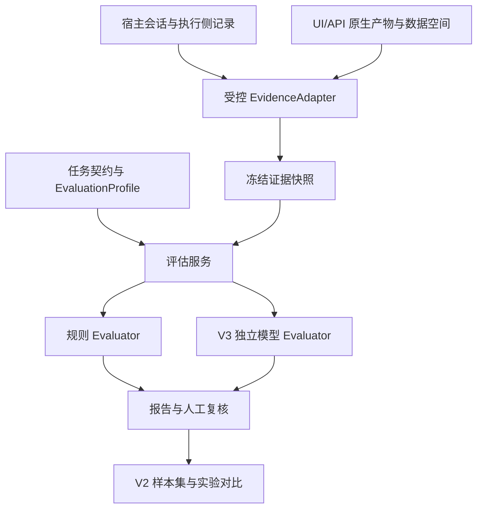

# Agent 评估中心：工程设计与实施验收计划

版本：设计修订版 1.0；日期：2026-10-23。状态：**设计已整理，功能尚未实施，本文全部实施任务初始为待执行**。

适用项目：pi-web-ui；首批交付对象：Pi 引擎、Electron macOS arm64。本文是后续执行依据，不表示授权付费模型调用、实际业务写入、应用中断或发布。

## 1. 复审结论与本次修订

总体可行，需要先收敛采集和判定口径，再实施。核心目标是回答：任务实际完成了什么、结论有什么证据、时间花在哪里，以及修改后的 Agent 是否更好。

| 原设计隐患                           | 本次决定                                         | 实施影响                                      |
| ------------------------------------ | ------------------------------------------------ | --------------------------------------------- |
| 把完整证据理解成收集所有日志         | 按每条规则的必要证据判定完整性                   | 一个维度缺证据不拖累其他独立维度              |
| 轨迹预览可直接作为评估依据           | 预览与受控证据读取分开，保留截断和来源标记       | 不扩大发给所有插件的快照                      |
| 自动识别全部历史任务、跨引擎统一评价 | V1 显式选择一个任务范围，先支持 Pi               | 不先开发全历史扫描和通用分段模型              |
| 证据采集失败可能阻止用户原任务       | 普通任务继续，评估降级；专用实验单独配置暂停策略 | 评估不成为业务执行的新门禁                    |
| 数据空间承载全部评估数据             | 评估模块独立持有记录，复用项目与环境引用         | 数据空间关闭仍可诊断开发或文档任务            |
| 所有结论都归为通过或失败             | 分离执行状态、目标完成度、逐项判定和证据状态     | 环境阻塞、评估错误、缺证据不会混为 Agent 失败 |
| 首版同时建设实验执行与模型评审       | V1 客观诊断，V2 可重复实验，V3 校准后的模型评审  | 不用昂贵功能阻挡首版验收                      |
| 预留大量框架接口和外部平台           | V1 仅落地证据适配、评估器、任务配置三个注册点    | 执行适配器到 V2；外部平台按需求接入           |

### 1.1 验收依据标签

- **U**：用户明确要求——多方面评价、核心优先、结论可信、证据完整、工程化可扩展。
- **R**：仓库约束——服务端事实源、执行侧权限、Electron 优先、独立测试数据、技能/工具管理和真实状态交付。
- **C**：当前源码事实，见第 2 节。
- **D**：本文选择的产品与工程契约。属于拟实施设计，不能写成已有事实。
- **X**：外部官方技术参考，见第 13 节。参考方法不等于本项目实测。

各任务验收均同时指向具体测试场景和这些依据，避免仅以“页面做好”“测试数量增加”验收。

## 2. 当前能力、缺口与可信边界

本次核对工作区 HEAD 为 `ff8acaf`，工作区存在其他任务的未提交修改。实施前须重新核对，不能用该提交号覆盖当前状态。

| 编号 | 当前事实与源码入口                                                                                                                               | 对设计的约束                                    |
| ---- | ------------------------------------------------------------------------------------------------------------------------------------------------ | ----------------------------------------------- |
| C01  | [PluginRunEvent](../server/plugins.ts) 提供运行、轮次、消息、工具事件；任务文本最多 500 字，参数/结果预览约 4K                                   | 适合实时展示，不代表完整原始证据                |
| C02  | [emitRun 与事件分发](../server/agent/agent-service.ts) 经插件订阅转发，异常隔离；[plugins.ts](../server/plugins.ts) 无该事件流的持久游标确认接口 | 不能声称当前订阅零丢失或支持完整重放            |
| C03  | [UiMessage](../server/protocol.ts) 已有 durationMs、model、provider、usageCost；[序列化](../server/serialize.ts) 会裁剪正文、参数和 details      | 先复用实测字段；缺失不补零，UI 摘要不是权威全文 |
| C04  | [运行轨迹](../plugins/run-trace/README.md) 已有时间线、调用统计；部分模型片段使用估算时长，文档注明 Pi 覆盖限制                                  | 复用展示思路，精确统计不取显示估算值            |
| C05  | [目标证据](../server/goal-evidence.ts) 默认最多 8 条、单条尾部 400 字、整段 6000 字                                                              | 可作为摘要方法，不能作为完整任务证据接口        |
| C06  | [原生产物读取](../server/test-asset-reader.ts) 已核验部分 UI/API 产物、摘要、路径和 run                                                          | 复用核验能力，不复制 runner、批准或业务规则     |
| C07  | [子代理](../server/agent/subagents.ts) 已有父会话关系；插件事件主要依 conversationId 关联                                                        | 补持久任务/尝试关联，不仅依赖易失会话 ID        |
| C08  | [数据空间](../plugins/data-space/README.md) 保存项目、环境、用例与执行结果                                                                       | 用正式受控入口关联，不直接读写其存储文件        |

可信边界：可提供本地可审计、按证据判定的结果；不能保证任意历史任务证据齐全，不能证明第三方数据源一定真实，也不能仅靠 SHA-256 宣称抵抗宿主管理员篡改。首版不建设合规审计系统，不采集隐藏思考作为必要依据。

## 3. 产品范围与交付版本

### V1：可核验的单任务诊断（P0）

用户从当前打开或已加载的历史对话进入“评估此任务”，选择消息范围、核对验收条件、运行客观检查、查看证据并人工复核。可以只评效率，不必先确认全部业务预期；缺少目标依据时完成度显示无法判定。

范围：选定任务与可关联子代理，工具错误/拒绝、耗时、产物检查、UI/API 原生证据、数据空间入库核验。数据空间适配器缺失只阻塞该规则，不阻塞一般轨迹诊断。

不做：自动执行业务、全历史扫描、通用任务切分、综合百分制、排行榜、跨引擎齐套、模型评审、外部 SaaS 强依赖。

### V2：可重复实验与版本对比（P1）

新增人工确认的样本集、固定版本、隔离执行、取消与预算、逐样本比较。以可隔离的 fixture 为先，不把历史业务操作直接重放。

### V3：语义评审与反馈闭环（P2）

增加独立模型评审、人工校准、结果抽样、失败样本推荐。未经授权不调用付费模型。线上自动采样与外部平台集成不阻挡 V1/V2。

## 4. 用户流程与判定语义

### 4.1 任务范围与验收契约

任务契约最少包含：`taskId`、`revision`、稳定会话定位、消息起止引用、用户目标、必要条件、禁止行为、环境前提、规则配置和条件来源。

条件来源区分 `user`（用户）、`project-policy`（项目约束）、`proposed`（待确认）。拟议条件不能用于硬性失败判断。用户已有明确要求时直接引用，不重复请求确认。历史消息不能稳定定位时，保存经核对的选区快照及摘要，并标记边界精度。

一个任务可关联多次尝试；用户改目标生成新契约版本，旧尝试保留原版本；无证据判断两个续跑属于同一任务时，由用户关联，不能按标题猜测。

### 4.2 四种状态分开保存

| 对象     | 状态                                                                      | 规则                                                                      |
| -------- | ------------------------------------------------------------------------- | ------------------------------------------------------------------------- |
| 执行尝试 | running / ended / blocked / cancelled / timed-out / interrupted / unknown | run_end 最多支持 ended，不能推导目标已完成；恢复执行创建新尝试            |
| 用户目标 | achieved / partially-achieved / not-achieved / undetermined               | 依据必需验收条件与实际结果；可以已完成部分条件但尚未达成目标              |
| 单项判定 | pass / fail / inconclusive / not-applicable                               | 缺必要证据为 inconclusive；不适用必须有原因                               |
| 评估作业 | queued / running / completed / failed / cancelled                         | failed 是评估基础设施错误，不是 Agent 失败；completed 允许含 inconclusive |

报告还单列证据状态：sufficient / partial / unavailable / invalid；判断方法：rule / model / human；结论性质：verified / judgment / unconfirmed。性质由服务端根据方法和证据验证结果计算，不由模型自报可信等级。

失败归因可多选：Agent 决策、工具/应用、环境/权限、需求/数据、评估器、未知。归因带证据与“已证实/待核实”，不把一次任务扩大为模型总体能力结论。

### 4.3 默认聚合规则

先核验适用条件。必需条件全部通过且其证据充分，才可判目标 achieved；存在已证实违反的必需条件，目标不可 achieved；缺关键证据而不能证明目标是否达成，使用 undetermined。部分条件已完成时可同时列出分项进度，但不能用平均分冲淡关键失败。

任务要求“无权限时停止”且实际正确停止，可以得到执行 blocked、行为规则 pass。用户要求实际入库但未入库，则目标尚未达成；是否合理处理阻塞另行判断。

## 5. 证据链与完整性设计

### 5.1 必要证据链

`目标/授权 → 配置与环境 → 实际动作 → 权限/工具结果 → 业务产物 → 验收读取 → 结论`。

每条规则声明需要哪些环节，不要求所有规则拥有全部环节。效率规则不依赖业务回查，入库规则不依赖精确模型耗时。历史任务缺口如实保留，补采时记录新的观察时间，不能回填为当时已经观察到。

证据来源分为用户原文、宿主事件、工具原始回执、原生产物、业务查询、人工标注、派生摘要。记录生产者和观察范围，不能笼统指定某种来源对所有事实都更权威。Agent 自述只证明它作出了该声明。

### 5.2 存储与读取

- V1 采用现有持久会话作为来源，补充必要的结构化运行侧记录；只有用户选择启用采集/评估的范围进入评估存储。完整历史缺口不能自动补齐。
- 宿主提供受控读取接口。展示仍使用截断预览；评估器按必要范围获取原证据或受控脱敏副本，不把全文下发给全部插件。
- `EvidenceRef` 包含 `id/type/source/producer/observedAt/sourceRevision/digest/locator/redaction/truncation/availability`。digest 对实际保存的字节计算；脱敏副本单独标识，不能冒充原始字节。
- 工具自己已经截断的输出不能由宿主恢复；关联原文件仍不存在时标记缺口。敏感值不写评估库，保留参数名、引用及执行状态。
- 路径经真实路径、工作区与所属会话授权校验；防绝对路径注入、符号链接越界和跨用户/客户端读取。任意路径不作为公开 API 入参。
- 业务核验默认读取已保存的正式回执。需要新查询时明确记录“本次额外核验”，使用既有只读入口及目标范围，不隐式登录、刷新凭据或执行脚本。
- 来源冲突时保留双方，返回 inconclusive 或交人工复核；不能让模型自行覆盖。当前回查只能证明当前状态，不能推断历史时点未有其他修改。

### 5.3 采集可靠性与重启

新增侧记录只补现有会话缺失的稳定关联、权限与运行生命周期，不复制全部消息。每条带 `eventId/sourceStreamId/seq/attemptId/parentAttemptId/toolCallId/observedAt`；父关系可未知，但不能猜。时间用墙钟作关联，同进程区间优先单调计时，跨重启不伪造单调连续性。

持久化由宿主单写者串行完成。评估消费游标仅在对应证据批次原子提交后前移；同一 eventId 重放幂等。过程记录使用追加日志，封存清单记录已持久序列范围、来源水位、缺口及摘要，原子替换派生索引。索引可重建，原始证据不可被评分改写。

序号连续只证明接收到的序列连续，不能证明源头未漏发。封存前还需核对执行尝试起止、工具成对关系、已知子代理清单和规则所需证据；`complete` 必须携带覆盖范围。崩溃留下未结束调用则标记 interrupted/unknown，不自动补成功。

普通任务采集异常不阻止原任务；显示 collection-degraded，记录最近成功水位，恢复后只补可验证部分。采集失败时无法持久写告警也不能声称零丢失；恢复时发现未封存批次即降级。专用实验可以配置必要证据采集失败后停止后续尝试，停止通过执行适配器完成。

采集不是业务写入事务。发生“业务已写入、回执丢失”时先标 unknown，按幂等键只读核验，不因证据缺失重放写入。

### 5.4 保留与资源边界

建议目录为 `<dataDir>/agent-evaluation/`，不是工作区下的可执行内容。V1 使用本地单进程文件存储：不可变快照/评估 JSON、必要追加日志、按需证据 blob 和可重建索引。复用现有原子写模式，不新建服务或引入数据库集群。

默认不自动删除评估证据；提供容量展示和显式归档/删除预览。删除来源后报告保留“引用失效”状态，不能继续显示重新核验通过。设置单项读取、每批证据与总容量上限，具体默认值在 E00 根据本机大样本测量冻结；达到上限停止扩充并标记不完整，不静默截断后评分。

备份复制已封存记录和索引，恢复时重新校验摘要并重建索引；不恢复为正在执行状态。首版不提供跨机器密钥、签名、公证或合规审计保证。

## 6. 工程结构与扩展契约

### 6.1 拟新增职责与文件位置

以下路径为计划，不表示文件已存在。实施时按职责最小落文件，禁止提前创建空框架。

| 位置                                                                         | 职责                                                         |
| ---------------------------------------------------------------------------- | ------------------------------------------------------------ |
| `server/agent/evaluation-evidence.ts`                                        | 持久关联、受控读取、运行侧记录接线；复用会话真相源           |
| `plugins/agent-evaluation/index.mjs`                                         | 插件激活、公开操作、依赖与能力声明、取消销毁                 |
| `plugins/agent-evaluation/store.mjs`                                         | 评估快照、记录、游标、单写者与恢复                           |
| `plugins/agent-evaluation/evaluate.mjs`                                      | 作业编排、依赖检查、超时、结果校验                           |
| `plugins/agent-evaluation/adapters/`                                         | Pi、原生测试与数据空间受控证据适配                           |
| `plugins/agent-evaluation/evaluators/`                                       | 明确业务规则的纯检查函数                                     |
| `plugins/agent-evaluation/profiles/`                                         | 开发任务、测试任务等声明式规则选择                           |
| `plugins/agent-evaluation/client/`                                           | 列表、详情、证据定位；V2 再增加实验页                        |
| `plugins/agent-evaluation/skills/agent-evaluation/SKILL.md`                  | 仅描述入口、证据和交付约束，不承载评分业务规则               |
| `scripts/enable-agent-evaluation.mjs`                                        | 显式 agentDir/dataDir 登记，重复运行不覆盖个人安装与禁用设置 |
| `tests/unit/agent-evaluation-*.test.ts`、`tests/agent-evaluation-*-test.mjs` | 单元、宿主、恢复与桌面验收                                   |

跨端业务协议仍以 `server/protocol.ts` 为唯一类型事实源；插件宿主接口在原插件 API 类型入口维护，纯内部类型留所属模块。运行时 schema 与类型联动测试，禁止多份手工维护的同名协议。公开工具登记沿用工具管理与执行侧守卫。

### 6.2 三个 V1 扩展点

| 接口              | 输入/输出约定                                                                              | 限制                                                      |
| ----------------- | ------------------------------------------------------------------------------------------ | --------------------------------------------------------- |
| EvidenceAdapter   | `capabilities()`；`collect(scope,cursor,budget,signal)` 返回证据、覆盖范围、缺口和后续游标 | 不自行执行业务；明确 live/history/children/usage 等支持项 |
| Evaluator         | `manifest` + `evaluate(contract,snapshot,config,signal)` 返回逐项 finding                  | 仅接收宿主验证后的证据视图，无原业务写入能力              |
| EvaluationProfile | `id/version/taskTypes/rules/required/aggregation`                                          | 只选择规则与参数，不承载第二套执行流程                    |

评估器 manifest 至少包含 `id/version/method/supportedTaskTypes/requiredEvidence/configSchema/outputSchemaVersion/timeout/budget`。注册时拒绝重复 ID+版本、无效 schema、无法解析的规则依赖。加载后配置冻结，插件更新不修改已经封存的评估。

只有来源适配器扩展时才涉及新增证据读取权限；新增纯规则不应修改采集核心或报告主数据结构。规则版本变化生成新结果，不覆盖旧结果。

V1 只加载随代码发布的可信评估器，不支持用户上传任意脚本。V2 才实现 ExecutionAdapter 的 `prepare/start/status/cancel/cleanup`；没有可取消和可核验隔离能力的执行环境，不开放批量运行。

### 6.3 最小数据模型

| 对象             | 必要字段                                                                                                               |
| ---------------- | ---------------------------------------------------------------------------------------------------------------------- |
| TaskContract     | taskId、revision、scope、objective、conditions、constraints、environmentRefs、provenance                               |
| ExecutionAttempt | attemptId、taskRevision、sourceSessionId、parentAttemptId、configurationRef、startedAt、endedAt、state                 |
| EvidenceSnapshot | snapshotId、schemaVersion、scope、sourceWatermarks、evidenceRefs、coverage、gaps、sealedAt                             |
| EvaluationRun    | evaluationId、snapshotId、contractRevision、profileVersion、evaluatorVersions、configDigest、state、startedAt、endedAt |
| Finding          | ruleId、verdict、evidenceState、method、nature、evidenceRefs、missingEvidence、reason、metrics                         |
| ReviewRevision   | reviewId、evaluationId、findingId、previousRevision、decision、reason、reviewer、at                                    |

真实生成 ID 不从任务名派生。未知与 0 分开；字段不存在不表示条件满足。配置摘要记录模型参数、Skill/工具内容版本、源码提交及相关未提交修改摘要；不可只保存 Git HEAD，也不能把凭据内容纳入摘要或导出。

### 6.4 对外操作与权限

V1 提供创建任务契约/修订、建立证据快照、开始评估、查询进度/报告、取消评估、人工复核、导出脱敏报告。通过现有插件接口暴露，操作名在 E00 冻结，不新增通用命令框架。

查询只读；创建快照和评估属于本地持久写入，仍遵守计划/只读/委派与插件禁用守卫。人工复核仅经可信用户入口记录身份，Agent 的自述不冒充人工确认。重新评分不运行工具；业务回查单独声明来源适配器的只读能力及目标范围。

身份来自宿主上下文，不能信任请求体传来的 owner/clientId。停用时注销监听、停止新作业并取消可取消作业；迟到结果检查作业代次，不写入新会话或已取消报告。导出默认脱敏，不导出私有路径或凭据。

## 7. 首批评估规则与统计口径

### 7.1 V1 规则

| ID  | 规则                     | 必需证据                                       | 判定边界                                        |
| --- | ------------------------ | ---------------------------------------------- | ----------------------------------------------- |
| F01 | 交付物存在且结构满足约定 | 用户条件、受控文件/原生产物读取                | 存在不代表语义正确；未定义内容要求不猜          |
| F02 | 原生测试执行声明一致     | 原生 run、逐项状态和输出声明                   | runner 未启动不记业务失败；旧 run 不算本轮      |
| F03 | 用例入库数量与归属       | 本批来源、env/project 关系、导入回执、有效回查 | 回查时间/范围不匹配则无法判定；不为核验再导入   |
| F04 | 前置失败后的依赖行为     | 已确认依赖关系、失败事件、后续调用             | 停止依赖步骤不阻止独立取证或阶段报告            |
| F05 | 最终完成声明与事实一致   | 原始答复、已核验验收项                         | V1 只自动处理明确结构化声明；自由文本由人工核对 |
| F06 | 工具失败、拒绝和取消统计 | 完整调用状态及去重标识                         | 分类别，不把所有非成功都归为 Agent 错误         |
| F07 | 重复失败/读取候选        | 规范化参数、目标版本、错误类别、前提变化       | 只提示，合理轮询/修复后复验不硬扣分             |
| F08 | 时长与费用               | 实测区间、消息 usage、价格/费用来源            | 缺失标未知；估算单列；评估成本独立              |

F03 中“75条、P0=28、P1=47”仅用于已确认的历史样本/对应 fixture，不硬编码进通用评估器。生产入库缺口以当前来源和状态重新核验，历史任务不回写改结果。

### 7.2 聚合与成本

- 显示计划、已执行、可判定、通过、不通过、无法判定、不适用、评估错误、未执行的数量，清楚说明统计对象是样本还是规则。
- 有效通过率 = pass / (pass + fail)；同时显示判定覆盖率 = (pass + fail) / 适用的计划检查数。分母为 0 返回未定义，不返回 100%。不适用单列，运行错误和未执行不会从覆盖率分母悄悄消失。
- 同进程区间按单调时钟；总历时与累计工具工作量并列。并行调用取区间并集统计占用，不简单相加为总时间；父等待子执行不重复计入全局耗时。
- 未观测区间为 unknown，不以“总时间减工具时间”充当模型思考。压缩次数、重复读取次数属于线索，不自动等于浪费。
- 费用优先提供者/SDK实际记录；按价格表推算时记录价格版本并标估算。token 不等于费用，未知费用不是免费。父子运行用来源调用 ID 去重，评估器费用另账。
- 对比采用相同样本和规则版本；只在双方可比且同等目标覆盖的样本上比较性能，同时报告全部退化/阻塞，避免只展示成功子集。小样本展示次数和分布，不下统计显著性结论。

## 8. V2 实验与 V3 模型评审的具体边界

### 8.1 实验

样本包含初始输入、有限对话上下文、必要文件/fixture、预期和禁止行为；历史轨迹经人工确认才转为样本，历史 Agent 输出不是标准答案。冻结 dataset、规则、配置、环境与数据版本；每次尝试从同一可验证初态启动，运行前后记录清理回执。

先支持一个已隔离的执行适配器和串行执行，独立数据/取消收尾通过后再开并行。所有业务副作用沿原宿主权限执行，不能通过“评测模式”绕过。

预算分别限制最大调用次数、单次超时、总时限、最大输出及费用。取消请求和实际进程结束分开记录；未确认终止或清理时阻塞冲突的下一尝试。收费不能仅靠结束后计费约束：有调用前上限估计和请求输出限制时才可声明费用上限；否则说明只支持软预算，拒绝硬预算实验。

配置差异一次优先只改一个因素；多因素变化只评价整体配置。缓存命中/模拟运行/真实模型分别标注。mock 证明编排，不证明模型决策效果。

### 8.2 模型评审

使用独立无业务工具上下文、固定评分规则、经授权的脱敏证据。模型只返回 verdict/reason/evidenceIds/missingEvidence，服务端验证引用存在且属于当前快照，缺引用不发已核验结论。轨迹内容是数据，不能改变系统规则；不执行其中指令。

保存模型与提示词版本、实际证据输入清单、调用结果及成本。模型自报置信度不转为可信概率。规则与模型冲突时保留分项结果并转人工，不用模型覆盖已验证客观事实。

校准集与保留检验集分离；至少覆盖成功、失败、证据不足、合理阻塞、提示注入和风格差异。报告误报/漏报/弃权及人工一致性；门槛在有标签后、正式检验前冻结，不能看完结果再调整。相同模型多次投票不代表独立证据。

## 9. 页面与能力交付

V1 两个页面：评估记录列表、任务详情。详情顺序为目标/范围 → 实际结果 → 证据覆盖 → 关键问题 → 时间线/证据 → 人工复核。进入评估时可编辑契约；不能把模型建议伪装成已确认需求。

报告显示 provisional（任务进行中）或 sealed（固定快照），来源后来变化不会改旧报告。提供重新评分，不混入重新执行。证据跳转复用受控预览，不暴露任意文件读取。V2 增加样本集与实验对比页。

插件、工具、技能管理及 `/skill:agent-evaluation` 发现同任务交付；禁用后入口及调用按既有机制生效，重载持久；实际 agentDir/dataDir 登记支持重复执行且保留个人安装。桌面共享 UI 遵循主题、zh/en、appUrl/appSend 和浮层约束。

不因安装插件要求加载外部 SaaS、收集全部历史会话或开启付费评审。数据空间关闭时保留一般评估功能并标出不可用的业务规则。

## 10. 执行优先级、依赖与交付物

全部任务初始状态：**待执行**。执行时更新独立验收记录，只有证据满足条件才转完成。当前任务仅交付本文。

| ID  | 优先级/版本 | 前置     | 具体实现与交付物                                                                                   | 验收依据与场景                                           |
| --- | ----------- | -------- | -------------------------------------------------------------------------------------------------- | -------------------------------------------------------- |
| E00 | P0/V1       | 无       | 核对当前源码/运行配置/权限/现有dirty变更；冻结契约、证据能力矩阵、资源上限及性能基线；准备测试样本 | U/R/C01–C08；A01、A02、A17，输出范围与缺口清单           |
| E01 | P0/V1       | E00      | 实现任务选区、稳定任务/尝试标识和权限作用域；补最小宿主读取接口                                    | C01/C07/D；A01、A02、A08、A13                            |
| E02 | P0/V1       | E01      | 受控采集、证据摘要/脱敏、侧记录、游标/幂等、封存/恢复与资源边界                                    | U/C02/C03/D；A03–A09、A16                                |
| E03 | P0/V1       | E01      | 实现三类注册契约、schema校验、作业状态/超时/取消及旧版本读取                                       | U/R/D；A10、A11、A15；开发可与E02并行，集成依赖E02       |
| E04 | P0/V1       | E02、E03 | 落地 F01/F02/F04–F08；补数据空间适配器及F03；规则聚合与指标对账                                    | U/C05/C06/C08/D；A06、A10、A12、A14、A18                 |
| E05 | P0/V1       | E04      | 两页界面、人工复核、技能/插件/工具登记、安装脚本；隔离与实际Electron接入                           | R/D；A13、A15–A17；F03依赖缺失需明确列未完成，不伪装通过 |
| E06 | P0/V1       | E05      | 性能及故障验收，历史任务只读复盘，交付状态对账、提交推送与回滚记录                                 | U/R/D；A01–A18全部按适用性留证，首版正式交付             |
| E07 | P1/V2       | E06      | 样本/配置版本、串行隔离ExecutionAdapter、预算/取消/清理、实验页与比较                              | U/R/D/X；A19–A22                                         |
| E08 | P2/V3       | E06      | 授权后接模型评审、独立上下文、引用校验、人工校准；自动采样后置                                     | U/R/D/X；A23–A25；不依赖E07，不阻挡V1/V2                 |

表中的验收场景可跨任务分步建立：E00只冻结夹具、现状和操作范围，不提前宣称A01/A02/A17功能通过；功能实测在对应实现完成后执行，E06统一对账。

关键路径：E00 → E01 → E02/E03 → E04 → E05 → E06。E07、E08是独立后续交付。数据空间入库自身的修复继续由原任务负责；本模块核验其结果，不承接其修复工作。

## 11. 验收矩阵与证据要求

以下是设计用例，不是本轮已经执行的测试。每条实施验收记录包含操作/输入、预期、实际、环境/版本、证据引用、结论及限制。

| ID  | 场景与具体预期                                                                 | 依据      | 验证方式/证据                                       |
| --- | ------------------------------------------------------------------------------ | --------- | --------------------------------------------------- |
| A01 | 单会话两项任务，选区只评价指定项；目标修改形成新版本，run_end不判目标完成      | U/D       | 已知消息夹具、任务契约与结果JSON                    |
| A02 | 正确停止权限受限任务，执行blocked、停止行为pass；要求实际入库时目标仍未达成    | U/R/D     | 权限拒绝事件、目标条件、逐项判定                    |
| A03 | 相同事件投递两次、重启重放，次数/费用/结果不增倍                               | C02/D     | 故障注入前后账本与游标                              |
| A04 | 采集中途崩溃/写盘失败/尾记录损坏，恢复后显示缺口，不自动补结束或成功           | C02/D     | 真实进程终止、恢复日志、封存清单；保留损坏原件      |
| A05 | 参数/结果预览截断，源证据可用则读取；源头也截断则必要规则inconclusive          | C01/C03/D | 超长夹具、原始/预览摘要、missingEvidence            |
| A06 | 有效原生产物通过；摘要不符、旧批次冒充本轮被拒；仅文件存在不宣称内容正确       | C06/D     | 原生fixture、篡改副本、规则结果                     |
| A07 | 子代理缺失、工具只有开始、采集在中途启用，分别标识范围缺口                     | C07/D     | 父子夹具、缺口清单；不混称完整任务                  |
| A08 | 越界路径、符号链接、伪造客户端身份、其他会话证据请求被拒                       | R/D       | 宿主权限集成，确认未泄露内容                        |
| A09 | 业务写入完成后丢失回执，不重放写入；只读核验或返回未知                         | U/R/D     | 隔离业务fixture计数、事件损坏、查询回执             |
| A10 | 评估器异常/超时不改变原任务，其他独立规则可结束；取消后迟到结果不覆盖          | R/D       | 故障评估器、原任务前后快照、作业状态                |
| A11 | 新增一条纯规则，仅增加实现/注册/测试；无效配置及重复版本拒绝；旧报告可读       | U/D       | 对应差异、注册测试、旧schema夹具                    |
| A12 | 同时执行两个10秒工具，累计约20秒、经过约10秒；父等待子不重复累计               | U/D       | 可控时钟单测及短真实并发集成；误差按E00计时分辨率   |
| A13 | 插件/工具禁用、跨客户端访问、实际应用重载均遵守权限；数据空间关闭仍可一般诊断  | R/D       | 隔离Electron与实际配置登记证据                      |
| A14 | 费用缺失显示未知；估算单列；评估费用与任务分账，重评不复制旧费用               | C03/D     | usage夹具与人工计算对账                             |
| A15 | 人工复核追加修订不覆盖原结论；Agent不能冒充人工；已封存证据变化可检测          | U/R/D     | 用户入口、修订链、证据校验与旧报告回读              |
| A16 | 满容量/超读取上限停止扩充并降级；关闭插件不留监听/进程；备份恢复不再执行       | R/D       | 有界大样本、资源统计、恢复前后证据索引              |
| A17 | 页面结果、证据跳转、长文本、空/错误态、zh/en、技能设置与/补全、启停持久        | R/D       | Electron截图/行为记录；隔离通过与实际登记分别报告   |
| A18 | 75条隔离样本首次入库、重复、错项目、部分失败、缺回查、自由文本声称成功分别判定 | U/C08/D   | 本地业务fixture、正式工具回执和查询；不写真实用例库 |
| A19 | 固定样本同初态运行两次，产物隔离、记录不覆盖，失败清理未完成阻止冲突任务       | R/D       | V2真实执行适配器与清理回执                          |
| A20 | 超时/预算触发取消，未确认结束不启动冲突尝试；不支持硬费用上限时明确拒绝该配置  | R/D       | 执行进程计数、预算记录、取消确认                    |
| A21 | 样本/规则/环境变化时标不可直接对比；模拟、缓存与真实运行分别显示               | U/D/X     | 配置快照、实验对比结果                              |
| A22 | 预设正确与退化版本能定位到样本差异；未知、错误、未执行保留在覆盖率口径         | U/D       | 带标准答案的实验fixture和人工计算                   |
| A23 | 模型引用不存在证据、受证据内注入诱导，服务端拒绝无效结构/引用且不触发业务工具  | R/D       | 固定对抗样本；模拟控制测试和真实模型语义实测分开    |
| A24 | 保留检验集报告误报/漏报/弃权和人工一致性，未达事先门槛则维持辅助评审定位       | U/D/X     | 人工标签、规则版本、真实授权评审回执                |
| A25 | 未授权/未启用模型时零调用；评审超时/费用不足保留客观结果并显示未完成项         | R/D       | 模型调用计数、预算和报告                            |

V1 不以“所有任务自动判断”验收，而以适用规则的正确判定、缺口识别和证据可追溯验收。V2/V3 的SKIP不能算通过，不阻挡已完成V1交付，但必须在对应版本保留未完成状态。

### 11.1 性能验收

E00 冻结同一机器、轨迹规模和fixture，测量未启用新采集的现状基线，并定义后续对照方式；尚未实现的报告生成时间记为未测。E06 在同等条件下重复测量关闭/开启采集及报告生成，记录运行耗时、采集CPU/内存、落盘字节和报告生成时间。覆盖短串行、并行、长输出三类，每类每种可测配置至少重复5次记录原始值；样本仅用于工程基线，不宣称统计显著。

冻结资源阈值和可接受增量后再实施，不预先宣称提速百分比。若超预算，先分页/摘要和按需读取，不靠丢必要证据或省略失败样本换性能。阈值修改须记录理由并重跑同一对照集，禁止验收后追调门槛。

## 12. 实施操作、验证、回滚与交付

### 12.1 开始每项任务

1. 核对当前分支、源码/应用路径、可写范围、未提交差异和现有进程；保留并行任务改动。
2. 阅读对应仓库开发约束。需要修改受保护桌面核心时按当前范围决定核对适用边界，不以本文替代批准记录。
3. 确认目标、任务编号、输入、验收场景和证据目录；工具可用时用plan_update记录，缺失时记录文档进度，不虚构状态。
4. 用最小失败样本复现缺口，再修改；每阶段只改职责相关文件，不复制UI/API执行器。

### 12.2 验证顺序

按项目要求格式化本次文件 → 完整typecheck → 相关Vitest → lint、check:protocol、差异检查 → 相关宿主集成。需要构建时串行一次，冒烟通过现有ensure-build入口复用，不并行重复构建。

测试端口≥8900，独立dataDir/agentDir；只有与本任务直接相关的隔离数据可写。新增工具联动发现、执行守卫、设置、禁用与重载；插件版本、适用bundle和文档导航同任务更新。实际桌面接入不能以隔离实例通过替代；不得擅自中断用户正在运行的任务。

### 12.3 停止、恢复与回滚

- 必要前置失败则停止依赖阶段，独立读取和取证可继续。阶段报告不是最终完成。
- 源码不可写、实际配置未知时先解决接入路径，不再复制多份开发目录盲目推进。
- 卸载/停用不删历史证据；回滚代码用git revert，旧版本遇到新schema只读或明确不兼容，不覆盖或降级改写。
- schema升级采用新文件/新版本、迁移前备份与校验，损坏或迁移失败保留原文件；派生索引可重建。
- 数据空间原始业务结果从不由评估回滚修改。真实业务修复独立走原授权和工作流。

### 12.4 最终交付清单

每个版本提供：实现范围、运行环境/版本、当前任务目标、已设计/已执行/通过/失败/阻塞/未执行、证据覆盖及缺口、规则/样本版本、测试原始结果、桌面登记证明、资源测量、回滚说明和剩余限制。

完成验证后只暂存本任务差异，创建可回滚提交，按持续授权推送当前origin同名分支并核对远端提交；禁止强推、发布标签或发布包。V1/V2/V3分别验收，不用后续可选功能拖住已达到条件的版本。

## 13. 外部参考与选择

官方页面已在本会话调研读取；访问日期2026-10-23。以下仅是能力参考，未做平台部署或性能比较，不承诺许可、价格或私有部署条件。

| 参考                                                                    | 借鉴点                                    | 本项目决定                               |
| ----------------------------------------------------------------------- | ----------------------------------------- | ---------------------------------------- |
| [LangSmith Evaluation](https://docs.langchain.com/langsmith/evaluation) | 数据集、离线/线上评估、人工标注、实验比较 | V2采用固定样本和失败回归闭环             |
| [AgentEvals](https://docs.langchain.com/langsmith/trajectory-evals)     | 顺序/集合轨迹与模型评审                   | 只对必要步骤施加顺序，不固定所有工具路径 |
| [Langfuse Evaluation](https://langfuse.com/docs/evaluation/overview)    | trace、评分、实验、人工校准               | 借鉴可追溯评分，暂不引入部署依赖         |
| [Arize Phoenix](https://arize.com/docs/phoenix)                         | OpenTelemetry/OpenInference、证据与实验   | 保留事件映射可能，首版不部署collector    |
| [Braintrust](https://www.braintrust.dev/docs/evaluate)                  | 数据/任务/评估器分离、不可变实验          | 配置和证据快照冻结，重新评估追加版本     |
| [Promptfoo](https://www.promptfoo.dev/docs/intro/)                      | 声明式断言、本地回归、对比与CI            | 后续按具体任务验证复用，不与原runner重复 |

## 14. 文档复审与当前状态

本次已做设计一致性复审：依赖无环；V1不依赖付费模型、实验执行或外部平台；事实与推断分开；证据缺失可降级；子代理、重启、取消、权限、版本和实际桌面接入均有验收项；新增规则的扩展成本有专门验收。

仍需在E00冻结的实施参数：事件读取/存储容量默认值、采集开销预算、当前运行配置和可取得的历史证据范围。它们不阻塞本文作为执行方案交付，但在冻结前不得声称相关能力或性能已经验收。

当前状态：E00–E08均待执行；A01–A25均为待实施验收场景。文档格式/链接/基础检查的通过只证明本次文档交付质量，不代表Agent评估功能已实现、历史任务已重新评分或真实业务已测试。

本次文档交付检查（2026-10-23）：格式与本地链接有效，9项任务依赖无环，25项验收编号无重复；完整typecheck、3个相关现有测试文件共48项单测、lint通过。协议类型/shim/版本一致性检查通过，因无可用Git标签而跳过的历史版本启发式未计通过。未执行新功能集成、Electron验收、真实模型或业务测试；开始和交付clean均仅预览，无文件删除。
