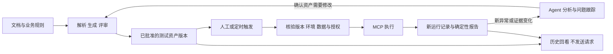

# 接口测试资产、回放与定时执行设计

状态：待实施设计；2026-10-21 根据用户要求补充。实施优先级：**先跑通主要业务闭环，再实现完整持久化与数据管理，之后接入定时执行**。

[闭环总体设计](api-testing-workflow-design.md) · [文档导航](README.md)

## 1. 目标与成本边界

用例、断言脚本、集合、评审结果和报告应成为可复用的项目资产。把“生产测试资产”和“执行测试资产”拆开：首次构建需要解析、生成和评审，后续回归直接执行已批准版本，不再从自然语言任务头开始。

重复执行仍需校验版本完整性、运行环境、凭据、数据准备和授权，但这些是确定性检查，不必每次调用模型。全部通过的普通回归由程序生成报告；新失败、失败特征变化或显式分析请求才进入 Agent 分析。接口调用和模型消耗分别记录，不能把缓存旧结果当成节省执行成本。



## 2. 四种用户操作

| 操作                 | 行为                                                     | 是否调用模型/被测接口                               |
| -------------------- | -------------------------------------------------------- | --------------------------------------------------- |
| 构建或更新测试资产   | 导入、生成或编辑、编译、评审，产生新的资产版本           | 按需调用模型；评审本身不请求被测接口                |
| 历史回看             | 展示指定运行的用例、脚本、证据、报告和问题处置过程       | 均不调用；这不是当前环境的新测试结果                |
| 再次执行（在线回放） | 选择已批准版本、环境和数据集，通过同一执行入口创建新 run | 不重复生成/评审；真实调用接口，新异常可触发模型分析 |
| 基于历史证据重新分析 | 对已有证据按指定规则/模型形成新的分析或报告 revision     | 可能调用模型，不调用接口，不改写原运行结论          |

界面不使用含糊的一个“回放”按钮承载全部行为。再次执行不承诺恢复旧业务状态：新建资源使用本次 fixture，运行中提取的新 ID/token 不能沿用历史值；真实环境变化可能产生不同结果。

历史证据可能被脱敏或截断，不能对缺失字段作完整离线断言。不可验证项明确标记证据不足；新分析不能覆盖原始断言结果、首次失败或原报告。

## 3. 持久化对象与引用关系

| 对象                         | 保存内容                                                                          | 版本/复用原则                                                                  |
| ---------------------------- | --------------------------------------------------------------------------------- | ------------------------------------------------------------------------------ |
| 来源版本                     | 契约副本、引用依赖、解析结果、转换损失、业务规则及来源位置                        | checksum 与解析器版本固定；保存前清除嵌入凭据，分别记录输入指纹与保存副本 hash |
| 用例版本                     | 请求参数、预期、优先级、来源依据、场景依赖、数据策略                              | 修改产生新 revision，不覆盖已有运行引用的版本                                  |
| 脚本与可执行集合             | 完整断言/前后置脚本文本、Collection v2.1、编译器/依赖版本                         | 保存实际评审和执行的字节，不只保存“生成脚本的 prompt”                          |
| 评审凭据                     | 机器诊断、模型评审、policy version、批准的资产 hash                               | 只能批准精确版本；不能靠文件名或“最近通过”匹配                                 |
| 测试套件版本 `SuiteRevision` | 精确引用 source/case/script/scenario/fixture/review 版本和文件 hash               | `draft → approved → retired`；当前批准指针只是便利入口，不是执行依据           |
| 环境与数据集版本             | base URL、非敏感参数、credential ref、fixture/清理策略                            | 凭据只存引用；每次执行重新解析、校验，独立记录实际参数摘要                     |
| 运行快照与证据               | run ID、suite revision、trigger、环境/服务版本、数据种子、时间、attempt、脱敏结果 | 每次实际执行新建 run；重试新建 attempt；不能覆盖历史                           |
| 报告与分析版本               | Markdown/JSON/JUnit、统计、问题引用、分析模型/规则版本、证据指纹                  | 模板或分析变化新增 report revision，始终关联原 run                             |
| 问题台账                     | 稳定 finding ID、每次出现、分析、修复与复测证据                                   | 复用问题身份；每次出现和结论保留，历史分析仅作参考                             |
| 定时定义                     | schedule ID/revision、套件版本、环境/数据引用、周期、时区、授权与并发策略         | 调度定义与运行历史分开；每次触发解析为不可变运行快照                           |

核心引用链为 `SourceRevision → Case/ScriptRevision → SuiteRevision + Review → RunSnapshot → Evidence → Report/Finding`。每个持久化格式带 `schemaVersion`；导出必须包含引用闭包和文件 hash。导入同一包幂等去重，不改写已有 ID 对应的不同内容；不能用导入文件中的“approved”标记直接取得本机执行授权。

## 4. 复用与失效规则

复用的是资产和评审，不是测试结果。执行前以套件 manifest 核对所有文件 hash、评审策略、编译器/runner 兼容范围、数据约束和授权状态。

| 变化                                  | 是否重新生成     | 是否重新评审/检查                                                      |
| ------------------------------------- | ---------------- | ---------------------------------------------------------------------- |
| 同版本套件再次执行                    | 否               | 每次环境/权限/完整性检查；复用有效评审                                 |
| 只修改 cron、标签或报告展示模板       | 否               | 检查调度或模板；报告模板变化不使测试用例失效                           |
| 凭据值正常轮换，身份权限不变          | 否               | 重新获取凭据；身份或权限范围变化时重新核验授权                         |
| 更换环境或参数化数据                  | 通常否           | 仅已批准的参数范围可复用；新主机/角色/请求结构超出边界时阻塞并重新核验 |
| 被测服务升级                          | 否               | 真实执行并记录服务版本；新失败进入分析，不自动改用例适配实现           |
| 契约、业务规则或脚本改变              | 仅重建受影响部分 | 相关用例重新评审，生成新套件版本；旧版本留作追踪                       |
| parser/compiler/runner 或评审策略升级 | 不默认全量生成   | 先判断行为兼容性；语义变化重编译/重评，不能盲目沿用批准                |
| 仅生成模型/提示词升级                 | 否               | 已冻结且策略有效的资产继续使用；新生成任务使用新版本                   |
| 文件损坏、引用缺失、证据删除          | 否               | 阻塞相应执行或回看，不悄悄调用模型重造原件                             |

解析缓存键包含来源及全部 `$ref` 内容指纹、解析/转换器版本和影响语义的配置。评审复用键包含实际用例/脚本 hash、规则和评审策略版本；人工修改同样使相关批准失效。不能仅靠 URL、mtime、用例标题或模型口头说明命中缓存。

契约更新先计算依赖影响范围；共享 schema、认证与全局变量变化向引用方传播。无法证明不受影响的部分按受影响处理。发生语义变更的套件默认阻塞其日常/定时执行，需批准新版本或明确选择历史兼容测试；纯文案变化可保留旧批准。不要将整个文档的任意字节变化机械地等同于所有用例都必须重生成。

定时任务默认固定 `suiteId + revision`，不自动追逐 latest。可选择将任务切换到新批准版本，变更本身留痕；在运行中的快照不受切换影响。修正候选版本不能被下一次定时任务提前执行。定时失败只产生分析与修订建议，资产更新通过显式构建任务完成，不在每次触发中自动进入生成循环。

## 5. 存储实现与管理边界

### 主流程阶段的最小产物

P1 只保存完成一轮测试所必需的执行包：来源/用例/脚本、manifest/hash、评审结果、最小运行状态、脱敏证据和报告。使用用户指定的本地输出目录，写入运行身份后才能发送请求，取消/失败也保留部分证据。这是可验证执行的基础，不是提前建设资产管理平台。

P1 不建设数据库、资产列表/搜索、批量编辑、保留策略、导入迁移、跨重启自动续跑或定时任务。可在同轮修复复测时复用已批准包；面向用户的跨任务回放管理放 P2。服务重启后遇到未完成记录只标记结果未知，不自动恢复写请求。

### 主流程验收后的完整持久化

P2 默认使用**版本化 JSON manifest + 独立产物文件 + 可重建索引**，沿用项目本地文件方案；暂不引入数据库服务、对象存储、ORM 或通用仓储框架。未来有实际检索/并发规模证据时再评估 SQLite，不能在当前主流程前增加这项依赖。

建议逻辑布局（待实现，目录不是现有事实）：

```text
<assetRoot>/<projectId>/
  sources/<sourceId>/<revision>/
  suites/<suiteId>/<revision>/       # 用例、脚本、场景、评审与 manifest
  environments/                    # 非敏感配置与 credential ref
  datasets/                        # 数据模板/版本，不保存会话 token
  runs/<runId>/                    # 运行清单、attempt、证据与报告 revision
  findings/                        # 问题及处置历史
  schedules/                       # 业务调度定义与触发记录
  index.json                       # 派生索引，可由 manifest 重建
```

`assetRoot` 使用项目选定的持久目录，不能将插件私有可卸载目录作为唯一数据源。P2 安装/首次设置时确定路径与访问授权；进程以绑定的 project ID/root 操作，不能随当前聊天切换项目。迁移 P1 产物采用校验、导入、确认后切换的方式，失败时保留原件，不因“优化存储”删除唯一证据。

发布资产先写暂存目录、校验所有 hash，再发布最终 manifest；索引最后更新。没有完整 manifest 的版本不参与执行，索引损坏可重建。单实例持有项目写锁，revision 更新采用比较后写入；首版不支持多个实例并发写同一资产根，不承诺文件系统事务或分布式 exactly-once。

可复用 `server/atomic-file.ts` 的普通文件写入经验，但其 rename 失败会退回原地写，**不能直接当作严格原子发布保证**。关键 manifest 的发布必须失败即中止，旧版本保持可用；断电持久性、Windows 文件占用与恢复校验在 P2 单独验证，不为此先重构全仓写文件函数。

P2 管理功能：套件/版本浏览、克隆编辑成草稿、批准/归档、历史回看、再次执行、运行对比、报告导出、备份恢复和引用检查。删除默认先归档；被定时任务、固定基线或保留中的运行引用的版本不得清除。过期大证据可按项目配置清理，但留下删除记录和证据不完整标记；停止任务不是删除历史。保留周期由项目设置，不能默认无限保留敏感响应。

## 6. 定时执行：复用宿主调度，直接运行资产

P3 接入现有 `host.schedule` / `server/plugin-schedule.ts` 的 cron、间隔与长定时器分片能力。回调调用同一个受控 `executeApprovedSuite` 业务入口（拟定职责名，尚不存在），复用人工执行的版本、环境、权限、MCP、报告与清理路径。

不将定时测试保存成“每次重新解析文档并生成用例”的 prompt。现有 `server/scheduler-tasks.ts` 的默认 executor 会唤醒 Agent；本设计选择插件回调路径，成功回归不必创建对话或调用模型。异常分析单独排入有限预算的分析阶段；分析失败不重跑已完成的接口请求。

定时定义至少包含：项目、精确套件版本、环境/数据版本、cron/interval、时区、enabled、执行授权 ref、超时/预算、重叠策略、漏跑策略及分析策略。创建与更新在当时授权范围内完成，不在本设计任务中实际创建任何定时器。

| 事项      | 首版策略与已知接缝                                                                                                                                           |
| --------- | ------------------------------------------------------------------------------------------------------------------------------------------------------------ |
| 版本选择  | 固定已批准版本；文件 hash、规则或授权无效时 blocked，不自动生成新版本                                                                                        |
| 时区      | 现有 cron 使用服务器本地时区；展示并记录实际 IANA 时区与下次触发时间。首版只支持与部署时区一致的任务，异时区拒绝配置；主机时区改变时暂停并提示，不能静默漂移 |
| 时区扩展  | 后续确需按任务选择时区时复用成熟 cron 库并验证夏令时，不通过修改进程全局 TZ 解决                                                                             |
| 重叠      | 同套件/环境默认不重叠，忙时记录 skipped_overlap；人工与定时共用锁，有共享测试资源的套件使用同一资源锁                                                        |
| 漏跑      | 默认 skip，重启不补发一串历史请求；显式选择补跑一次仍需检查上次结果与写入副作用                                                                              |
| 去重      | 以 schedule revision + 计划触发时刻 UTC 形成 fire key，执行前持久化认领；当前回调没有计划时刻参数，须最小补齐触发上下文，不能假装已有此保证                  |
| 中断      | 保留 run/进程关联与状态；不明结果标 unknown，阻止冲突执行直至核对；人工 Stop 与撤销授权共用取消路径                                                          |
| 运行条件  | 服务和插件必须运行；关闭桌面/服务器时不会在云端自动执行，长期运行复用项目既有部署方式                                                                        |
| 凭据/权限 | 每次获取有效凭据并核验非交互执行授权；缺失时 blocked，不在后台等无人响应的弹窗，不写明文到调度定义                                                           |
| 通知      | 保存每次结果，默认仅新失败、回归恢复或需处理事项通知；外部通知渠道需另有授权                                                                                 |

`host.schedule` 当前只保存声明与 lastRun，不是完整执行账本；也不提供 API 测试需要的持久化去重、资源锁或业务版本绑定。这些在 P3 的薄衔接层实现，调度声明落盘失败时不得显示“已启用”。插件 activate 需要重新注册回调；后台面板“停止”会删除声明，资产侧必须同步暂停，不能在重启后按旧 enabled 字段偷偷重建。发现业务定义与宿主声明不一致时先暂停核对；补齐停止状态同步后再宣称可管理。

持续执行授权与聊天中的临时模式区分：授权的无人值守任务有独立执行身份，不依赖当前是否打开对话；来自聊天的人工执行仍遵循该会话的计划/委派限制。定时调度不能成为绕过权限的另一条入口，撤销任务执行授权必须立即阻止后续运行。

## 7. 分析复用与成本验收

新 run 始终生成新统计和报告。失败分类可以先复用确定性规则；相同失败且证据/环境/被测版本/分析规则未变化时，可以引用历史分析并标明来源，不伪装成新诊断。仅错误文案相同不足以复用根因结论。

成功回归默认 0 次生成、0 次模型评审、0 次模型分析。新增失败或失败模式变化时才加载结果分析 skill；用户要求全量分析时另记预算。账本记录 cache hit/miss 原因、生成/评审/分析调用次数和实际 token 用量；缺少 usage 则标未知，不填写 0。统计预检查、执行、报告分别耗时，不把历史成功作为本次成功。

实现验收按总体设计阶段执行：

1. **P1 主流程**：一轮导入→生成→退回修正→通过→MCP 执行→异常分析→修复复测→报告；用最小文件包保留证据，资产管理不是前置条件。
2. **P2 资产复用**：重启后能回看原脚本/报告；同一批准版本再次执行产生新 run，生成与评审调用均为 0；修改脚本或共享 schema 后不能错误复用旧批准。
3. **P2 管理可靠性**：导入 P1 产物后引用完整；半写 manifest、索引损坏、重复导入、占用文件、删除被引用版本有明确结果；插件卸载不会删除唯一资产副本。
4. **P3 调度**：成功定时回归没有模型调用；定时绑定精确版本，失败保留证据；重叠、漏跑、停止后重启、时区变化、凭据过期和未知写请求不造成无声跳过或重复副作用。
5. **P3 分析闭环**：新异常进入分析与问题台账；旧问题修复后有新证据；历史回看/重新分析不发送接口请求，也不覆盖原始测试结论。

本次只更新功能与技术设计，不实现资产存储、MCP 运行或定时任务。现有调度/文件单测只能说明宿主基础能力，不代表本设计已通过上述验收。
