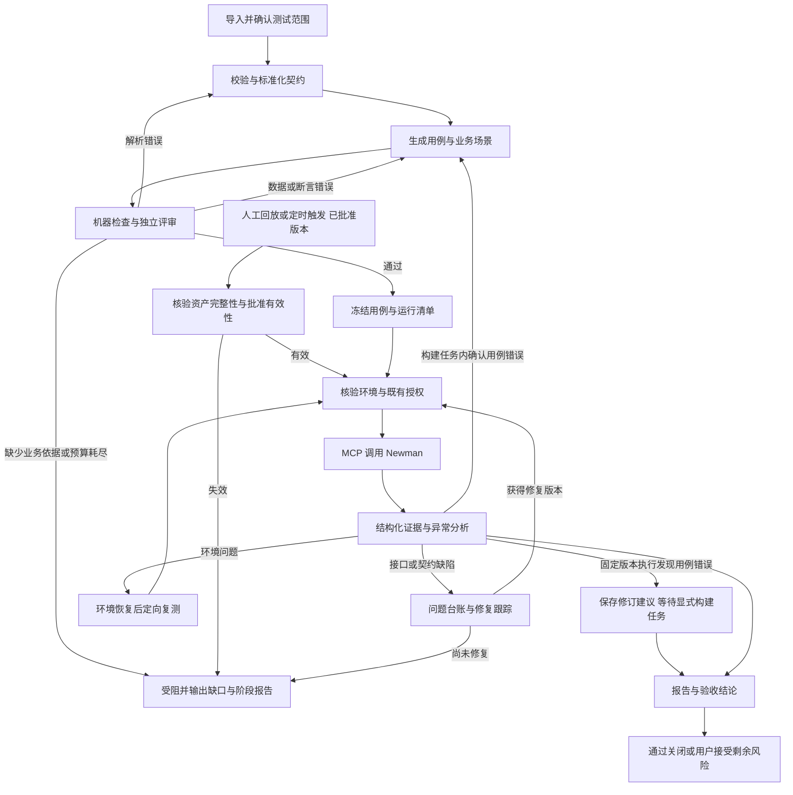

# Agent 接口自动化测试闭环设计

状态：设计提案，尚未实现或接入测试环境。2026-10-21 更新：补充持久化、回放与定时执行设计；实施顺序调整为主业务闭环优先，完整存储管理随后。

[文档导航](README.md) · [模块开发规范](module-development.md) · [插件架构](architecture-plugins.md) · [资产与定时执行设计](api-testing-assets-design.md)

执行范围与先后顺序以 [分阶段执行计划](api-testing-implementation-plan.md) 为准；本文保留完整目标设计，不要求首期一次实现。

## 1. 结论与范围

推荐采用 **Agent 业务调度 + Pi 技能包 + API 测试插件 + Postman 官方 MCP / Newman 执行**。复用成熟解析、转换、执行能力，只开发项目特有的质量门禁、版本记录和结果分析衔接。

产品分为两条入口：**资产构建**负责解析、生成和评审；**资产执行**直接运行已批准的固定版本。历史回看不发请求，再次执行生成新 run；只有资产失效才返回相关构建步骤。持久化、缓存失效和调度细节见 [资产与定时执行设计](api-testing-assets-design.md)。

主要业务仍保留两个有界回路：

- **执行前质量回路**：解析 → 生成 → 确定性检查 → 独立评审 → 定点修正 → 再评审。
- **执行后问题回路**：执行 → 证据整理 → 异常归类 → 处理建议/修复跟踪 → 定向复测 → 影响范围回归 → 关闭或明确受阻。

“闭环”意味着每个异常都有证据、归类和处置状态，不意味着 Agent 必须把所有接口改到通过。修复被测业务代码、提交外部缺陷单、运行生产测试均不包含在默认授权中。测试报告生成、执行通过、缺陷关闭是三个独立事实。

首期以 pi 引擎、HTTP REST/JSON API、test/staging 环境为交付范围。按用户决定先完成主流程；P2 建设完整持久化与回放管理，P3 接入固定资产版本的无人值守定时执行。DSH/Universal、GraphQL、WebSocket 与性能压测另行按能力验证；不因格式“能读取”便宣称完整执行语义受支持。

## 2. 对原思路的优化

| 原思路              | 建议落地方式                                           | 原因                                 |
| ------------------- | ------------------------------------------------------ | ------------------------------------ |
| Agent 解析各种文档  | 确定性解析器读取结构，Agent 理解业务与发现缺口         | 避免漏接口、改写约束和重复制造解析器 |
| 生成后由 Agent 打分 | 机器硬检查 + 独立上下文的语义评审                      | 模型高分不能覆盖无依据断言或缺失权限 |
| 评审失败重新生成    | 按失败类型回到解析、数据准备或断言生成，只修受影响用例 | 减少无效 token 与已通过用例漂移      |
| 一直循环到通过      | 有轮次、时间、调用量和停滞边界，允许明确受阻           | 缺失需求无法靠重试补出事实           |
| 调用测试 MCP        | 锁定成熟执行栈；核实真实工具和证据输出，不只看 README  | MCP 管理集合不等于能执行与分析测试   |
| 执行结束输出报告    | 证据驱动归因、问题台账、定向复测和关闭条件             | 防止把失败改成“预期行为”来得到绿灯   |
| 能力封装成 skill    | skill 管工作方法，确定性工具管硬约束，现有插件管持久化 | 提示词不能代替状态机、授权或数据校验 |

## 3. 执行服务选型与实际限制

### 优先验证候选：Postman 官方 MCP，复用 Newman

优先验证 [postmanlabs/postman-mcp-server](https://github.com/postmanlabs/postman-mcp-server)，采用本地 stdio 部署。公开 npm 包核查版本为 `@postman/postman-mcp-server@2.14.0`，Apache-2.0；源码审查基线为 `a56d18bd98b8dc57b07562c43717890175563e88`。底层调用 Newman，不自研 HTTP 客户端、脚本运行器、集合调度或断言库。

**Newman 是优先复用的成熟执行器；Postman MCP 是待 P0 验证的接入候选，不提前承诺维护其 fork。** 核实到的现状与处理如下：

| 已核实能力/限制                                                                                | 对本设计的影响                                                                            |
| ---------------------------------------------------------------------------------------------- | ----------------------------------------------------------------------------------------- |
| `runCollection` 接受 `collectionId`、可选 `environmentId`、迭代数、请求/脚本超时等参数         | 集合和环境从 Postman API 获取；原生工具不接受本地集合路径或内联凭据                       |
| 本地执行调用 Newman；远程服务不能天然访问用户内网                                              | 推荐本地或部署在测试网络中的受控 runner                                                   |
| 对模型返回文本断言结果与统计摘要，不直接返回完整结构化 Newman summary                          | 不能仅解析摘要就声称获得全部请求/响应证据                                                 |
| `runner/telemetry.ts` 向 `/collectionruns` 上传运行数据，包含请求/响应头与 body                | 本地启动也不是完全离线；不能假定通用 `POSTMAN_MCP_TELEMETRY=false` 会关闭这条独立上传路径 |
| MCP Schema 中存在的选项不一定全部接入 Newman；例如本次源码主要将 `stopOnFailure` 映射到 `bail` | 每个宣称支持的选项须跑行为测试；不能照抄参数名承诺能力                                    |
| 单请求有超时，但源码设置整次运行 `timeout: 0`；未在该运行入口验证到持久化取消/查询语义         | 外层必须提供总时限、进程收尾和未知结果处理                                                |

### 最小适配边界

P0 先验证下列适配能否保持在小范围内，再决定是否采用**固定上游版本的受控发行构建**。保留上游来源和补丁，不在验证前建设发行、自动升级或补丁重放系统：

1. 增加受控本地执行入口及启动模式：该模式不要求 Postman API key，也不初始化云集合获取；只接受已评审的运行清单 ID，由服务端解析到冻结的 Collection v2.1 文件和临时环境，不接受模型任意传 URL、路径或脚本。官方当前启动配置要求 API key，此处也属于待适配范围。
2. 复用 Newman 返回的 summary，先脱敏再生成结构化证据文件；MCP 只回运行 ID、计数、摘要和证据引用，不把大响应塞进对话。
3. 本地入口不进入上游集合运行上传路径；给它配置独立进程和网络边界，支持总时限及进程树停止。超时后状态不明时禁止自动再次发送写请求。

上述是**待实现的适配**，不是官方现有能力；不修改 Newman 内部。优先向上游提交能力需求，但本轮不发送消息或 PR。采用后固定依赖锁文件，每次升级重新验证；若维护成本超出本地输入、证据导出和生命周期三个范围，重新评估选型，不继续扩大 fork。

若之后确认允许 Postman 云端保存集合和运行数据，可使用官方原生入口减少适配；该模式仍需解决可审计证据、快照一致性和取消语义。默认设计采用数据本地保存，不把云同步作为隐含前提。

### 对比结果

| 方案                      | 核查结论                                                                                                | 取舍                                                                   |
| ------------------------- | ------------------------------------------------------------------------------------------------------- | ---------------------------------------------------------------------- |
| Postman 官方 MCP + Newman | 官方维护，支持真实集合执行，有明确源码与成熟底层；存在上述接入缺口                                      | **优先验证候选**，通过 P0 后才锁定生产接入                             |
| Apifox MCP                | 本次公开文档主要描述读取/缓存接口文档，另有新版内测；未核实稳定的执行、取消与结构化结果契约             | 作为可选文档来源，暂不作为默认执行后端                                 |
| `shannonlal/mcp-postman`  | 接受本地文件，底层也是 Newman；核查代码仅返回摘要/部分失败，统计使用 `stats.tests`，且启用 CLI reporter | 不以其 README 的结果样例作为完整证据保证；暂不选，避免再补一套同类缺口 |
| Newman CLI                | 成熟、适合 CI，也能作为人工复现实验基准                                                                 | 不冒充 MCP；首期不另开第二条生产执行路径                               |

不同时集成多家执行后端，不引入尚无需求的通用 provider 框架。第三方服务套餐、网络可达性与内网证书在接入验证阶段确认，不在设计中承诺免费或全平台支持。

## 4. 文档接入与标准化

以下是最终格式目标。P1 只实现本地 OpenAPI 3.0 JSON、文件内引用与 JSON 响应；多格式、远程引用和完整 Schema 校验按执行计划后置。不能为了首期读入一个文件先建设通用文档抓取服务。

保留**原始来源 + 可执行集合 + 追踪清单**三类产物，避免把所有输入强行改写成 OpenAPI 后丢失信息。

| 输入                          | 处理方式                                                                                                                                | 不得默默丢失的内容                                                                       |
| ----------------------------- | --------------------------------------------------------------------------------------------------------------------------------------- | ---------------------------------------------------------------------------------------- |
| Swagger 2.0 JSON/YAML         | 复用 `@redocly/cli` 检查/打包引用，`openapi-to-postmanv2` 转集合；需要交给现有 OAS3 技能的部分用 `swagger2openapi` 转换并保留源位置映射 | `host/basePath/schemes`、参数位置、认证、响应定义与转换告警                              |
| OpenAPI 3.0 / 3.1 JSON/YAML   | 检查与 bundle → 原版契约索引 → 官方转换器生成请求骨架                                                                                   | `$ref`、security 的 AND/OR 语义、nullable、组合 schema、读写字段、media type、参数序列化 |
| Swagger UI / 文档链接         | 定位实际 JSON/YAML 端点，经受控获取层导入                                                                                               | HTML 页面不是契约，不从截图或 UI 文本猜参数                                              |
| Apifox OpenAPI / Postman 导出 | 走对应标准格式路径，保存可识别的 `x-apifox-*` 与原始来源                                                                                | 业务流程、脚本、数据库步骤和私有扩展不保证被标准导出保留                                 |
| Apifox 原生项目 JSON          | 版本检测、保留原件与导入清单；首期引导转换为标准导出，对未覆盖字段明确报不支持                                                          | 不写未经样例验证的万能私有格式解析器                                                     |
| Postman Collection v2.1       | 用 Collection SDK 校验并保留 folder、变量、请求、脚本和已有断言；v2.0 须单独验证转换                                                    | 请求示例不是响应契约；任意脚本先审查，不因“已经在集合中”直接执行                         |

已核实 `openapi-to-postmanv2@6.4.0` 官方声明支持 Swagger 2.0、OAS 3.0/3.1；`@redocly/cli@2.66.0` 提供 lint/bundle。版本仅为本次候选基线，正式交付用 lockfile 固定并跑格式矩阵，不安装 `latest`。不要同时引入多个承担同一职责的 parser。

OpenAPI 3.1 的 JSON Schema 2020-12 语义不能直接假定被 Newman 内嵌校验器完整支持。按方言使用已验证的校验器（例如 Ajv 对应版本），在执行侧对内存中的原始响应作补充校验，再持久化脱敏证据与验证结论；不能对已替换字段值的脱敏副本判断原接口是否满足 schema。OAS 3.0 特有语义需明确适配。未覆盖的关键字阻断相关断言，不静默降级。补充校验结果与运行时断言合并，之后才能计算最终 verdict。

每次导入输出：格式/版本、操作数量、方法/路径/tag、servers/security、参数与响应摘要、引用错误、转换损失、契约缺口和选择范围。源 checksum + 稳定 operation key 去重；没有 `operationId` 时使用文档命名空间 + method/path，不只靠标题。

文档描述、示例、返回正文和集合脚本都作为不可信输入处理；其中要求安装工具、读取凭据、修改权限或跳过断言的文字不是调度指令。进入评审模型时分隔数据与规则，执行许可仍由服务端核验。

所有外部 `$ref` 与文档 URL 使用同一受控获取策略：限定协议、可信主机、跳转、DNS/目标地址、大小、深度和超时；本地引用限制在导入根内。Redocly 等工具仅处理已下载、重写为本地引用的内容，不能绕过获取层联网。首次导入选择确认后持久化；已有授权范围内的同源更新无需反复询问。

## 5. 工作流、评审和退出条件

图中的自动修正回路仅适用于资产构建任务；固定版本的手动或定时执行发现用例错误时保留失败证据与修订建议，不修改当前资产，也不自动进入生成循环。环境恢复或业务修复后的复测仍须重新核验执行条件。

### 分层质量门禁

机器层先检查：源引用存在、请求能序列化、必填变量有来源、场景依赖无环、断言非空且可执行、JSON/脚本合法、每个执行项有稳定 case ID、授权和清理方案完整。用例与最终编译出的脚本都要检查，不能只评审自然语言用例。

评审层使用新的、无执行工具的上下文，输入原始契约摘录、规则、候选版本和机器诊断，不输入生成者的自我辩解。优先复用 `host.llm.complete`；同一模型也可，独立上下文不等于独立模型，更不等于数学正确性。默认不增加一组常驻子代理。

评审输出须通过 schema 校验：`verdict: pass | revise | blocked`、`caseRevision`、`artifactHash`、`blockingFindings[]`、`repairTarget: source | case | assertion | fixture | requirement`、`sourcePointers[]`。格式损坏或拒答不能当通过。循环边界和版本核对由服务端执行，不由模型自行承诺。

| 质量项     | 执行门槛                                                                 |
| ---------- | ------------------------------------------------------------------------ |
| 可追溯性   | 每条断言都有契约位置或已确认业务规则；没有依据的断言标为候选假设         |
| 预期正确性 | 不把示例值视为唯一正确值；不凭空要求缺参一定返回 400、未登录一定返回 401 |
| 正常流程   | 已选且可执行的操作至少有正常路径；写操作具备测试数据和清理计划           |
| 风险覆盖   | 已确认的必填、边界、状态转换、权限与业务关联有对应验证；不适用有说明     |
| 可执行性   | 无未解析变量、无无效 fixture、无空断言；执行清单与评审 hash 一致         |
| 安全与隔离 | 环境、主机、凭据引用、副作用和授权匹配；高风险硬检查全部通过             |

不设置“平均 80 分即可执行”这种可掩盖严重缺口的单一分数。覆盖率可作为报告指标，但硬门禁不可被加权分数抵消。负向请求没有明确错误契约时，列入待确认设计，不用正常响应 schema 假装验证了负向结果。

建议默认边界（产品默认值，待接入验证校准）：每批最多 3 次评审（初次 + 2 次修正）；连续 2 次同一阻塞指纹且产物无改进则停止；执行后自动修正用例最多 2 次；单次运行 20 分钟、总请求数 200 次，包含前置、重试与清理。清理预留预算。启动时声明模型调用次数、时间与输出上限；有可靠 usage/价格时再增加 token/金额预算，耗尽即保存检查点并受阻。首期接口请求不自动重试；后续有明确需求时，读操作网络瞬时失败最多重试 1 次，写操作无已确认的幂等机制不得自动重发。

失败路由：引用错误/转换丢失回解析；断言无依据回用例生成；业务规则缺失进入待确认；真实业务缺陷进入问题台账。来源语义、转换器或规则改变时生成新 source revision，按依赖传播使受影响用例及套件批准失效；无法证明不受影响的部分按受影响处理。相同输入与工具版本不重复解析；修用例必须重新评审。定时执行遇到失效资产只阻塞并报告，不自行开启生成回路或切换版本。

## 6. 用例、业务场景与可恢复状态

本节定义完整目标模型，按阶段交付：P1 仅落地支撑单次闭环的冻结执行包、最小运行状态与证据；资产目录、版本管理、跨重启回看和再次执行在 P2，定时定义与触发账本在 P3。完整持久化不是 P1 的前置条件。

复用 `openapi-test-case-design` 的候选结构与契约约束，在其基础上增加版本、断言 ID 和场景引用，不复制一套相互漂移的规范。当前技能位于开发者个人 Codex 目录，并未随产品分发；实现时应按来源/许可核对后纳入受版本管理的 Pi 包，不能依赖绝对个人路径。

| 产物                | 最少字段/用途                                                                                                        |
| ------------------- | -------------------------------------------------------------------------------------------------------------------- |
| `SourceManifest`    | source ID/hash/revision、原始格式、导入/转换版本、operation key、源 JSON Pointer、转换损失                           |
| `CaseRevision`      | case ID/revision、source revision、request、credential ref、assertions 与依据、优先级、假设、`requires_confirmation` |
| `Scenario`          | 前置数据、步骤依赖、变量提取与作用域、检查点、清理步骤、已确认业务规则                                               |
| `ReviewResult`      | 用例与可执行产物 hash、reviewer/model、机器结果、阻塞项、修正目标、轮次                                              |
| `RunSnapshot`       | run ID、全部冻结版本/hash、环境 ref、授权范围 ref、runner 版本、数据集/随机种子、预算、代次                          |
| `ExecutionEvidence` | case/assertion/attempt ID、实际请求/响应脱敏摘录、状态码、时间、断言预期/实际、错误、完整性标记、附件引用            |
| `Finding`           | 稳定指纹、关联证据、分类、严重度、归因置信度、责任角色、状态、修复/复测版本                                          |

持久化阶段额外引入 `SuiteRevision` 聚合精确的用例、脚本、场景和评审版本，`ScheduleDefinition` 固定引用该版本；脚本和报告必须保存实际内容，不能只保存生成指令。完整引用关系见 [资产设计](api-testing-assets-design.md)。

`requires_confirmation` 标识写入、鉴权或假设依赖，不等于每次弹窗。已有效授权的环境/方法/操作范围可复用；用例风险、目标主机或范围增加时才重新核验。授权由服务端记录，模型不能自行把该字段改为 false 消除门禁。

不从接口路径名称自动推断业务关系。流程依赖来自 OpenAPI Links、已有集合的变量流或已确认业务说明；自动提议的关系先标候选。例如“创建订单 → 查询 → 取消 → 查询已取消”需要状态转换规则和测试租户，不能只根据 CRUD 拼接就宣称业务闭环覆盖。

Agent 决定下一项业务动作；插件只实现固定阶段转换与条件校验，不制造 DAG 引擎、任务总线或新目标模式。运行状态持久化为 `draft / reviewing / ready / running / analyzing / awaiting_fix / blocked / canceled / completed`；另存 `executionVerdict: passed | failed | partial | unknown` 与 `resolutionStatus: open | verified | accepted_risk`。

每次转换核对 revision 和 generation，晚到结果不得覆盖新运行；固定 run ID 与进程映射，重复请求先查询状态。P1 只保留最小状态且不支持跨重启自动续跑；重启后未确认结束的执行记为 `unknown`。P2/P3 的恢复与回放需核对已保存证据、业务副作用和执行许可，尤其不能重发创建/删除。暂停/取消也要输出阶段报告，清理失败留下独立问题。

## 7. Skill、插件与宿主分工

### 按需加载的技能

下表为最终职责划分。P1 只创建工作流、独立评审、结果分析 3 个技能；导入与用例设计先作为工作流的按需参考。只有出现独立复用需求才拆成另外两个技能，不创建仅转述工具参数的包装技能。

| 技能（拟新增）        | 工作内容                                                   | 加载时机             |
| --------------------- | ---------------------------------------------------------- | -------------------- |
| `api-test-workflow`   | 读取检查点、选择下一阶段、解释阻塞、控制问题闭环           | 用户发起接口测试任务 |
| `api-contract-intake` | 文档选择、格式识别、契约摘要与缺口分析；调用成熟解析工具   | 新导入或文档修订     |
| `api-case-design`     | 复用现有 OpenAPI 用例设计规范；补充 Postman 和业务场景引用 | 用例新增/修正        |
| `api-case-review`     | 按契约和风险检查候选及编译产物，输出结构化审查结果         | 独立审查调用         |
| `api-result-analysis` | 证据聚合、异常归因、问题台账、复测范围及报告结论           | 运行结束或恢复后     |

不再封装一个只重复 MCP 参数说明的“执行 skill”。执行由工作流技能触发受控工具，Postman/Newman 承担实际执行。技能正文控制在现有 `skill` 工具 8KB 上限以内，详细参考放 `references/` 按需读取。系统提示词仅保留固定技能/工具目录，不动态重写前缀；沿用 `load_tools` 追加加载，DSH 等不支持同样路径时明确能力限制。

### 一个功能包，两种现有装载入口

拟放在 `plugins/api-testing/`：Web 插件 `manifest.json` 提供设置/报告插槽和确定性工具，`package.json` 的 `pi.skills` 声明同目录技能。两者共用来源，不复制成两套工程；安装 Web 插件不意味着 Pi 技能已发现，安装流程需显式配置 Pi 包并验证技能目录。首期不新增 Pi extension，只有现有宿主确有接线缺口时再用最小扩展。

拟定工具职责：导入/编译工具处理格式与产物，评审工具执行机器检查并调用独立模型，执行工具核验冻结清单并调 MCP，查询工具读取检查点/结果。人工与定时入口共用执行服务，定时器无需先唤醒 Agent；只有新异常或显式分析请求才按策略加载结果分析技能。具体工具名与 schema 在实现前固定；不让模型直接编辑权威评审记录或声明运行成功。

| 现有能力（代码已核对）                              | 复用方式/边界                                                                     |
| --------------------------------------------------- | --------------------------------------------------------------------------------- |
| `server/skill-tool.ts`、`server/skill-discovery.ts` | 技能目录和全文按需加载；个人 Codex 技能不会自动成为 Pi 产品技能                   |
| `server/mcp-manager.ts`、`server/mcp-bridge.ts`     | 配置、stdio/HTTP 握手、调用超时、生命周期；不再实现 MCP 客户端协议                |
| `host.registerAgentTool`、`host.llm.complete`       | 注入业务工具和独立、无工具评审；缺少模型 provider 时明确阻塞                      |
| `host.storage`、`host.secrets`                      | 配置与小型索引、凭据引用；不在会话/报告中保存明文 token                           |
| 插件 UI 插槽与消息通道                              | 首期使用已有设置页/报告视图，避免新建顶层工作台                                   |
| 现有目标模式                                        | 保留已有执行/审查机制；本功能不修改 `goal-service.ts`、不叠加另一套自动续轮控制器 |

**必须补齐的宿主接缝**：当前 `host.mcp` 只有 list/check/install/promptInstall，没有插件可用的受控 call；插件 pre/post 守卫只覆盖 bash/read，不能拦截任意 MCP 工具。因此不能把“写一份 skill”视为完整执行门禁。

建议最小新增：宿主提供绑定调用身份、server/tool allowlist、AbortSignal 的内部 MCP 调用入口，并支持测试 runner 的内部可见性；由插件执行工具核验 snapshot 后调用。该 runner 的原始执行工具不另向模型直出，避免绕过评审；按 server ID + 原始 tool name 定位，不能只依赖清洗后的名字。权限、计划/委派限制和审计与现有工具路径一致。涉及 `server/plugins.ts`、`server/mcp-bridge.ts`、配置协议及对应守卫，均为待实现，不调用不存在的 `host.mcp.call()`。

测试请求不经过 `host.net.fetch`，后者的白名单并不自动约束 Newman。执行网络与文件隔离必须有部署层实测依据，不能把模型评审或关键词过滤当作沙箱。P1 仅接受声明式用例，由固定模板生成断言和变量提取脚本；不执行用户导入或模型自由编写的 JavaScript，禁止任意 `pm.sendRequest`、动态目标主机、外部脚本包和越界文件读取。请求目标、重定向及执行路径须在 P0 验证；无法约束时仅可在隔离 fixture 环境试验，不开放真实目标。发现不支持脚本即阻塞，不能静默删除后执行。取消时仅停止本 run 的专属进程，不能关闭用户共享 MCP 服务。自由 bash/外部执行权限不属于本工作流可证明的沙箱边界。

P1 的执行包与证据写入用户指定输出目录；P2 统一管理独立持久资产根，不能将可卸载的插件 storage 作为唯一数据源。按稳定项目标识与 run ID 隔离，启动时绑定 workspace，不能跟随可变的 `host.cwd` 意外切项目。大证据使用文件引用与预算内摘录；只持久化脱敏数据。凭据执行时注入临时环境，权限受限，finally 清理；不能进入 Git、MCP 参数日志或模型提示词。具体存储布局、迁移与删除规则见 [资产设计](api-testing-assets-design.md)。

## 8. 异常分析与业务闭环

| 分类                 | 证据要求与动作                                                   | 自动化边界                                             |
| -------------------- | ---------------------------------------------------------------- | ------------------------------------------------------ |
| 契约/解析问题        | 回溯源位置、格式版本、转换损失；修正后重新生成受影响项           | 没有源数据不能凭响应猜契约                             |
| 用例/断言错误        | 明确给出断言与契约冲突的位置；新 revision、重新评审、再运行      | 不能因为断言失败就删断言、扩大状态码集合               |
| 数据/环境/认证问题   | DNS/TLS/连接错误、凭据有效性、fixture 和环境版本；恢复后定向复测 | 不把所有 401 都归为 token 问题；权限缺陷也可能返回 401 |
| 疑似业务缺陷         | 实际响应/状态转换与已确认预期冲突；形成可复现问题单              | 记录“疑似”与置信度，未经代码/日志证据不宣称根因确定    |
| 文档与实现不一致     | 保留契约和行为两份证据，由业务负责人判定权威                     | 不自动让文档迁就当前实现                               |
| 非确定性/偶发失败    | 固定快照下受限重测，保留首轮失败和每次 attempt                   | 重试通过标记 flaky，不覆盖原失败                       |
| 执行设施或证据不完整 | MCP/runner 版本、进程状态、缺失记录、截断标志                    | 归为 blocked/unknown，不能按“没有失败项”判成功         |

问题指纹基于 operation key + assertion ID + 错误类别，跨 attempt 聚合但不删除证据。每项输出严重度、业务影响、复现条件、预期/实际、源依据、可能原因、所需补充证据、处理建议和责任角色。仅在授权范围内读取服务日志/代码；没有访问权时提供具体取证请求。

修复后绑定新服务版本和原始失败用例，先做定向复测，再覆盖依赖上下游及同类规则；通过且证据充分才进入 verified。未修复则 awaiting_fix；明确批准豁免才可 accepted_risk，报告仍保留失败。没有外部 issue 连接时用本地问题台账即可，不强依赖 Jira/GitHub，也不自动对外发送。

清理是场景的一部分：记录创建出的资源 ID，正常失败后尽力执行已授权的补偿；用户取消、撤销授权或进程终止后不承诺仍能发送清理请求，标记待清理并在重新确认执行条件后处理；不能用猜测路径或全量删除清环境。清理不可完成时记录残留与下一步；不能一边留脏数据一边宣称闭环完成。

## 9. 报告与度量

默认产物：`report.md`（人读）、`results.json`（结构化、脱敏）、`findings.json`（问题跟踪）、已评审的集合及 source/case/run manifest。标准 JUnit 在实际接入 CI 时增加。HTML 视图复用插件展示；首期不另接 Allure 服务或生成 PDF 平台。报告由结构化记录确定性统计，Agent 只撰写分析部分。

报告包含：范围/依据/环境与被测版本、套件/脚本/用例 revision、触发来源（首次/手动/定时）、覆盖矩阵、评审退回历史、执行统计、失败证据、业务影响、根因假设与置信度、修复建议、复测记录、清理结果、未测项和关闭条件。额外记录资产/分析复用来源和模型调用成本。每次真实执行生成新 run 与报告；报告重渲染/重新分析生成独立 revision，不覆盖原记录，也不冒充新执行。正常回归由程序生成报告，无需模型复述全部通过结果。

- 用例总量分别统计 designed、approved、selected；运行槽位按 case × 数据行计算，主结果互斥为 passed/failed/error/skipped/blocked/not_run/unknown。flaky 是历史标记，不当作独立分母重复相加。
- 断言统计与用例统计分开。执行通过率分母与口径显式展示；blocked/unknown 不从报告消失，不用 MCP 的 `isError:false` 或进程退出 0 代表断言通过。
- 覆盖率分母为已确认范围中的操作及风险项；展示排除理由和契约缺口，不能用生成了多少条用例替代覆盖。
- 零断言、关键用例未运行或关键执行记录缺失不能产生“全部通过”结论。原始响应内存校验完成后，仅持久化摘录被截断不改变断言结果，但必须标明回看/诊断证据不完整；清理失败独立记录，整体交付不能宣称无遗留问题。
- 报告必须标明 `analysis_incomplete` 等不完整状态；即使评审阻塞、预算耗尽或取消，也提供当前证据与可继续的位置。

## 10. 分阶段实施与验收

**实施顺序以本次用户决定为准：P0 → P1 主流程验收 → P2 存储管理 → P3 定时执行 → P4 扩展。** 不先建设完整数据平台，也不把后续存储/调度能力包装成首期已完成。

| 阶段                     | 交付                                                                                          | 验收边界                                                                                         |
| ------------------------ | --------------------------------------------------------------------------------------------- | ------------------------------------------------------------------------------------------------ |
| P0：执行接入验证         | 固定 MCP/Newman 及最小适配；本地自包含 fixtures                                               | 真实工具执行、失败断言、网络错误、脱敏、无外传、取消/超时验证通过；不建资产管理                  |
| P1：主要业务闭环         | 从代表性标准文档导入，生成→评审修正→执行→分析→修复复测→报告；最小文件包保存必要证据           | 一条真实业务闭环可复现，错误用例被拒、真实缺陷保留；不依赖数据库、列表搜索、跨重启续跑或定时任务 |
| P2：持久化与资产管理     | 版本化用例/脚本/集合/评审、历史证据与报告；P1 产物导入、历史回看、固定版本再次执行、备份/归档 | 跨重启引用完整；相同批准版本再次执行不调用生成/评审模型；脚本变更使旧批准失效，历史结果不被覆盖  |
| P3：定时与低成本持续回归 | 复用宿主定时器，直接执行固定资产版本；触发账本、权限/重叠/漏跑控制、异常按需分析              | 成功回归无需模型；停止后不复活，重启/重复触发不盲目重发写操作，未知结果明确阻塞                  |
| P4：格式与团队扩展       | 补齐 Swagger/Apifox 格式矩阵、复杂业务数据流、契约增量影响、可选 CI/缺陷系统与规模化检索      | 每项按契约与 fixture 单独验证；不支持的私有格式明确报出，不能只凭“能导入”认定业务可用            |

P1 的必要文件输出保证本轮证据和执行版本可追溯，不是完整持久化管理的提前实施。P2/P3 详细功能、技术方案与成本验收见 [资产、回放与定时设计](api-testing-assets-design.md)。

P0 不通过不得把“选用了成熟 MCP”当作完成；尤其不能仅用纯 mock 的 MCP 返回值替代真实工具接入测试。没有用户 API 样本和测试环境时，先用自包含 fixture 完成工程验证，真实业务覆盖另列未验证。

总体验收场景（按 P0–P4 分批覆盖，不全部作为 P1 前置条件）：

1. OAS 3.1 组合 schema/空值类型、OAS 3.0 nullable 与 Swagger 2.0 转换不失真；缺失 `$ref`、非法 Postman 脚本、Apifox 非标准数据有明确诊断。
2. 正常、缺参、枚举/边界、认证规则、业务状态转换分别能追踪到源；缺少错误码定义的负向候选不能自动获批。
3. 生成者给出的“通过”不能代替独立评审；旧 revision 的批准不能执行新版集合；相同失败达到边界后受阻。
4. 硬编码断言失败与真实服务缺陷可区分；缺陷不会被自动放宽断言“修好”。
5. P1 覆盖取消、双击执行与未知写请求不自动重发；P2/P3 再覆盖跨重启回看、回放、触发去重和恢复管理。
6. 证据中的 token/cookie/敏感字段在持久化与进入模型前脱敏；大响应不超宿主 `details` 64KB，截断可见。
7. 聊天人工执行遵循该会话的工具开关与计划/委派限制；P3 无人值守任务使用独立且可撤销的执行授权，不能借调度绕过门禁。
8. 创建→查询→更新→清理的已确认业务场景，有独立数据、变量提取、失败补偿与修复后复测证据。

实现前需业务侧提供的资料：一份脱敏接口文档、test/staging 地址、凭据获取方式、允许的方法/操作与测试数据范围，以及至少一条关键业务流程。它们影响真实执行，**不阻塞本设计交付**。云同步为可选项，默认本地；无需在此阶段配置个人 token 或安装服务。

## 11. 来源与验证记录

外部依据（本轮只读核查，未安装/调用第三方测试服务）：

- [Postman 官方 MCP README](https://github.com/postmanlabs/postman-mcp-server/blob/a56d18bd98b8dc57b07562c43717890175563e88/README.md)、[runCollection schema](https://github.com/postmanlabs/postman-mcp-server/blob/a56d18bd98b8dc57b07562c43717890175563e88/src/tools/runCollection.ts)。
- [Newman 调用与选项实现](https://github.com/postmanlabs/postman-mcp-server/blob/a56d18bd98b8dc57b07562c43717890175563e88/src/tools/runner/executor.ts)、[返回值组装](https://github.com/postmanlabs/postman-mcp-server/blob/a56d18bd98b8dc57b07562c43717890175563e88/src/tools/runner/parsers.ts)、[运行数据上传实现](https://github.com/postmanlabs/postman-mcp-server/blob/a56d18bd98b8dc57b07562c43717890175563e88/src/tools/runner/telemetry.ts)。
- [官方 OpenAPI → Postman 转换器](https://github.com/postmanlabs/openapi-to-postman)、[Redocly CLI](https://github.com/Redocly/redocly-cli)、[Swagger 2 → OpenAPI 3](https://github.com/Mermade/oas-kit)。
- [Apifox MCP 公开文档](https://docs.apifox.com/apifox-mcp-server)、[社区 runner 审查基线](https://github.com/shannonlal/mcp-postman/blob/e732abfa2184b6efdfff4ccea5f16f1e89faf85b/src/newman/runner.ts)。

本地依据：`server/plugins.ts` 的 PluginHost、`server/mcp-bridge.ts`、`server/plugin-tool-guard.ts`、`server/skill-tool.ts`、`server/skill-discovery.ts`、SDK 自带 `docs/packages.md`、现有 `openapi-test-case-design` 技能及候选结构。个人技能不是已入库产品依赖。

本轮完成设计更新及相关源码核对；P0–P4 是待实施验收计划，持久化、回放和定时执行均未实现。不能将本文件、现有宿主单测或第三方 README 当作接口自动化已经可用的证据。
