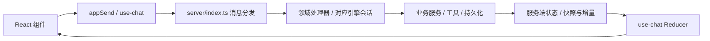

# 项目与模块地图

[文档导航](README.md) · [模块开发规范](module-development.md) · [文件级目录参考](directory-reference.md)

能力代码现按 `server/agent`、`model`、`prompt`、`skill`、`mcp` 分组，项目测试技能位于 `.pi/skills/`；完整归属与加载方式见 [能力维护指南](capability-layout.md)。

## 仓库分区

按职责理解现有目录，不要求为新功能重新搬动整个仓库。

| 分区           | 路径                                           | 用途与维护边界                                                   |
| -------------- | ---------------------------------------------- | ---------------------------------------------------------------- |
| 产品核心       | `server/`、`web/`                              | 服务端业务、协议与 React 界面，共用一套服务支持浏览器和桌面      |
| 启动与平台适配 | `bin/`、`desktop/`、`launcher/`、`extensions/` | CLI、Electron、便携启动器、pi 扩展；业务规则优先留在服务端       |
| 功能扩展       | `plugins/`、`plugin-sdk/`                      | 独立插件、市场清单与宿主接口；每个插件维护自己的说明和版本       |
| Agent 测试能力 | `.pi/skills/ui-testing-workflow/`              | 原版 UI workflow 包、原生 MCP 薄接入与配置；不承载产品业务       |
| 主题与语言     | `themes/`、`locales/`、`assets/`               | 主题、可下载语言包、项目展示资源；前端静态资源另见 `web/public/` |
| 验证与工程     | `tests/`、`scripts/`、`.github/`               | 单测、协议/UI 回归、构建维护脚本、CI                             |
| 文档与部署     | `docs/`、`deploy/`、根目录 Docker 文件         | 设计依据、交付证据与部署示例                                     |
| 开发辅助       | `dev/`                                         | 预览、探针等开发资料，不作为产品运行入口                         |
| 独立配套服务   | `cf-worker-feature-board/`                     | Cloudflare 功能看板 API，独立依赖和部署，不属于主应用构建        |

技能中文展示与能力联动由 `server/skill/skill-presentation.ts`、`settings-service.ts` 和现有 Pi 资源过滤链维护，见 [技能与能力管理](skill-capability-management.md)。

根目录保留项目入口、包配置、构建配置和跨项目说明。新增长期维护脚本放 `scripts/`，测试放 `tests/`，设计说明放 `docs/`；不要继续向根目录堆一次性文件。

## 核心请求路径

这是 WebSocket 主链路；文件媒体、上传下载等还有 HTTP 路由。跨端消息类型由 `server/protocol.ts` 定义，`web/src/types.ts` 只作导出桥接。定位问题时先确认是界面事件、消息路由、业务处理还是状态同步，再进入相应模块。

聊天文件链接由 `web/src/file-link.ts` 识别规范化，经 `Markdown.tsx` → `file-preview-bridge.ts` → 原文件预览与读取链路；见 [附件与预览](architecture-attachments.md#文件预览协议)。

## 按功能定位模块

下列路径相对仓库根目录；列出的是阅读起点，不是全部文件，也不表示这些文件都需要修改。

| 模块             | 服务端阅读起点                                                                                                                             | 前端/其他入口                                                                                                                | 主要边界                                                   |
| ---------------- | ------------------------------------------------------------------------------------------------------------------------------------------ | ---------------------------------------------------------------------------------------------------------------------------- | ---------------------------------------------------------- |
| 连接与协议       | `server/index.ts`、`server/protocol.ts`、`server/dispatch-domain-handlers.ts`                                                              | `web/src/use-chat.ts`、`web/src/base-url.ts`                                                                                 | 路由、校验、消息转换；业务细节交给所属服务                 |
| 会话与引擎       | `server/agent/agent-service.ts`、`server/engine-capabilities.ts`、`server/dsh/`、`server/universal/`、`server/durable/`                    | `web/src/components/EnginePicker.tsx`、`web/src/components/MessageList.tsx`                                                  | 每会话运行态隔离；新增能力逐引擎确认支持情况               |
| 工具与授权       | `server/tool-manager.ts`、`server/tool-host-factories.ts`、`server/tool-overrides.ts`、`server/tool-approval.ts`、`server/tool-guards.ts`  | `web/src/components/ToolCallBlock.tsx`、`web/src/components/ToolApprovalDialog.tsx`                                          | 工具目录单源；审批与模式限制在执行侧生效                   |
| 目标、计划与委派 | `server/goal-service.ts`、`server/goal-evidence.ts`、`server/plan-mode.ts`、`server/delegate-mode.ts`、`server/agent/subagents.ts`         | `web/src/components/GoalBar.tsx`、`web/src/components/PlanBoard.tsx`                                                         | 服务端控制轮次和停止；计划/委派硬闸门不可绕过              |
| 设置、模型与预设 | `server/settings-service.ts`、`server/client-state.ts`、`server/model/model-admin.ts`、`server/preset-share.ts`、`server/preset-fields.ts` | `web/src/components/SettingsModal.tsx`、`web/src/components/ModelConfigModal.tsx`、`web/src/components/PresetShareModal.tsx` | 区分全局/项目/会话作用域；预设分享白名单净化               |
| 文件与附件       | `server/files-service.ts`、`server/uploads.ts`、`server/attachments.ts`、`server/text-sniff.ts`                                            | `web/src/components/FilePreview.tsx`、`web/src/file-transfer.ts`                                                             | 工作区边界、大小预算、文本解码、远端路径语义               |
| 终端与 Git       | `server/terminals.ts`、`server/scm.ts`、`server/worktree-service.ts`                                                                       | `web/src/components/TerminalPanel.tsx`、`web/src/components/SCMPanel.tsx`                                                    | 进程随会话管理；Git 写操作走可见终端                       |
| 插件与 MCP       | `server/plugins.ts`、`server/plugin-permissions.ts`、`server/mcp/mcp-manager.ts`、`server/mcp/mcp-bridge.ts`                               | `web/src/ui-slots.ts`、`web/src/plugin-host.ts`、`plugin-sdk/`                                                               | 使用宿主 API、声明权限、卸载时释放副作用                   |
| 界面基础设施     | `server/i18n.ts`、`server/themes.ts`、`server/locales.ts`                                                                                  | `web/src/app-globals.ts`、`web/src/styles.css`、`web/src/i18n.tsx`、`web/src/use-floating-panel.ts`                          | 高频快照不入全局 Store；复用主题、翻译和浮层机制           |
| 桌面平台         | `desktop/main.ts`、`desktop/sidecar.ts`、`desktop/preload.cts`、`desktop/process-lifecycle.ts`、`desktop/client-identity.ts`               | `web/src/desktop.ts`、`desktop/README.md`                                                                                    | 桌面桥接和生命周期；共用 Web/server 业务，遵循桌面范围决定 |

接口测试 P0-1 验证入口为 `tests/api-testing-p0-test.mjs`，固定依赖与本地 runner 在 `tests/fixtures/api-testing-p0/`；只在隔离目录运行，不属于产品插件。范围、证据与复现见 [P0-1 验收记录](api-testing-evidence/P0-1.md)。

P0-2 的 `plugins/api-testing/` 提供最小执行工具；`server/mcp/plugin-mcp.ts` 负责可信调用身份和实时撤权，`server/api-testing-runner.ts` 负责 fixture 批准、私有 MCP 与 run 生命周期，`server/api-testing-isolation.ts` 生成 macOS 的 OS 文件/端口限制，`server/api-testing-relay.ts` 为宿主配置的手动 HTTP IPv4 目标提供固定 TCP 转发与集合传输映射；`tests/api-testing-controlled-test.mjs` 验证真实链路。它与 P0-1 探针分别保留，真实目标仍阻塞，见 [P0-2 验收](api-testing-evidence/P0-2.md)。

P1-1 `plugins/api-testing/suite.mjs` 负责本地 OAS 3.0 解析、候选纲要、声明式断言与固定模板草稿；`tests/api-testing-suite-test.mjs` 和 `tests/fixtures/api-testing-workflow/contract.json` 验证。详见 [P1-1](api-testing-evidence/P1-1.md)，不包含实际模型或真实业务执行。

P1-2 `plugins/api-testing/review.mjs` 负责确定性重编译与独立模型补全的有界评审，`tests/api-testing-review-test.mjs` 用明确模型替身验证控制。实际模型验收单列，见 [P1-2](api-testing-evidence/P1-2.md)。

## 状态应该放在哪里

| 状态                         | 归属                                      | 例子/约束                                              |
| ---------------------------- | ----------------------------------------- | ------------------------------------------------------ |
| 业务事实与运行进度           | 服务端对应项目/会话 runtime               | 轮次、审批、执行状态；前端不能靠本地状态模拟已完成     |
| 需要重启恢复的偏好           | 现有持久化层，如 `server/client-state.ts` | 新字段说明默认值、旧数据兼容、作用域及是否允许预设导出 |
| 消息、工具与高频快照         | `web/src/use-chat.ts` 的消息/快照处理路径 | 不放进 `app-globals.ts`，避免无关组件高频刷新          |
| 整树共享的低频运行信息       | `web/src/app-globals.ts`                  | 通过 `useAppField` 等现有机制订阅；不要变成业务数据库  |
| 弹窗开关、输入交互等局部状态 | 所属组件或 Hook                           | 不因为“将来可能复用”提前提升为全局状态                 |

## 文件与资料管理

- `node_modules/`、`dist/`、`web/dist/`、`release/` 是依赖或生成目录，按现有忽略规则管理；修改源码后由构建生成，不手改产物。
- 部分插件的客户端 bundle 已被 Git 跟踪，是上述规则的例外；修改其源码后按插件构建说明同步，并运行 CI 对应的新鲜度检查。
- 临时调试文件使用已忽略的 `tests/scratch/`（按需创建）；自动化测试的数据目录使用系统临时目录。不要把个人配置、凭据、对话、数据库或运行日志提交到仓库。
- 生成物维护使用 `scripts/clean-project.mjs`（`npm run clean` 预览、`clean:apply` 按保留期回收），规则与体积审计见 [项目体积维护](project-cleanup.md)；清理不进入服务启动或运行时链路。
- `docs/desktop-delivery/` 是证据档案。保留原文件名和引用，通过导航区分当前决定、提案和历史结果，不为“清理”删除证据。
- 新增、移动或重命名文件时检查 import、脚本、构建入口、打包清单、测试和文档引用，再更新目录参考。既有文件不为统一命名批量改名。
- 模块数量、工具数量、测试数量等易变信息以源码清单为准；文档记录职责和入口，减少手工维护的重复计数。

P1-3 `plugins/api-testing/workflow.mjs` 编排受控 action 与文件证据，`report.mjs` 负责问题分类/复测关联；宿主按插件源码 hash 装载固定模块快照，防止模块缓存继续使用旧依赖。`tests/api-testing-workflow-test.mjs` 验证真实 MCP/Newman 闭环，模型为明确替身。见 [P1-3](api-testing-evidence/P1-3.md)。

P1-4 的三个分发技能位于 `plugins/api-testing/skills/`；由 `tests/api-testing-skills-test.mjs` 在临时项目调用真实 SDK 和宿主 skill 工具验证。需复制到目标项目技能目录或显式配置 skillPaths；插件安装不自动加载。实际模型/业务验收仍阻塞，见 [接入清单](api-testing-evidence/P1-4.md)。

P1-4 实际模型补验入口 `tests/api-testing-model-test.mjs` 通过 SDK 复用系统配置模型，生成与评审各自独立无工具上下文；不在零 token 冒烟中自动调用。最终验收及历史失败见 [P1-4 模型补验](api-testing-evidence/P1-4-model.md)。

P2-1 `plugins/api-testing/assets.mjs` 管理宿主持有的不可变整包、run 证据与派生索引；`server/api-testing-runner.ts` 仅把固定存储根和受控执行回调接入。`tests/api-testing-assets-test.mjs` 验证重启复用、损坏拒绝和卸载保留，见 [P2-1](api-testing-evidence/P2-1.md)。

P2-2 `plugins/api-testing/asset-management.mjs` 提供最小列表、草稿克隆、归档、引用检查和同宿主备份恢复；通过既有工具卡片展示。`tests/api-testing-asset-management-test.mjs` 验证真实入口、完整性/冲突与项目边界，见 [P2-2](api-testing-evidence/P2-2.md)。

P3-1 `plugins/api-testing/schedules.mjs` 管理固定匿名 fixture 授权与触发账本，宿主 `PluginApiScheduleHost` 提供计划时间、严格保存及停止通知；`tests/api-testing-schedules-test.mjs` 验证真实 60 秒调度和 MCP，`tests/api-testing-schedule-guards-test.mjs` 明确以替身覆盖门禁。见 [P3-1](api-testing-evidence/P3-1.md)。

P3-2 `plugins/api-testing/tracking.mjs` 从不可变运行结果关联问题，追加有限预算分析与报告修订；`tests/api-testing-tracking-test.mjs` 覆盖真实 MCP、分析故障/恢复及 opt-in 实际模型。见 [P3-2](api-testing-evidence/P3-2.md)。

`server/api-testing-credential.ts` 校验专用测试 token 文件的权限、目标/项目绑定、到期及撤销；宿主只在私有执行管道交付其值，模型和持久证据不接收。见 [凭据验收](api-testing-evidence/credential-host.md)。

API 能力接入：`scripts/enable-api-testing.mjs` 在明确的宿主 dataDir 安装原插件，并向项目/应用 agent 配置登记三项技能；`tests/api-testing-visibility-test.mjs` 验证真实 Electron 中技能、插件、工具管理和 `/api` 补全/启停。见 [验收](api-testing-visibility.md)。

工具按需加载恢复名单由 `server/agent/lazy-tools-state.ts` 从转录提取；出站预算回归入口为
`tests/tool-context-budget-test.mjs`，机制与验收见 [工具上下文预算](tool-context-budget.md)。

可选工具依赖在 `desktop/`、`tools/vendor/`、`tools/e2e/` 独立锁定；安装与兼容链接由 `scripts/install-profile.mjs` 管理。API 运行隔离入口见 `tests/lib/api-test-runtime.mjs`。详见 [项目精简](project-slimming.md)。

对话过程展示由 `web/src/chat-presentation.ts` 生成投影，`web/src/components/ModelTiming.tsx` 显示 SDK 请求耗时；行为及原始历史边界见 [核心架构](architecture-core.md#对话过程与模型耗时)。

UI 测试 P0：`server/extension-tool-policy.ts` 定义操作副作用，`server/extension-tool-gate.ts` 在 Pi SDK 工具调用前检查模式与只读权限；`qa/ui/` 维护本项目隔离服务、数据和浏览器 fixture。运行入口见 [fixture 维护](../qa/ui/README.md)，证据见 [P0 验收](ui-testing-p0-evidence.md)。

数据空间与原生 UI/API 执行关联：`plugins/data-space/test-channel.mjs`（环境初始化与资产归档）、`environment-preparation.mjs`（模式及非敏感参数准备回执）、`plugins/data-space/automation.mjs`、`server/test-asset-reader.ts`（只读核验）、`server/test-execution-notice.ts`（完成引用及原生 UI 阶段的看板投影）。维护与验收见 [接入记录](data-space-integration.md)、[UI 优化执行记录](ui-testing-optimization-execution.md)。

数据空间版本展示：`plugins/data-space/client/case-versions.mjs` 按明确来源和入库顺序投影列表；不变更原生批准、历史资产或执行记录。

数据空间 Agent 交接规范：`.pi/skills/data-space-testing/SKILL.md` 选择查询／绑定／同步／普通登记路径，`references/result-output.md` 约定结果交付，`scripts/validate-result.mjs` 只读校验交付一致性；`tests/data-space-skill-desktop-test.mjs` 验证 Electron 发现与插件归属联动。

Agent 评估工程基础：`plugins/agent-evaluation/{schema,store,durable,collect}.mjs`、`adapters/pi.mjs` 与 `server/agent/evaluation-evidence.ts`，提供统一仓库、受控选区、只读原生证据与封存；产品入口待 EC04，见 [EC01](agent-evaluation-evidence/EC01.md)、[EC02](agent-evaluation-evidence/EC02.md)。

Agent 评估评分基础：`plugins/agent-evaluation/{registry,evaluate,aggregate}.mjs`，处理可信扩展注册、快照评分作业与契约聚合；`evaluators/{basic,metrics,common}.mjs` 与 `profiles/internal.mjs` 提供七条规则和指标；授权文件快照在 `server/agent/evaluation-artifact.ts`，见 [进展](agent-evaluation-evidence/EC03.md)。

Agent 评估 EC04 产品接线：`plugins/agent-evaluation/{index,service}.mjs`、`client/`、唯一 `skills/agent-evaluation/SKILL.md` 与项目发现 shim；`scripts/enable-agent-evaluation.mjs` 显式登记。`client/configuration.mjs`负责已绑定规则的表单呈现与序列化，业务校验仍复用service/registry；配置新报告使用原快照。`tests/agent-evaluation-native-desktop-test.mjs`只读复用已有合成原生结果，验证实际Electron批次详情。`evaluate.mjs`同步封存卸载取消终态，`tests/fixtures/agent-evaluation/active-jobs.mjs`仅用于隔离桌面故障注入。两页、可信人审与原工具门禁已有工程实现，实际桌面/性能逐项状态见 [EC04](agent-evaluation-evidence/EC04.md)，M1 未完成。

EC04 批量证据持久化：`plugins/agent-evaluation/pack.mjs` 编解码有界物理范围索引；`store.mjs` 保留逐条逻辑记录/授权/回执并兼容旧 JSON/blob，`durable.mjs` 在原子发布前依次同步正文和记录清单。恢复与故障回归仍在 store/evidence 单测。

EC05 离线转换基础：`plugins/agent-evaluation/adapters/atif.mjs`使用`adapters/atif/schema.json`固定官方格式，仅解析/转换数据。生产导入/报告接线状态与边界见[EC05](agent-evaluation-evidence/EC05.md)。

EC05 持久化：`plugins/agent-evaluation/import.mjs`复用既有记录/快照/评分，实现offline范围的可恢复幂等导入；`store.mjs`保护原包归档，普通证据与导出保持脱敏。`tests/agent-evaluation-import-test.mjs`为原生工程探针，用户service/UI接线及实际验收见下述产品上传模块。

EC05 产品上传：`plugins/agent-evaluation/upload.mjs`维护有界临时原字节、身份绑定、分块重试与过期清除；`service.mjs`的人审专用动作连接原有import/store/engine，`client/`提供上传预览/确认与离线报告来源/损失/原包分页。`tests/unit/agent-evaluation-upload.test.ts`覆盖资源/权限边界；`tests/fixtures/agent-evaluation/offline-import.mjs`在实际Electron主用例中验证文件上传和跨进程回读。

EC06 隔离可行性：`tests/agent-evaluation-isolation-test.mjs` 与 `tests/fixtures/agent-evaluation/isolation-probe.mjs` 仅运行原生 macOS 零模型探针，保存文件/网络拒绝及逃逸子进程取消反例；诊断 PASS 不代表执行后端获批，见 [EC06](agent-evaluation-evidence/EC06.md)。

EC04 桌面可选补验：`tests/agent-evaluation-desktop-test.mjs --evidence-matrix`复用`tests/fixtures/agent-evaluation/evidence-matrix.mjs`，验证160K合成证据完整分页、真实缺文件/恢复、窄屏与小样本绘制耗时；不改产品，不替代性能或完整回滚门禁，见[记录](agent-evaluation-evidence/EC04.md)。

EC04 回滚验收：`tests/agent-evaluation-desktop-test.mjs --rollback`通过`tests/fixtures/agent-evaluation/rollback.mjs`在自有数据目录执行实际插件revert、完整停止后userData备份/恢复及旧版未知格式写入拒绝；版本/同宿主边界和原始证据见[记录](agent-evaluation-evidence/EC04-rollback-diagnostics.json)。

EC04规模与分页回归：`tests/agent-evaluation-desktop-test.mjs --scale`使用`tests/fixtures/agent-evaluation/scale.mjs`在停止自有应用后生成50份合成报告/1000证据快照，验证实际Electron分页与投影有界；service单测覆盖可见引用摘要，原始失败和结果见[EC04](agent-evaluation-evidence/EC04.md)。

EC04工具通道补验：`tests/agent-evaluation-native-desktop-test.mjs --tool-matrix`复用`tests/fixtures/agent-evaluation/tool-channel.mjs`的本地确定性SSE，经实际Electron/SDK验证get正对照、review输入schema拒绝与可信UI追加对照；无真实模型调用，见[证据](agent-evaluation-evidence/EC04-tool-channel-diagnostics.json)。

EC04实际执行多页：`tests/agent-evaluation-ui-matrix-test.mjs`复用原UI诊断/正式runner和data-space夹具，产生41条真实本地混合结果；原生桌面跑器逐行核对分页与历史读取边界，见[证据](agent-evaluation-evidence/EC04-executed-matrix-diagnostics.json)。

EC04 规则扩展补验：`tests/agent-evaluation-desktop-test.mjs --rule-upgrade`使用`tests/fixtures/agent-evaluation/rule-upgrade.mjs`，在自有profile追加纯规则、V1/V2并存、精确重评和无数据空间F07；原执行器/注册表/引擎/存储不替换，合成调用历史不冒充真实执行，见[证据](agent-evaluation-evidence/EC04-rule-upgrade-diagnostics.json)。

EC04 双任务补验：`tests/agent-evaluation-desktop-test.mjs --task-scope`使用`tests/fixtures/agent-evaluation/task-scope.mjs`生成同会话两个合成任务，经实际界面核对选区、空业务条件诊断、原请求回执重放及独立重评；零真实工具/模型调用，见[证据](agent-evaluation-evidence/EC04-task-scope-diagnostics.json)。

EC04 结论边界补验：`tests/agent-evaluation-desktop-test.mjs --verdict-matrix`使用`tests/fixtures/agent-evaluation/verdict-matrix.mjs`构造10组合成历史，经可信桌面连接创建契约并逐一打开报告，核对目标、依赖约束、交付及缺口；零真实工具/模型调用，见[证据](agent-evaluation-evidence/EC04-verdict-matrix-diagnostics.json)。

EC04 丢回执补验：`tests/agent-evaluation-desktop-test.mjs --receipt-loss`使用`tests/fixtures/agent-evaluation/receipt-loss.mjs`阻止6个成功回复向应用交付，经原键重试和完整桌面重启后验证整仓字节不变及报告/review回读；测试接收器保留原生线路回复，不冒充网络故障，见[证据](agent-evaluation-evidence/EC04-receipt-loss-diagnostics.json)。

EC04 费用边界补验：`tests/agent-evaluation-desktop-test.mjs --cost-matrix`通过`tests/fixtures/agent-evaluation/cost-matrix.mjs`在实际Electron核对缺usage、无版本/歧义报价、多币种小计及表单改价后旧报告冻结重评；全为合成SDK历史/价格，不代表真实账单，见[证据](agent-evaluation-evidence/EC04-cost-matrix-diagnostics.json)。

EC04 默认容量补验：`tests/agent-evaluation-desktop-test.mjs --capacity`通过`tests/fixtures/agent-evaluation/capacity.mjs`在实际Electron验证原10,000条记录上限、草稿/旧报告保留、1MiB超大来源缺口及停机移除自有填充包后恢复；只读重建满仓核验，非真实磁盘满或生产清理入口，见[证据](agent-evaluation-evidence/EC04-capacity-diagnostics.json)。

EC04 字节容量补验：`tests/agent-evaluation-desktop-test.mjs --byte-capacity`复用`tests/fixtures/agent-evaluation/capacity.mjs`，在实际Electron验证原256MiB字节上限下的拒绝/草稿与旧报告保留/停机自有包恢复，满仓逐正文回读；非真实ENOSPC或生产清理，见[证据](agent-evaluation-evidence/EC04-byte-capacity-diagnostics.json)。记录模式仍用`--capacity`分别执行。

EC04 合成时序补验：`tests/agent-evaluation-desktop-test.mjs --timing-matrix`使用`tests/fixtures/agent-evaluation/timing-matrix.mjs`，在实际Electron核对并行/等待、时钟缺口及冻结上限重评；夹具自编正文，非真实SDK执行/时钟故障，见[证据](agent-evaluation-evidence/EC04-timing-matrix-diagnostics.json)。

EC04 合成分账补验：`tests/agent-evaluation-desktop-test.mjs --usage-matrix`使用`tests/fixtures/agent-evaluation/usage-matrix.mjs`，在实际Electron核对同调用跨来源去重、五阶段分账、金额/阶段冲突和旧报告重评；金额与供应商字段全为合成，不代表真实账单，见[证据](agent-evaluation-evidence/EC04-usage-matrix-diagnostics.json)。

EC04 半发布恢复补验：`tests/agent-evaluation-desktop-test.mjs --crash-store`通过`tests/fixtures/agent-evaluation/crash-store.mjs`只在自有隔离插件注入半manifest后sidecar退出，实际桌面验证遗留锁拒写、原件保留及显式评估仓库备份恢复；非断电/自动解锁，见[证据](agent-evaluation-evidence/EC04-crash-store-diagnostics.json)。

EC04 半报告恢复补验：`tests/agent-evaluation-desktop-test.mjs --crash-report`复用`tests/fixtures/agent-evaluation/crash-store.mjs`，实际sidecar同步23字节报告后退出；确认记录显式复制恢复后unknown作业拒绝旧请求重放，原`--crash-store`干净备份恢复已复跑。见[证据](agent-evaluation-evidence/EC04-crash-report-diagnostics.json)。

EC04 评分作业回查：现有`service.mjs`的`list(kind:"jobs")`与`client/entry.mjs`记录页补齐重启后的作业发现，复用原status及授权；`--crash-report`覆盖实际未知状态卡片，见[证据](agent-evaluation-evidence/EC04-job-discovery-diagnostics.json)。

EC04 普通任务采集故障：`tests/agent-evaluation-native-desktop-test.mjs --collection-fault`复用`tests/fixtures/agent-evaluation/collection-fault.mjs`及原本地SSE，验证真实写锁拒绝时SDK继续、检查点保持和显式恢复；见[证据](agent-evaluation-evidence/EC04-collection-fault-diagnostics.json)。

EC06 VM隔离候选：`tests/agent-evaluation-vm-isolation-test.mjs`与测试夹具`vm-supervisor.swift`、`prepare-vm-runtime.mjs`验证系统VZ的无网Linux guest和整机收尾；不暴露产品执行后端，见[证据](agent-evaluation-evidence/EC06-vm-diagnostics.json)。

EC06 VM恢复前置：`tests/agent-evaluation-vm-recovery-test.mjs`与测试夹具`vm-recovery-supervisor.swift`验证同一VZ候选的持久claim、控制端崩溃后新鲜查询及原VM停止、未知不重发；仅诊断，不是产品执行器，见[证据](agent-evaluation-evidence/EC06-vm-recovery-diagnostics.json)。

EC06执行日志组件：`server/external-evaluation-log.ts`提供有界原始字节、UTF-8/JSONL解析与背压/缺口记录，`tests/agent-evaluation-execution-log-test.mjs`以可信合成进程验证；尚未接入产品执行器，见[证据](agent-evaluation-evidence/EC06-execution-log-diagnostics.json)。

EC06宿主环境生命周期：`server/external-evaluation-runtime.ts`为固定无网VZ环境提供持久启动/新鲜查询/取消超时/日志校验与cleanup；`tests/agent-evaluation-runtime-test.mjs`验证Node和Electron Node模式。guest CLI和产品执行入口未接通，见[证据](agent-evaluation-evidence/EC06-runtime-diagnostics.json)。

EC06 guest协议：`server/external-evaluation-guest.ts`提供有界argv/stdin编码及原字节分帧解析；`tests/agent-evaluation-guest-test.mjs`配合`guest-cli{,-runner}.sh`验证固定无网VZ假CLI。nonce不认证guest，尚未接通产品执行器，见[证据](agent-evaluation-evidence/EC06-guest-diagnostics.json)。

EC06 worker接线：`server/external-evaluation-guest-session.ts`将固定假CLI协议与独立原字节日志接入现有`external-evaluation-runtime.ts`，冻结输入/夹具摘要且恢复不重发；`tests/agent-evaluation-guest-worker-test.mjs`验证真实控制端SIGKILL、取消/超时/精确二进制回读。限可信假CLI，尚无统一store/产品入口，见[证据](agent-evaluation-evidence/EC06-guest-worker-diagnostics.json)。

EC06统一仓库接线：`server/external-evaluation-execution.ts`将固定离线假CLI的状态、脱敏日志和停止证明接入原EvaluationStore；`tests/agent-evaluation-execution-store-test.mjs`验证真实VM到统一attempt/evidence/snapshot与原评分器。限宿主私有工程入口，产物/verifier及产品执行登记待完成，见[证据](agent-evaluation-evidence/EC06-execution-store-diagnostics.json)。

EC06 离线资源单源：`plugins/agent-evaluation/runtime/` 随插件保存固定可信假 CLI、guest runner 与 Swift supervisor；测试不再依赖已移除的同名测试夹具。等待输入仅为该目标的自报状态，执行入口/安装登记仍待完成。
