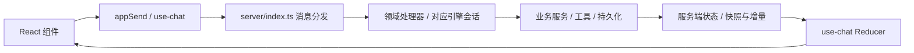

# 项目与模块地图

[文档导航](README.md) · [模块开发规范](module-development.md) · [文件级目录参考](directory-reference.md)

能力代码现按 `server/agent`、`model`、`prompt`、`skill`、`mcp` 分组，项目测试技能位于 `.pi/skills/`；完整归属与加载方式见 [能力维护指南](capability-layout.md)。

## 仓库分区

按职责理解现有目录，不要求为新功能重新搬动整个仓库。

| 分区           | 路径                                           | 用途与维护边界                                                   |
| -------------- | ---------------------------------------------- | ---------------------------------------------------------------- |
| 产品核心       | `server/`、`web/`                              | 服务端业务、协议与 React 界面，共用一套服务支持浏览器和桌面      |
| 启动与平台适配 | `bin/`、`desktop/`、`launcher/`、`extensions/` | CLI、Electron、便携启动器、pi 扩展；业务规则优先留在服务端       |
| 功能扩展       | `plugins/`、`plugin-sdk/`                      | 独立插件、市场清单与宿主接口；每个插件维护自己的说明和版本       |
| Agent 测试能力 | `.pi/skills/ui-testing-workflow/`              | 原版 UI workflow 包、原生 MCP 薄接入与配置；不承载产品业务       |
| 主题与语言     | `themes/`、`locales/`、`assets/`               | 主题、可下载语言包、项目展示资源；前端静态资源另见 `web/public/` |
| 验证与工程     | `tests/`、`scripts/`、`.github/`               | 单测、协议/UI 回归、构建维护脚本、CI                             |
| 文档与部署     | `docs/`、`deploy/`、根目录 Docker 文件         | 设计依据、交付证据与部署示例                                     |
| 开发辅助       | `dev/`                                         | 预览、探针等开发资料，不作为产品运行入口                         |
| 独立配套服务   | `cf-worker-feature-board/`                     | Cloudflare 功能看板 API，独立依赖和部署，不属于主应用构建        |

技能中文展示与能力联动由 `server/skill/skill-presentation.ts`、`settings-service.ts` 和现有 Pi 资源过滤链维护，见 [技能与能力管理](skill-capability-management.md)。

根目录保留项目入口、包配置、构建配置和跨项目说明。新增长期维护脚本放 `scripts/`，测试放 `tests/`，设计说明放 `docs/`；不要继续向根目录堆一次性文件。

## 核心请求路径

这是 WebSocket 主链路；文件媒体、上传下载等还有 HTTP 路由。跨端消息类型由 `server/protocol.ts` 定义，`web/src/types.ts` 只作导出桥接。定位问题时先确认是界面事件、消息路由、业务处理还是状态同步，再进入相应模块。

聊天文件链接由 `web/src/file-link.ts` 识别规范化，经 `Markdown.tsx` → `file-preview-bridge.ts` → 原文件预览与读取链路；见 [附件与预览](architecture-attachments.md#文件预览协议)。

## 按功能定位模块

下列路径相对仓库根目录；列出的是阅读起点，不是全部文件，也不表示这些文件都需要修改。

| 模块             | 服务端阅读起点                                                                                                                             | 前端/其他入口                                                                                                                | 主要边界                                                   |
| ---------------- | ------------------------------------------------------------------------------------------------------------------------------------------ | ---------------------------------------------------------------------------------------------------------------------------- | ---------------------------------------------------------- |
| 连接与协议       | `server/index.ts`、`server/protocol.ts`、`server/dispatch-domain-handlers.ts`                                                              | `web/src/use-chat.ts`、`web/src/base-url.ts`                                                                                 | 路由、校验、消息转换；业务细节交给所属服务                 |
| 会话与引擎       | `server/agent/agent-service.ts`、`server/engine-capabilities.ts`、`server/dsh/`、`server/universal/`、`server/durable/`                    | `web/src/components/EnginePicker.tsx`、`web/src/components/MessageList.tsx`                                                  | 每会话运行态隔离；新增能力逐引擎确认支持情况               |
| 工具与授权       | `server/tool-manager.ts`、`server/tool-host-factories.ts`、`server/tool-overrides.ts`、`server/tool-approval.ts`、`server/tool-guards.ts`  | `web/src/components/ToolCallBlock.tsx`、`web/src/components/ToolApprovalDialog.tsx`                                          | 工具目录单源；审批与模式限制在执行侧生效                   |
| 目标、计划与委派 | `server/goal-service.ts`、`server/goal-evidence.ts`、`server/plan-mode.ts`、`server/delegate-mode.ts`、`server/agent/subagents.ts`         | `web/src/components/GoalBar.tsx`、`web/src/components/PlanBoard.tsx`                                                         | 服务端控制轮次和停止；计划/委派硬闸门不可绕过              |
| 设置、模型与预设 | `server/settings-service.ts`、`server/client-state.ts`、`server/model/model-admin.ts`、`server/preset-share.ts`、`server/preset-fields.ts` | `web/src/components/SettingsModal.tsx`、`web/src/components/ModelConfigModal.tsx`、`web/src/components/PresetShareModal.tsx` | 区分全局/项目/会话作用域；预设分享白名单净化               |
| 文件与附件       | `server/files-service.ts`、`server/uploads.ts`、`server/attachments.ts`、`server/text-sniff.ts`                                            | `web/src/components/FilePreview.tsx`、`web/src/file-transfer.ts`                                                             | 工作区边界、大小预算、文本解码、远端路径语义               |
| 终端与 Git       | `server/terminals.ts`、`server/scm.ts`、`server/worktree-service.ts`                                                                       | `web/src/components/TerminalPanel.tsx`、`web/src/components/SCMPanel.tsx`                                                    | 进程随会话管理；Git 写操作走可见终端                       |
| 插件与 MCP       | `server/plugins.ts`、`server/plugin-permissions.ts`、`server/mcp/mcp-manager.ts`、`server/mcp/mcp-bridge.ts`                               | `web/src/ui-slots.ts`、`web/src/plugin-host.ts`、`plugin-sdk/`                                                               | 使用宿主 API、声明权限、卸载时释放副作用                   |
| 界面基础设施     | `server/i18n.ts`、`server/themes.ts`、`server/locales.ts`                                                                                  | `web/src/app-globals.ts`、`web/src/styles.css`、`web/src/i18n.tsx`、`web/src/use-floating-panel.ts`                          | 高频快照不入全局 Store；复用主题、翻译和浮层机制           |
| 桌面平台         | `desktop/main.ts`、`desktop/sidecar.ts`、`desktop/preload.cts`、`desktop/process-lifecycle.ts`                                             | `web/src/desktop.ts`、`desktop/README.md`                                                                                    | 桌面桥接和生命周期；共用 Web/server 业务，遵循桌面范围决定 |

接口测试 P0-1 验证入口为 `tests/api-testing-p0-test.mjs`，固定依赖与本地 runner 在 `tests/fixtures/api-testing-p0/`；只在隔离目录运行，不属于产品插件。范围、证据与复现见 [P0-1 验收记录](api-testing-evidence/P0-1.md)。

P0-2 的 `plugins/api-testing/` 提供最小执行工具；`server/mcp/plugin-mcp.ts` 负责可信调用身份和实时撤权，`server/api-testing-runner.ts` 负责 fixture 批准、私有 MCP 与 run 生命周期，`server/api-testing-isolation.ts` 生成 macOS 的 OS 文件/端口限制，`server/api-testing-relay.ts` 为宿主配置的手动 HTTP IPv4 目标提供固定 TCP 转发与集合传输映射；`tests/api-testing-controlled-test.mjs` 验证真实链路。它与 P0-1 探针分别保留，真实目标仍阻塞，见 [P0-2 验收](api-testing-evidence/P0-2.md)。

P1-1 `plugins/api-testing/suite.mjs` 负责本地 OAS 3.0 解析、候选纲要、声明式断言与固定模板草稿；`tests/api-testing-suite-test.mjs` 和 `tests/fixtures/api-testing-workflow/contract.json` 验证。详见 [P1-1](api-testing-evidence/P1-1.md)，不包含实际模型或真实业务执行。

P1-2 `plugins/api-testing/review.mjs` 负责确定性重编译与独立模型补全的有界评审，`tests/api-testing-review-test.mjs` 用明确模型替身验证控制。实际模型验收单列，见 [P1-2](api-testing-evidence/P1-2.md)。

## 状态应该放在哪里

| 状态                         | 归属                                      | 例子/约束                                              |
| ---------------------------- | ----------------------------------------- | ------------------------------------------------------ |
| 业务事实与运行进度           | 服务端对应项目/会话 runtime               | 轮次、审批、执行状态；前端不能靠本地状态模拟已完成     |
| 需要重启恢复的偏好           | 现有持久化层，如 `server/client-state.ts` | 新字段说明默认值、旧数据兼容、作用域及是否允许预设导出 |
| 消息、工具与高频快照         | `web/src/use-chat.ts` 的消息/快照处理路径 | 不放进 `app-globals.ts`，避免无关组件高频刷新          |
| 整树共享的低频运行信息       | `web/src/app-globals.ts`                  | 通过 `useAppField` 等现有机制订阅；不要变成业务数据库  |
| 弹窗开关、输入交互等局部状态 | 所属组件或 Hook                           | 不因为“将来可能复用”提前提升为全局状态                 |

## 文件与资料管理

- `node_modules/`、`dist/`、`web/dist/`、`release/` 是依赖或生成目录，按现有忽略规则管理；修改源码后由构建生成，不手改产物。
- 部分插件的客户端 bundle 已被 Git 跟踪，是上述规则的例外；修改其源码后按插件构建说明同步，并运行 CI 对应的新鲜度检查。
- 临时调试文件使用已忽略的 `tests/scratch/`（按需创建）；自动化测试的数据目录使用系统临时目录。不要把个人配置、凭据、对话、数据库或运行日志提交到仓库。
- 生成物维护使用 `scripts/clean-project.mjs`（`npm run clean` 预览、`clean:apply` 按保留期回收），规则与体积审计见 [项目体积维护](project-cleanup.md)；清理不进入服务启动或运行时链路。
- `docs/desktop-delivery/` 是证据档案。保留原文件名和引用，通过导航区分当前决定、提案和历史结果，不为“清理”删除证据。
- 新增、移动或重命名文件时检查 import、脚本、构建入口、打包清单、测试和文档引用，再更新目录参考。既有文件不为统一命名批量改名。
- 模块数量、工具数量、测试数量等易变信息以源码清单为准；文档记录职责和入口，减少手工维护的重复计数。

P1-3 `plugins/api-testing/workflow.mjs` 编排受控 action 与文件证据，`report.mjs` 负责问题分类/复测关联；宿主按插件源码 hash 装载固定模块快照，防止模块缓存继续使用旧依赖。`tests/api-testing-workflow-test.mjs` 验证真实 MCP/Newman 闭环，模型为明确替身。见 [P1-3](api-testing-evidence/P1-3.md)。

P1-4 的三个分发技能位于 `plugins/api-testing/skills/`；由 `tests/api-testing-skills-test.mjs` 在临时项目调用真实 SDK 和宿主 skill 工具验证。需复制到目标项目技能目录或显式配置 skillPaths；插件安装不自动加载。实际模型/业务验收仍阻塞，见 [接入清单](api-testing-evidence/P1-4.md)。

P1-4 实际模型补验入口 `tests/api-testing-model-test.mjs` 通过 SDK 复用系统配置模型，生成与评审各自独立无工具上下文；不在零 token 冒烟中自动调用。最终验收及历史失败见 [P1-4 模型补验](api-testing-evidence/P1-4-model.md)。

P2-1 `plugins/api-testing/assets.mjs` 管理宿主持有的不可变整包、run 证据与派生索引；`server/api-testing-runner.ts` 仅把固定存储根和受控执行回调接入。`tests/api-testing-assets-test.mjs` 验证重启复用、损坏拒绝和卸载保留，见 [P2-1](api-testing-evidence/P2-1.md)。

P2-2 `plugins/api-testing/asset-management.mjs` 提供最小列表、草稿克隆、归档、引用检查和同宿主备份恢复；通过既有工具卡片展示。`tests/api-testing-asset-management-test.mjs` 验证真实入口、完整性/冲突与项目边界，见 [P2-2](api-testing-evidence/P2-2.md)。

P3-1 `plugins/api-testing/schedules.mjs` 管理固定匿名 fixture 授权与触发账本，宿主 `PluginApiScheduleHost` 提供计划时间、严格保存及停止通知；`tests/api-testing-schedules-test.mjs` 验证真实 60 秒调度和 MCP，`tests/api-testing-schedule-guards-test.mjs` 明确以替身覆盖门禁。见 [P3-1](api-testing-evidence/P3-1.md)。

P3-2 `plugins/api-testing/tracking.mjs` 从不可变运行结果关联问题，追加有限预算分析与报告修订；`tests/api-testing-tracking-test.mjs` 覆盖真实 MCP、分析故障/恢复及 opt-in 实际模型。见 [P3-2](api-testing-evidence/P3-2.md)。

`server/api-testing-credential.ts` 校验专用测试 token 文件的权限、目标/项目绑定、到期及撤销；宿主只在私有执行管道交付其值，模型和持久证据不接收。见 [凭据验收](api-testing-evidence/credential-host.md)。

API 能力接入：`scripts/enable-api-testing.mjs` 在明确的宿主 dataDir 安装原插件，并向项目/应用 agent 配置登记三项技能；`tests/api-testing-visibility-test.mjs` 验证真实 Electron 中技能、插件、工具管理和 `/api` 补全/启停。见 [验收](api-testing-visibility.md)。

工具按需加载恢复名单由 `server/agent/lazy-tools-state.ts` 从转录提取；出站预算回归入口为
`tests/tool-context-budget-test.mjs`，机制与验收见 [工具上下文预算](tool-context-budget.md)。

可选工具依赖在 `desktop/`、`tools/vendor/`、`tools/e2e/` 独立锁定；安装与兼容链接由 `scripts/install-profile.mjs` 管理。API 运行隔离入口见 `tests/lib/api-test-runtime.mjs`。详见 [项目精简](project-slimming.md)。

对话过程展示由 `web/src/chat-presentation.ts` 生成投影，`web/src/components/ModelTiming.tsx` 显示 SDK 请求耗时；行为及原始历史边界见 [核心架构](architecture-core.md#对话过程与模型耗时)。

UI 测试 P0：`server/extension-tool-policy.ts` 定义操作副作用，`server/extension-tool-gate.ts` 在 Pi SDK 工具调用前检查模式与只读权限；`qa/ui/` 维护本项目隔离服务、数据和浏览器 fixture。运行入口见 [fixture 维护](../qa/ui/README.md)，证据见 [P0 验收](ui-testing-p0-evidence.md)。

UI 私密捕获回归：`tests/ui-private-evidence-test.mjs` 使用原生包及合成认证验证诊断/正式执行的公开证据隔离；实现维护在上游，分发与安装位置见 [统一维护入口](../.pi/skills/ui-testing-workflow/references/maintenance.md)。

UI 多功能源码候选：`tests/ui-multifunction-candidate-test.mjs` 对 `tests/fixtures/data-space/ui-multifunction-candidate.ts` 做原生映射/编译检查并保留评审门禁；候选不随该检查执行，原浏览器 partial 证据保持不变。

数据空间与原生 UI/API 执行关联：`plugins/data-space/test-channel.mjs`（环境初始化与资产归档）、`environment-preparation.mjs`（模式及非敏感参数准备回执）、`private-browser-state.mjs`（短期执行私有引用及撤销）、`plugins/data-space/automation.mjs`、`server/test-asset-reader.ts`（只读核验）、`server/test-execution-notice.ts`（完成引用及原生 UI 阶段的看板投影）。维护与验收见 [接入记录](data-space-integration.md)、[UI 优化执行记录](ui-testing-optimization-execution.md)。

数据空间版本展示：`plugins/data-space/client/case-versions.mjs` 按明确来源和入库顺序投影列表；不变更原生批准、历史资产或执行记录。

数据空间 Agent 交接规范：`.pi/skills/data-space-testing/SKILL.md` 选择查询／绑定／同步／普通登记路径，`references/result-output.md` 约定结果交付，`scripts/validate-result.mjs` 只读校验交付一致性；`tests/data-space-skill-desktop-test.mjs` 验证 Electron 发现与插件归属联动。

UI 定位重验：`tests/ui-locator-revalidation-test.mjs` 使用 `tests/fixtures/data-space/ui-locator-wrapper.mjs` 包裹冻结页面，通过真实 SDK/MCP 验证严格重复匹配、iframe、变化后旧定位拒绝与新定位生成；三分支保留 partial。

UI 诊断输入准备：`tests/ui-multifunction-probes-test.mjs` 将 `tests/fixtures/data-space/ui-multifunction-probes.mjs` 的13个隔离变异与环境/配置纳入候选新修订，检查HTTP源码和静态契约，不运行未获批候选。
UI 诊断续跑：`tests/fixtures/data-space/ui-probe-replay.mjs` 恢复声明的合成地址；`tests/ui-multifunction-native-review.mjs` 使用共享授权账本调用原生独立评审/获批后诊断，保留错误和未执行边界。
UI 浏览器候选：`tests/ui-function-discovery-test.mjs --complete-candidate` 复用六功能探索，保存完整录制、参数化草稿及静态候选；默认分支继续检查partial/预算缺口。

UI 首次候选计量：`tests/ui-function-discovery-test.mjs --complete-candidate --measure`：采集首次发现至未批准静态候选的宿主调用、异步读取及阶段耗时；`tests/lib/ui-discovery-measure.mjs`只保存计数，不保存工具参数/正文。

UI 目录读取计量：`tests/ui-catalog-read-benchmark.mjs` 对归档真实run的1/8批样本统计catalog及view/analyze/execute状态查询的逐路径读取和扫描，验证损坏/删除/恢复，不启动浏览器。
UI 成对查询计量：`tests/ui-catalog-paired-benchmark.mjs` 对固定历史资产交替运行0.1.3/0.1.4各5次，保留全部读取计数、耗时和失败，不执行浏览器/模型。
UI 评审修订：`tests/ui-browser-review-revision.mjs` 按U05独立评审问题保存新的取消检查及逐测试origin候选，仅静态检查，不批准/执行。

UI 浏览器诊断准备：`tests/ui-browser-diagnostic-prepare.mjs` 基于已录制的 v2 保存新修订，保留原任务/范围及断言，加入逐功能错误副本、HTTP 路由与诊断计划；只核对源码/静态契约，不执行浏览器。

UI 获批浏览器执行：`tests/ui-browser-approved-run.mjs` 读取原生设计批准和诊断就绪，完成原录制任务后登记独立执行任务、正式批次与结果对账，不生成批准。

UI 获批基准计量：`tests/ui-approved-baseline-measure.mjs` 固定既有U05六功能资产，核对原生批准/诊断并测量正式run终态、同request状态、旧报告对账和view；不新增模型评审或声称完整基线。

UI 基准子进程/API观察：`tests/lib/ui-baseline-child-observer.mjs` 可选预载到runner/worker，记录聚合异步FS、确认后的进程启动及Playwright 1.62.1外部API；不保存参数，不修改原生runner或授权，不代表浏览器内部事件或发现计数。

UI 获批结果桌面验证：`tests/ui-approved-archive-desktop-test.mjs` 在原authority验证后，仅投影公开材料与选定run到隔离Electron，覆盖六功能映射、独立绑定、旧结果同步、重启及交付校验；不复制执行授权或新跑业务。

UI 认证轮换回归：`tests/ui-private-evidence-test.mjs --rotated-cookie` 使用运行时新签发的合成Cookie，验证公开日志/trace/附件脱敏，保留真实passed/failed及资源缺口。

PMS 私有环境准备：`tests/ui-pms-private-preparation.mjs --refresh` 对用户选定的 Electron 项目复用声明式登录脚本；`tests/lib/pms-private-session.mjs` 生成临时原生认证引用并清理。仅测试入口，不是已安装的 Agent 能力，不执行浏览器或改写数据空间原库。

UI 失败链基准：`tests/ui-failed-batch-baseline.mjs` 复用获批六功能资产，验证原生失败分析和仅失败项重跑；`--continue-from` 复用已保存父批次，结果评审另用显式授权，不将子集通过替代原失败。

PMS 浏览器准备：`tests/ui-pms-browser-preparation.mjs --refresh` 用所选项目临时私有引用做同源只读检查、账号匹配/匿名对照和公开脚本摘要对账；不采集截图、DOM或响应正文，不启动录制/正式测试，不代表桌面原生数据空间已接入。

PMS 原库接入与草稿：`tests/ui-pms-desktop-connection.mjs --connect-selected-data` 以临时UI/agent配置启动现有Electron构建，读取真实所选数据目录；可用显式`--intake-source-cases <回执>`经原生接口导入草稿并核对映射/去重。`tests/ui-pms-source-cases.mjs`只保存三项源码声明的原生cases，不生成脚本或批准。

UI 私有录制准备内部模块：`.pi/skills/ui-testing-workflow/assets/private-recording-workspace.mjs` 负责明确输入摘要副本、受管身份的子进程派生与失效撤销；未接入产品录制入口，边界见 [执行记录](ui-testing-optimization-execution.md)。

UI 私密录制连接守卫：`.pi/skills/ui-testing-workflow/assets/private-recording-transport.mjs` 将受管快照绑定到实际 MCP 连接/请求生命周期，失效阻断公开发布、失败发送撤销身份、正常响应交付前解绑取消；私有捕获/过滤及原生writer校验仍由调用方负责，尚未开放产品入口。

UI 私密存储事件内部模块：`.pi/skills/ui-testing-workflow/assets/private-recording-storage-events.mjs` 由受控seed在Chromium导航前安装CDP监听，私有记录历史值，宿主读取后复用原生过滤；当前blank单page/frame前提、指定origin，新增页面/frame历史拒绝，未接入产品record。不会自动修改业务seed或注册模型工具。

UI 录制配置预检：`.pi/skills/ui-testing-workflow/assets/recording-preflight-reporter.mjs`经Playwright公开Reporter API收集最小元数据，为已有setup钩子提供所选project的storageState配置拒绝依据；不读取认证值或执行seed。
