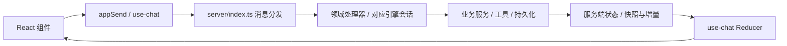

# 项目与模块地图

[文档导航](README.md) · [模块开发规范](module-development.md) · [文件级目录参考](directory-reference.md)

## 仓库分区

按职责理解现有目录，不要求为新功能重新搬动整个仓库。

| 分区           | 路径                                           | 用途与维护边界                                                   |
| -------------- | ---------------------------------------------- | ---------------------------------------------------------------- |
| 产品核心       | `server/`、`web/`                              | 服务端业务、协议与 React 界面，共用一套服务支持浏览器和桌面      |
| 启动与平台适配 | `bin/`、`desktop/`、`launcher/`、`extensions/` | CLI、Electron、便携启动器、pi 扩展；业务规则优先留在服务端       |
| 功能扩展       | `plugins/`、`plugin-sdk/`                      | 独立插件、市场清单与宿主接口；每个插件维护自己的说明和版本       |
| 主题与语言     | `themes/`、`locales/`、`assets/`               | 主题、可下载语言包、项目展示资源；前端静态资源另见 `web/public/` |
| 验证与工程     | `tests/`、`scripts/`、`.github/`               | 单测、协议/UI 回归、构建维护脚本、CI                             |
| 文档与部署     | `docs/`、`deploy/`、根目录 Docker 文件         | 设计依据、交付证据与部署示例                                     |
| 开发辅助       | `dev/`                                         | 预览、探针等开发资料，不作为产品运行入口                         |
| 独立配套服务   | `cf-worker-feature-board/`                     | Cloudflare 功能看板 API，独立依赖和部署，不属于主应用构建        |

根目录保留项目入口、包配置、构建配置和跨项目说明。新增长期维护脚本放 `scripts/`，测试放 `tests/`，设计说明放 `docs/`；不要继续向根目录堆一次性文件。

## 核心请求路径

这是 WebSocket 主链路；文件媒体、上传下载等还有 HTTP 路由。跨端消息类型由 `server/protocol.ts` 定义，`web/src/types.ts` 只作导出桥接。定位问题时先确认是界面事件、消息路由、业务处理还是状态同步，再进入相应模块。

## 按功能定位模块

下列路径相对仓库根目录；列出的是阅读起点，不是全部文件，也不表示这些文件都需要修改。

| 模块             | 服务端阅读起点                                                                                                                            | 前端/其他入口                                                                                                                | 主要边界                                                   |
| ---------------- | ----------------------------------------------------------------------------------------------------------------------------------------- | ---------------------------------------------------------------------------------------------------------------------------- | ---------------------------------------------------------- |
| 连接与协议       | `server/index.ts`、`server/protocol.ts`、`server/dispatch-domain-handlers.ts`                                                             | `web/src/use-chat.ts`、`web/src/base-url.ts`                                                                                 | 路由、校验、消息转换；业务细节交给所属服务                 |
| 会话与引擎       | `server/agent-service.ts`、`server/engine-capabilities.ts`、`server/dsh/`、`server/universal/`、`server/durable/`                         | `web/src/components/EnginePicker.tsx`、`web/src/components/MessageList.tsx`                                                  | 每会话运行态隔离；新增能力逐引擎确认支持情况               |
| 工具与授权       | `server/tool-manager.ts`、`server/tool-host-factories.ts`、`server/tool-overrides.ts`、`server/tool-approval.ts`、`server/tool-guards.ts` | `web/src/components/ToolCallBlock.tsx`、`web/src/components/ToolApprovalDialog.tsx`                                          | 工具目录单源；审批与模式限制在执行侧生效                   |
| 目标、计划与委派 | `server/goal-service.ts`、`server/goal-evidence.ts`、`server/plan-mode.ts`、`server/delegate-mode.ts`、`server/subagents.ts`              | `web/src/components/GoalBar.tsx`、`web/src/components/PlanBoard.tsx`                                                         | 服务端控制轮次和停止；计划/委派硬闸门不可绕过              |
| 设置、模型与预设 | `server/settings-service.ts`、`server/client-state.ts`、`server/model-admin.ts`、`server/preset-share.ts`、`server/preset-fields.ts`      | `web/src/components/SettingsModal.tsx`、`web/src/components/ModelConfigModal.tsx`、`web/src/components/PresetShareModal.tsx` | 区分全局/项目/会话作用域；预设分享白名单净化               |
| 文件与附件       | `server/files-service.ts`、`server/uploads.ts`、`server/attachments.ts`、`server/text-sniff.ts`                                           | `web/src/components/FilePreview.tsx`、`web/src/file-transfer.ts`                                                             | 工作区边界、大小预算、文本解码、远端路径语义               |
| 终端与 Git       | `server/terminals.ts`、`server/scm.ts`、`server/worktree-service.ts`                                                                      | `web/src/components/TerminalPanel.tsx`、`web/src/components/SCMPanel.tsx`                                                    | 进程随会话管理；Git 写操作走可见终端                       |
| 插件与 MCP       | `server/plugins.ts`、`server/plugin-permissions.ts`、`server/mcp-manager.ts`、`server/mcp-bridge.ts`                                      | `web/src/ui-slots.ts`、`web/src/plugin-host.ts`、`plugin-sdk/`                                                               | 使用宿主 API、声明权限、卸载时释放副作用                   |
| 界面基础设施     | `server/i18n.ts`、`server/themes.ts`、`server/locales.ts`                                                                                 | `web/src/app-globals.ts`、`web/src/styles.css`、`web/src/i18n.tsx`、`web/src/use-floating-panel.ts`                          | 高频快照不入全局 Store；复用主题、翻译和浮层机制           |
| 桌面平台         | `desktop/main.ts`、`desktop/sidecar.ts`、`desktop/preload.cts`、`desktop/process-lifecycle.ts`                                            | `web/src/desktop.ts`、`desktop/README.md`                                                                                    | 桌面桥接和生命周期；共用 Web/server 业务，遵循桌面范围决定 |

接口测试 P0-1 验证入口为 `tests/api-testing-p0-test.mjs`，固定依赖与本地 runner 在 `tests/fixtures/api-testing-p0/`；只在隔离目录运行，不属于产品插件。范围、证据与复现见 [P0-1 验收记录](api-testing-evidence/P0-1.md)。

P0-2 的 `plugins/api-testing/` 提供最小执行工具；`server/plugin-mcp.ts` 负责可信调用身份和实时撤权，`server/api-testing-runner.ts` 负责 fixture 批准、私有 MCP 与 run 生命周期；`tests/api-testing-controlled-test.mjs` 验证真实链路。它与 P0-1 探针分别保留，真实目标仍阻塞，见 [P0-2 验收](api-testing-evidence/P0-2.md)。

P1-1 `plugins/api-testing/suite.mjs` 负责本地 OAS 3.0 解析、候选纲要、声明式断言与固定模板草稿；`tests/api-testing-suite-test.mjs` 和 `tests/fixtures/api-testing-workflow/contract.json` 验证。详见 [P1-1](api-testing-evidence/P1-1.md)，不包含实际模型或真实业务执行。

P1-2 `plugins/api-testing/review.mjs` 负责确定性重编译与独立模型补全的有界评审，`tests/api-testing-review-test.mjs` 用明确模型替身验证控制。实际模型验收单列，见 [P1-2](api-testing-evidence/P1-2.md)。

## 状态应该放在哪里

| 状态                         | 归属                                      | 例子/约束                                              |
| ---------------------------- | ----------------------------------------- | ------------------------------------------------------ |
| 业务事实与运行进度           | 服务端对应项目/会话 runtime               | 轮次、审批、执行状态；前端不能靠本地状态模拟已完成     |
| 需要重启恢复的偏好           | 现有持久化层，如 `server/client-state.ts` | 新字段说明默认值、旧数据兼容、作用域及是否允许预设导出 |
| 消息、工具与高频快照         | `web/src/use-chat.ts` 的消息/快照处理路径 | 不放进 `app-globals.ts`，避免无关组件高频刷新          |
| 整树共享的低频运行信息       | `web/src/app-globals.ts`                  | 通过 `useAppField` 等现有机制订阅；不要变成业务数据库  |
| 弹窗开关、输入交互等局部状态 | 所属组件或 Hook                           | 不因为“将来可能复用”提前提升为全局状态                 |

## 文件与资料管理

- `node_modules/`、`dist/`、`web/dist/`、`release/` 是依赖或生成目录，按现有忽略规则管理；修改源码后由构建生成，不手改产物。
- 部分插件的客户端 bundle 已被 Git 跟踪，是上述规则的例外；修改其源码后按插件构建说明同步，并运行 CI 对应的新鲜度检查。
- 临时调试文件使用已忽略的 `tests/scratch/`（按需创建）；自动化测试的数据目录使用系统临时目录。不要把个人配置、凭据、对话、数据库或运行日志提交到仓库。
- `docs/desktop-delivery/` 是证据档案。保留原文件名和引用，通过导航区分当前决定、提案和历史结果，不为“清理”删除证据。
- 新增、移动或重命名文件时检查 import、脚本、构建入口、打包清单、测试和文档引用，再更新目录参考。既有文件不为统一命名批量改名。
- 模块数量、工具数量、测试数量等易变信息以源码清单为准；文档记录职责和入口，减少手工维护的重复计数。

P1-3 `plugins/api-testing/workflow.mjs` 编排受控 action 与文件证据，`report.mjs` 负责问题分类/复测关联；宿主按插件源码 hash 装载固定模块快照，防止模块缓存继续使用旧依赖。`tests/api-testing-workflow-test.mjs` 验证真实 MCP/Newman 闭环，模型为明确替身。见 [P1-3](api-testing-evidence/P1-3.md)。

P1-4 的三个分发技能位于 `plugins/api-testing/skills/`；由 `tests/api-testing-skills-test.mjs` 在临时项目调用真实 SDK 和宿主 skill 工具验证。需复制到目标项目技能目录或显式配置 skillPaths；插件安装不自动加载。实际模型/业务验收仍阻塞，见 [接入清单](api-testing-evidence/P1-4.md)。

P1-4 实际模型补验入口 `tests/api-testing-model-test.mjs` 通过 SDK 复用系统配置模型，生成与评审各自独立无工具上下文；不在零 token 冒烟中自动调用。最终验收及历史失败见 [P1-4 模型补验](api-testing-evidence/P1-4-model.md)。

P2-1 `plugins/api-testing/assets.mjs` 管理宿主持有的不可变整包、run 证据与派生索引；`server/api-testing-runner.ts` 仅把固定存储根和受控执行回调接入。`tests/api-testing-assets-test.mjs` 验证重启复用、损坏拒绝和卸载保留，见 [P2-1](api-testing-evidence/P2-1.md)。
